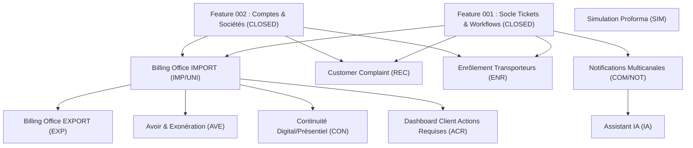

# Analyse de Séquençage et Roadmap des Features
## Plateforme Digitale CIT — v1.0

> **Document** : `docs/05-roadmap-features.md`  
> **Date** : 2026-08-30  
> **Statut** : Analyse de cadrage et séquençage post-Feature 002  
> **Source de vérité** : `docs/CDC_Plateforme_Digitale_CIT_v3.docx` et `docs/01-matrice-exigences.md`  
> **Constitution** : `.specify/memory/constitution.md` (v1.0.0 — Principes I à XVII)

---

## 1. État Actuel du Projet

Les deux premières features fondamentales sont officiellement **CLOSED** et validées :
- **Feature 001** (`specs/001-socle-tickets-workflows/`, commit baseline `a9657a4`) : Socle transverse de gestion des tickets, dossiers, files de traitement, circuits de transition, affectation/disponibilité, SLA, alertes, supervision et journal d'audit append-only.
- **Feature 002** (`specs/002-comptes-clients-societes/`, commit de clôture `46b2605`) : Référentiel des comptes clients (sociétés), authentification native avec défi 2FA TOTP, gestion multi-utilisateurs/collaborateurs rattachés, droits paramétrables de consultation et soumission, typage client (Normal, En Compte, Deposit, IES) avec snapshot de non-rétroactivité et cloisonnement étanche des données.

La suite de tests actuelle compte **180 tests** (31 Domain, 106 Application, 22 Infrastructure avec SQL Server réel, 21 Web avec `WebApplicationFactory`), 0 avertissement, 0 échec.

---

## 2. Reconstitution Mécanique de la Couverture CDC

Le cahier des charges comporte exactement **188 exigences numérotées** (`docs/01-matrice-exigences.md`) réparties en 150 Must, 32 Should et 6 Could.

### Décompte exact par Feature

```
TOTAL CDC          : 188 exigences (150 Must, 32 Should,  6 Could)
COUVERT F001       :  74 exigences ( 62 Must, 11 Should,  1 Could)
COUVERT F002       :  11 exigences (  8 Must,  2 Should,  1 Could)
TOTAL COUVERT      :  85 exigences ( 70 Must, 13 Should,  2 Could)
RESTE À RÉALISER   : 103 exigences ( 80 Must, 19 Should,  4 Could)
```

### Vérification d'unicité (0 doublon, 0 perte)

- **Feature 001 (74 exigences)** :
  - *Groupe A (26)* : `SOC-01` à `SOC-14` (14), `CYC-01` à `CYC-07` (7), `MSG-01` à `MSG-05` (5).
  - *Groupe B (48)* : `WKF-01` à `WKF-03` (3), `PEC-01` à `PEC-05` (5), `TRF-01` à `TRF-06` (6), `TPS-01` à `TPS-05` (5), `SLA-01` à `SLA-05` (5), `ALE-01` à `ALE-03` (3), `SUP-01` à `SUP-05` (5), `DIS-01` à `DIS-03` (3), `AFF-01` à `AFF-07` (7), `PRI-01` à `PRI-04` (4), `MAS-01` à `MAS-02` (2).
- **Feature 002 (11 exigences)** :
  - *Groupe C (11)* : `CPT-01` à `CPT-07` (7), `ENT-01` à `ENT-04` (4).
- **Total couvert** : $74 + 11 = 85$ exigences ($85 / 188 = 45{,}2\,\%$ du CDC total).
- **Reste à réaliser** : $188 - 85 = 103$ exigences ($54{,}8\,\%$ du CDC).

---

## 3. Inventaire des 103 Exigences Restantes par Famille Réelle

| Groupe CDC | Famille | Exigences exactes | Must | Should | Could | Total |
|---|---|---|---|---|---|---|
| **D** | **Billing Office IMPORT** | `IMP-01` à `IMP-06`, `IMP-10` à `IMP-15`, `IMP-20` à `IMP-22`, `IMP-30` à `IMP-32`, `IMP-40` à `IMP-42`, `UNI-01` à `UNI-04` | 23 | 2 | 0 | **25** |
| **E** | **Billing Office EXPORT** | `EXP-01` à `EXP-04` | 4 | 0 | 0 | **4** |
| **F** | **Simulation Proforma** | `SIM-01` à `SIM-11` | 7 | 3 | 1 | **11** |
| **G** | **Avoir et Exonération** | `AVE-01` à `AVE-04` | 3 | 1 | 0 | **4** |
| **H** | **Customer Complaint** | `REC-01` à `REC-06` | 4 | 1 | 1 | **6** |
| **I** | **Enrôlement Transporteurs** | `ENR-01` à `ENR-05` | 3 | 1 | 1 | **5** |
| **J** | **Notifications & Communication** | `COM-01` à `COM-06`, `NOT-01` à `NOT-03` | 6 | 2 | 1 | **9** |
| **K** | **Continuité Digital / Présentiel** | `CON-01` à `CON-04` | 3 | 1 | 0 | **4** |
| **L** | **Assistant IA** | `IA-01` à `IA-07` | 5 | 2 | 0 | **7** |
| **M** | **Sécurité Transversale** | `SEC-01` à `SEC-12` *(dont SEC-05 déjà câblé via SOC-13 et CPT-04/SEC-03 appliqués)* | 10 | 2 | 0 | **12** |
| **N** | **NFR & Gestion d'erreurs** | `NFR-01` à `NFR-11`, `ERR-01` à `ERR-04` | 11 | 4 | 0 | **15** |
| **O** | **Écran & UX** | `ACR-01` (Dashboard « Mes actions requises ») | 1 | 0 | 0 | **1** |
| **TOTAL** | | | **80** | **19** | **4** | **103** |

---

## 4. Analyse des Dépendances et Prérequis

### Arbre de dépendance fonctionnelle



### Analyse détaillée par groupe candidat

1. **Billing Office IMPORT (`IMP / UNI`)** :
   - *Dépendances F001 [E]* : Tickets, dossiers multi-BL (`SOC-11`), files de traitement (`SOC-04`), statuts/actions de validation (`SOC-06`), documents (`SOC-07`), clôture/archivage (`SOC-09`), SLA et alertes.
   - *Dépendances F002 [E]* : Authentification client (`CPT-03`), compte société et utilisateurs rattachés (`ENT-01`), 4 profils clients (`CPT-02` : Normal, En Compte, Deposit, IES) déterminant le circuit (`IMP-06`).
   - *Dépendances futures [D]* : Aucune dépendance bloquante. Les notifications e-mail (`IMP-03`, `IMP-05`) s'appuient sur les événements de domaine émis par le socle (principe P3 de fonctionnement autonome).
   - *Statut des dépendances* : **100 % SATISFAITES**.

2. **Simulation Proforma (`SIM`)** :
   - *Dépendances F001 / F002* : Aucune dépendance structurelle. Le CDC §15 et `SIM-01` stipulent explicitement que la simulation est autonome, indicative et optionnelle (peut être exécutée sans compte ou avant tout parcours).
   - *Dépendances futures [D]* : L'enregistrement sur profil (`SIM-08` Should) consomme F002.
   - *Statut des dépendances* : **100 % SATISFAITES**.

3. **Customer Complaint (`REC`)** :
   - *Dépendances F001 / F002* : Consomme les tickets, files (Support Opérationnel), chat et documents.
   - *Statut des dépendances* : **100 % SATISFAITES**.

4. **Billing Office EXPORT (`EXP`)** :
   - *Dépendances F001 / F002* : Dépend de la structure de commande de facturation (Draft IN, facturation, IES export) et partage les 4 circuits typés avec l'IMPORT (`EXP-03`).
   - *Dépendances [D]* : Bénéficie grandement des fondations du workflow de facturation posées par l'IMPORT.
   - *Statut des dépendances* : Partiellement dépendante de l'analogie IMPORT.

5. **Avoir et Exonération (`AVE`)** :
   - *Dépendances F001 / F002 / [D]* : Lié aux tickets de facturation initiale (`AVE-04` Should).
   - *Statut des dépendances* : Dépendante de l'existence préalable des tickets de facturation.

---

## 5. Recette CDC — Scénarios REC-SCE Restants

| ID Scénario | Intitulé exact (CDC §22) | Module | Exigences Must couvertes | Prérequis |
|---|---|---|---|---|
| **REC-SCE-01** | IMPORT client normal | Billing IMPORT | `SOC-01`, `SOC-02`, `SOC-06`, `SOC-09`, `IMP-01` à `IMP-06`, `IMP-10` à `IMP-14`, `UNI-01` à `UNI-03` | F001 (socle), F002 (compte Normal actif) |
| **REC-SCE-02** | IMPORT client en compte | Billing IMPORT | `IMP-20`, `IMP-21`, `IMP-22` | F001, F002 (compte En Compte actif) |
| **REC-SCE-03** | IMPORT client deposit | Billing IMPORT | `IMP-30`, `IMP-31`, `IMP-32` | F001, F002 (compte Deposit actif) |
| **REC-SCE-04** | IMPORT client IES | Billing IMPORT | `IMP-40`, `IMP-41`, `IMP-42`, `SEC-02` | F001, F002 (compte IES actif) |
| **REC-SCE-05** | EXPORT (4 types de clients) | Billing EXPORT | `EXP-01`, `EXP-02`, `EXP-03`, `EXP-04` | F001, F002 (4 types de comptes) |
| **REC-SCE-06** | Simulation de proforma | Proforma | `SIM-01` à `SIM-07` | Grille tarifaire Annexe A.8 |
| **REC-SCE-07** | Customer Complaint | Customer Complaint | `REC-01` à `REC-04` | F001, F002, Support Opérationnel |
| **REC-SCE-08** | Enrôlement transporteur | Enrôlement | `ENR-01` à `ENR-03` | F001, Agent Gate |
| **REC-SCE-14** | Transverse (portion restante) | Transverse / Notifications | `COM-01` à `COM-04`, `CON-01` à `CON-03`, `ACR-01`, `SEC-*` | F001, F002, canaux et guichet |

---

## 6. Analyse Comparative des Candidats Feature 003

### Candidat 1 : Billing Office IMPORT (`IMP / UNI`)

- **Familles CDC** : `IMP` (Billing Office Import), `UNI` (Contrôle d'unicité BL).
- **Exigences** : 25 exigences (`IMP-01` à `IMP-06`, `IMP-10` à `IMP-15`, `IMP-20` à `IMP-22`, `IMP-30` à `IMP-32`, `IMP-40` à `IMP-42`, `UNI-01` à `UNI-04`).
- **Priorités** : **23 Must**, **2 Should** (`IMP-15`, `UNI-04`), **0 Could**.
- **REC-SCE applicables** : **4 scénarios contractuels complets** (`REC-SCE-01`, `REC-SCE-02`, `REC-SCE-03`, `REC-SCE-04`).
- **Dépendances** : F001 ✅, F002 ✅.
- **Points ouverts (PC-xx)** :
  - `PC-03` (Rôle Caisse/Finance pour `IMP-13`) : Le CDC §25 confirme explicitement la responsabilité de validation des paiements. Le rôle peut être configuré comme une permission d'habilitation spécifique (`Permission.FacturationPaiementValider`) sans bloquer la conception.
  - `PC-08` (Pièces exigées par étape) : Géré paramétrablement via le mécanisme de documents de F001 (`SOC-07`).
  - `PC-05` (Champs réservés IES pour `IMP-40`) : Traité par des contrats de commande dédiés au Pilote Manifeste et au Pilote CD.
- **Complexité** : Élevée (4 variantes de workflow : Normal, En compte, Deposit, IES parallèle).
- **Valeur métier** : **Maximale** (flux opérationnel central de CIT, justification première de la plateforme digitale).
- **Risque** : Modéré (très structuré par les 4 profils de F002 et les files de F001).

### Candidat 2 : Simulation de Proforma (`SIM`)

- **Familles CDC** : `SIM` (Simulation Proforma).
- **Exigences** : 11 exigences (`SIM-01` à `SIM-11`).
- **Priorités** : **7 Must**, **3 Should** (`SIM-08` à `SIM-10`), **1 Could** (`SIM-11`).
- **REC-SCE applicables** : **1 scénario contractuel** (`REC-SCE-06` avec validation des 5 cas de l'Annexe A.8 au centime près).
- **Dépendances** : Aucune dépendance bloquante. Totalement autonome.
- **Points ouverts (PC-xx)** : Aucun bloquant (grilles tarifaires Annexe A et règles de calcul fournies).
- **Complexité** : Moyenne (moteur de calcul arithmétique et tarification multi-critères).
- **Valeur métier** : Forte pour les clients en amont de la commande, mais ne traite aucun ticket ni facturation réelle.
- **Risque** : Très faible.

### Candidat 3 : Customer Complaint (`REC`)

- **Familles CDC** : `REC` (Customer Complaint).
- **Exigences** : 6 exigences (`REC-01` à `REC-06`).
- **Priorités** : **4 Must**, **1 Should** (`REC-05`), **1 Could** (`REC-06`).
- **REC-SCE applicables** : **1 scénario contractuel** (`REC-SCE-07`).
- **Dépendances** : F001 ✅, F002 ✅.
- **Points ouverts (PC-xx)** : `PC-16` (catégories paramétrables).
- **Complexité** : Faible (workflow linéaire d'instruction support).
- **Valeur métier** : Moyenne (service client, mais volumétrie et impact financier moindres que le Billing).
- **Risque** : Très faible.

### Candidat 4 : Enrôlement Transporteurs (`ENR`)

- **Familles CDC** : `ENR` (Enrôlement Chauffeurs & Transporteurs).
- **Exigences** : 5 exigences (`ENR-01` à `ENR-05`).
- **Priorités** : **3 Must**, **1 Should** (`ENR-04`), **1 Could** (`ENR-05`).
- **REC-SCE applicables** : **1 scénario contractuel** (`REC-SCE-08`).
- **Dépendances** : F001 ✅, F002 ✅ (transporteurs), dépendance externe SMS (`COM-01`).
- **Complexité** : Faible à moyenne (circuit avec convocation physique badge).
- **Valeur métier** : Ciblée (flux Gate).

---

## 7. Matrice de Décision Multi-Critères

Évaluation sur une échelle de 1 (défavorable) à 5 (optimal) :

| Critère | Poids | Candidat 1 : Billing IMPORT | Candidat 2 : Simulation Proforma | Candidat 3 : Customer Complaint | Candidat 4 : Enrôlement |
|---|---|:---:|:---:|:---:|:---:|
| **A. Dépendances satisfaites** | 15% | **5** (F001 + F002 prêts) | **5** (Autonome) | **5** (F001 + F002 prêts) | **4** (Besoin SMS) |
| **B. Valeur métier & ROI** | 20% | **5** (Cœur métier CIT) | **3** (Pré-calcul informatif) | **3** (Support réclamations) | **3** (Flux transporteur) |
| **C. Nombre de Must traités** | 15% | **5** (23 Must couverts) | **3** (7 Must couverts) | **2** (4 Must couverts) | **2** (3 Must couverts) |
| **D. Autonomie fonctionnelle** | 10% | **4** (Bout-en-bout complet) | **5** (Totalement découplé) | **4** (Workflow autonome) | **3** (Étape physique) |
| **E. Testabilité & Recette** | 10% | **5** (4 REC-SCE majeurs) | **5** (REC-SCE-06 chiffré) | **4** (REC-SCE-07) | **3** (REC-SCE-08) |
| **F. Maîtrise risque technique** | 10% | **4** (Architecture socle validée) | **5** (Purement calculatoire) | **5** (Simple) | **4** (Simple) |
| **G. Absence de points bloquants** | 5% | **4** (PC-03/08 non bloquants) | **5** (Annexe A disponible) | **4** (PC-16 ouvert) | **4** (PC-08 ouvert) |
| **H. Exploitation F001/F002** | 5% | **5** (Exploite 100% du socle) | **1** (Peu d'usage F001/F002) | **4** (Exploite le socle) | **4** (Exploite le socle) |
| **I. Non-régression / Refactoring** | 5% | **5** (Valide le socle en charge) | **3** (Isolé) | **4** (Isolé) | **3** (Isolé) |
| **J. Couverture REC-SCE CDC** | 5% | **5** (4 / 14 scénarios CDC) | **3** (1 / 14 scénarios) | **3** (1 / 14 scénarios) | **3** (1 / 14 scénarios) |
| **NOTE PONDÉRÉE GLOBALE** | **100%** | **4,70 / 5** | **3,95 / 5** | **3,85 / 5** | **3,45 / 5** |

---

## 8. Analyse Approfondie du Candidat Recommandé : Billing Office IMPORT

### 8.1 Pourquoi Billing Office IMPORT est le meilleur choix pour Feature 003

1. **Consommation naturelle des investissements F001 et F002** :
   - F001 a été conçu spécifiquement pour porter les files (`Manifeste`, `Facturation`, `Contrôle Documentaire`, `Comptabilité`), les transitions dérogatoires, et la numérotation dossier multi-BL (`SOC-11`).
   - F002 a modélisé exactement les 4 profils clients (`Normal`, `En Compte`, `Deposit`, `IES`) avec non-rétroactivité et rattachement société.
   - L'IMPORT est le **seul module** qui valide immédiatement et conjointement l'intégralité de ces deux socles.
2. **Couverture massive du CDC** :
   - Traite **23 exigences Must** d'un coup (plus du quart des Must restants).
   - Valide **4 scénarios de recette contractuels** majeurs (`REC-SCE-01` à `REC-SCE-04`).
3. **Effet structurant pour les autres modules** :
   - L'EXPORT (`EXP`), l'Avoir/Exonération (`AVE`) et la Continuité guichet (`CON`) réutilisent directement les écrans et structures de facturation établis par l'IMPORT.

### 8.2 Découpage du périmètre : Ce qui doit être IN / OUT

- **Périmètre IN SCOPE de Feature 003** :
  - Formulaire dynamique multi-BL (jusqu'à 5 BL par dossier, `IMP-01`).
  - Génération des tickets indépendants par BL avec dossier parent (`IMP-02`).
  - Contrôle d'unicité sur les numéros de BL actifs (`UNI-01`, `UNI-02`, `UNI-03`).
  - Instruction Pilote Manifeste : validation, rejet motivé, demande de complément (`IMP-04`, `IMP-05`).
  - Aiguillage automatique selon profil client (`IMP-06`).
  - Workflow Client Normal : demande facture, édition facture, soumission preuve paiement, validation paiement, dépôt BS/BADT et clôture (`IMP-10` à `IMP-14`).
  - Workflow Client En Compte : facturation directe vers Contrôle Documentaire sans paiement (`IMP-20` à `IMP-22`).
  - Workflow Client Deposit : facturation, lettrage comptabilité, Contrôle Documentaire (`IMP-30` à `IMP-32`).
  - Workflow Client IES : traitement parallèle Manifeste / CD avec champs réservés, synchronisation/jointure, remise documents (`IMP-40` à `IMP-42`).
  - Traçabilité et événements déclencheurs associés.

- **Périmètre OUT OF SCOPE (Réservé aux features ultérieures)** :
  - *Simulation de Proforma (`SIM`)* : Moteur de simulation autonome, à implémenter dans sa feature dédiée (n'est pas un prérequis au parcours réel).
  - *Billing Office EXPORT (`EXP`)* : Codification Back Office et flux exports distincts (Feature 004).
  - *Avoir et Exonération (`AVE`)* : Circuit d'ajustement comptable a posteriori (Feature 005).
  - *Alternative physique / Prise de RDV (`IMP-15` / `CON-01..03`)* : Continuité guichet (Feature 007).
  - *Intégrations automatiques externes* (IPAKI, IRIS, SydamWorld, passerelles bancaires) : Hors CDC conformément au principe P3 (toutes les actions externes restent déclaratives/hors portail).

### 8.3 Analyse des points ouverts PC-03 et PC-08

- **`PC-03` (Rôle Caisse/Finance pour la validation paiement `IMP-13`)** :
  - *Analyse* : Le CDC §25 confirme expressément : *« La validation des preuves de paiement (rôle Caisse/Finance) est confirmée par le métier »*.
  - *Impact technique* : Ne bloque pas la spécification. La validation du paiement est portée par une permission explicite `Permission.FacturationPaiementValider` attribuée aux agents habilités, avec sa file dédiée ou intégrée selon paramétrage F001.
- **`PC-08` (Liste des pièces exigées)** :
  - *Analyse* : Le CDC stipule que les pièces exigées sont paramétrables par étape (`SOC-07`).
  - *Impact technique* : Aucune liste n'est figée en dur dans le code ; le formulaire de soumission utilise la configuration des types de pièces supportée par le socle.

---

## 9. Risques d'Architecture et Extensions Anticipées

L'implémentation de la Feature 003 nécessitera des extensions ciblées (sans refonte) des entités existantes :
1. **Extension `Ticket` / Entité Métier `DemandeImport`** :
   - Association d'un numéro de BL à chaque ticket individuel.
   - Conservation des métadonnées de facturation (montant, référence facture, preuve de paiement, statut de paiement).
2. **Gestion du traitement parallèle IES (`IMP-40`, `IMP-41`)** :
   - Deux sous-étapes indépendantes (Manifeste et Contrôle Documentaire) avec synchronisation avant clôture.
3. **Contrôle d'unicité BL (`UNI-01..03`)** :
   - Index et requête vérifiant l'absence de ticket actif pour un même numéro de BL en import.
4. **Tableau de bord et formulaires Blazor** :
   - Interfaces de soumission client multi-BL et écrans de traitement pour les files d'agents.

---

## 10. Roadmap Indicative Globale du Projet

| Feature | Intitulé | Familles CDC | Exigences Must / Total | Scénarios REC-SCE | Justification & Valeur |
|:---:|---|---|:---:|:---:|---|
| **001** | **Socle Tickets & Workflows** *(CLOSED)* | `SOC`, `CYC`, `MSG`, `WKF`, `PEC`, `TRF`, `TPS`, `SLA`, `ALE`, `SUP`, `DIS`, `AFF`, `PRI`, `MAS` | 62 / 74 | `REC-SCE-09` à `13` | Fondations transverses communes |
| **002** | **Comptes Clients & Sociétés** *(CLOSED)* | `CPT`, `ENT` | 8 / 11 | `REC-SCE-14` (partiel) | Référentiel client, 2FA, multi-utilisateurs, typage |
| **003** | **Billing Office IMPORT** *(Recommandé)* | `IMP`, `UNI` | **23 / 25** | **`REC-SCE-01`, `02`, `03`, `04`** | **Flux métier principal, 4 variantes de parcours, unicité BL** |
| **004** | **Billing Office EXPORT** | `EXP`, `UNI` (export) | 4 / 4 | `REC-SCE-05` | Codification Back Office, Draft IN, BEE |
| **005** | **Simulation de Proforma** | `SIM` | 7 / 11 | `REC-SCE-06` | Moteur de calcul tarifaire Annexe A.8, simulation autonome |
| **006** | **Avoir & Exonération** | `AVE` | 3 / 4 | — | Ajustements et litiges de facturation liés aux tickets |
| **007** | **Customer Complaint** | `REC` | 4 / 6 | `REC-SCE-07` | Réclamations clients, support opérationnel, clôture |
| **008** | **Enrôlement Transporteurs** | `ENR` | 3 / 5 | `REC-SCE-08` | Chauffeurs, pièces, agents Gate, convocation badge |
| **009** | **Continuité Digital / Présentiel & RDV** | `CON`, `IMP-15` | 3 / 4 | `REC-SCE-14` (partiel) | Prise de RDV, bascule guichet, recherche agent |
| **010** | **Notifications Multicanales & Portail** | `COM`, `NOT`, `SEC-12`, `ACR-01` | 7 / 10 | `REC-SCE-14` (partiel) | E-mail, SMS/WhatsApp, centre de notifications, Dashboard |
| **011** | **Assistant IA** | `IA` | 5 / 7 | — | RAG FAQ/procédures, orientation, escalade vers agent |
| **012** | **Durcissement Sécurité & Clôture Plateforme** | `SEC`, `NFR`, `ERR` | 21 / 27 | Recette globale | Audit de charge, ARTCI, sessions, mode dégradé |
| **TOTAL** | | | **150 Must / 188** | **14 / 14 REC-SCE** | **100 % Couverture CDC** |

---

## 11. Recommandation Finale pour Feature 003

### **Recommandation formelle : Billing Office IMPORT (`IMP / UNI`)**

- **Périmètre exact** : 25 exigences (23 Must, 2 Should).
- **Justification synthétique** :
  1. Toutes les dépendances (F001 socle + F002 comptes/profils) sont closes et vérifiées à 100%.
  2. Fournit le plus fort volume de valeur métier (23 Must d'un coup).
  3. Débloque 4 scénarios contractuels de recette (`REC-SCE-01` à `04`).
  4. Valide en conditions réelles les 4 circuits du profil client (Normal, En Compte, Deposit, IES).
  5. Établit les structures de facturation et de contrôle documentaire qui seront directement réutilisées par l'EXPORT et les Avoirs.

---
*(Fin du document — Aucune commande Spec Kit lancée, aucun code généré, en attente de validation humaine).*
