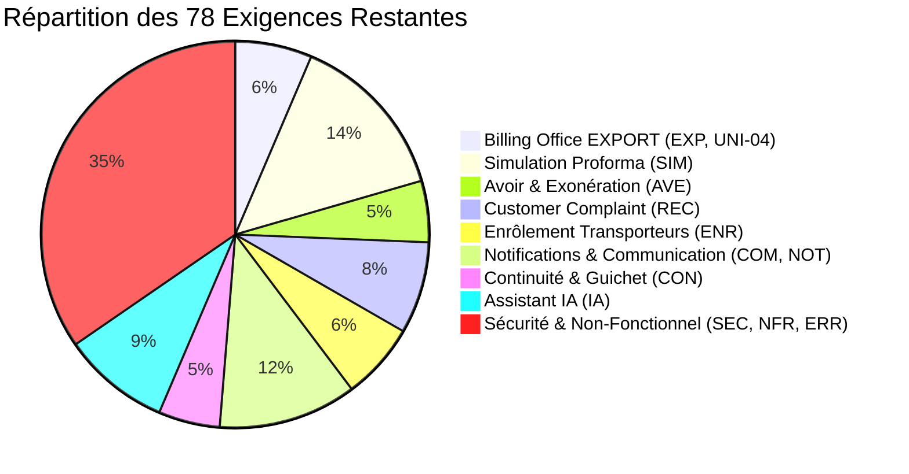
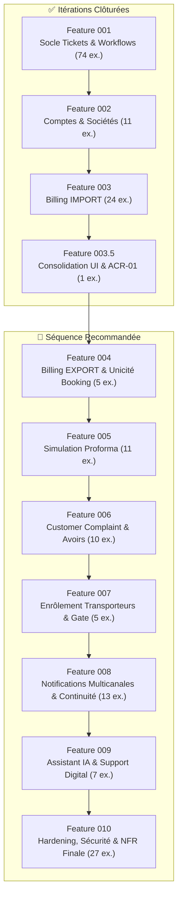

# Revue de Séquençage Post-Feature 003.5 & Roadmap Révisée

> **Document** : `docs/07-roadmap-post-ui.md`  
> **Date** : 30 Août 2026  
> **Référence CDC** : CIT-CIV-DSI-RFP-XXXX v1.0 — 12 août 2026  
> **Contexte** : Clôture formelle des Features 001, 002, 003 et 003.5.  
> **Statut** : Cadrage validé pour la sélection de la Feature 004.

---

## 1. État Réel du Projet & Baseline

Après la livraison et la fermeture formelle de la Feature 003.5 :
- **Socle Technique & Métier** : Robuste, unifié et navigable de bout en bout dans Blazor.
- **Zéro GUID Manuel** : Tous les parcours de production sont débarrassés des identifiants techniques.
- **Sécurité & Multi-Tenant** : Cloisonnement strict (0 IDOR) et matrice Challenge (302) vs Forbid (403) opérationnelle.
- **Baseline de Tests** : **310 tests verts** (37 Domain, 177 Application, 36 Infrastructure, 60 Web).

---

## 2. Réconciliation Mécanique de la Couverture CDC

Le décompte des exigences uniques couvertes par les 4 premières itérations est réconcilié comme suit :

| Feature | Périmètre Fonctionnel | Exigences Clôturées | Réf CDC |
| :--- | :--- | :---: | :--- |
| **Feature 001** | Socle Tickets, Workflows, Audit, SLA, Habilitations | **74** | SOC (13), CYC (7), MSG (5), WKF (3), PEC (5), TRF (6), TPS (5), SLA (5), ALE (3), SUP (5), DIS (3), AFF (7), PRI (4), MAS (2) *(hors SOC-14)* |
| **Feature 002** | Comptes Clients, Sociétés, 2FA, Gestion Collaborateurs | **11** | CPT-01 à CPT-07, ENT-01 à ENT-04 |
| **Feature 003** | Billing Office IMPORT, Unicité BL, Facturation, IES | **24** | IMP-01..06, IMP-10..14, IMP-15, IMP-20..22, IMP-30..32, IMP-40..42, UNI-01..03 |
| **Feature 003.5** | Consolidation UI/UX & Exigence "Mes actions requises" | **1** | **ACR-01** *(nouvelle exigence CDC formellement implémentée)* |
| **TOTAL COUVERT** | **Features 001 à 003.5** | **110** | **58.5 % du CDC** |

---

## 3. Inventaire des 78 Exigences Restantes

Les **78 exigences restantes** se répartissent en 8 capacités fonctionnelles et transversales :

### Détail des Références par Capacité :
1. **Billing Office EXPORT (5 exigences)** :
   - *Must* : `EXP-01`, `EXP-02`, `EXP-03`, `EXP-04`
   - *Should* : `UNI-04` (unicité booking)
2. **Simulation de Proforma (11 exigences)** :
   - *Must* : `SIM-01`, `SIM-02`, `SIM-03`, `SIM-04`, `SIM-05`, `SIM-06`, `SIM-07`
   - *Should* : `SIM-08`, `SIM-09`, `SIM-10`
   - *Could* : `SIM-11`
3. **Avoir et Exonération (4 exigences)** :
   - *Must* : `AVE-01`, `AVE-02`, `AVE-03`
   - *Should* : `AVE-04`
4. **Customer Complaint (6 exigences)** :
   - *Must* : `REC-01`, `REC-02`, `REC-03`, `REC-04`
   - *Should* : `REC-05`
   - *Could* : `REC-06`
5. **Enrôlement Transporteurs (5 exigences)** :
   - *Must* : `ENR-01`, `ENR-02`, `ENR-03`
   - *Should* : `ENR-04`
   - *Could* : `ENR-05`
6. **Communications & Notifications (9 exigences)** :
   - *Must* : `COM-01`, `COM-02`, `COM-03`, `COM-04`, `NOT-01`, `NOT-02`
   - *Should* : `COM-05`, `NOT-03`
   - *Could* : `COM-06`
7. **Continuité Digital / Présentiel & Guichet (4 exigences)** :
   - *Must* : `CON-01`, `CON-02`, `CON-03`
   - *Should* : `CON-04`
8. **Assistant IA (7 exigences)** :
   - *Must* : `IA-01`, `IA-02`, `IA-03`, `IA-06`, `IA-07`
   - *Should* : `IA-04`, `IA-05`
9. **Sécurité Transversale (12 exigences)** :
   - *Must* : `SEC-01`, `SEC-02`, `SEC-03`, `SEC-04`, `SEC-05`, `SEC-06`, `SEC-07`, `SEC-10`, `SEC-11`, `SEC-12`
   - *Should* : `SEC-08`, `SEC-09`
10. **Non Fonctionnel & Erreurs (15 exigences)** :
    - *Must* : `NFR-01`, `NFR-02`, `NFR-03`, `NFR-04`, `NFR-05`, `NFR-06`, `NFR-10`, `NFR-11`, `ERR-01`, `ERR-02`, `ERR-03`
    - *Should* : `NFR-07`, `NFR-08`, `NFR-09`, `ERR-04`

---

## 4. Scénarios de Recette (REC-SCE) Restants

| Scénario | Intitulé Contractuel | Module | Exigences Must | Prérequis & Dépendances |
| :--- | :--- | :--- | :--- | :--- |
| **REC-SCE-05** | EXPORT (4 types de clients) | Billing EXPORT | `EXP-01..04`, `UNI-04` | F001 (Workflows), F002 (Comptes), F003 (Moteur Billing) |
| **REC-SCE-06** | Simulation de Proforma | Proforma | `SIM-01..07`, `SIM-08..10` | Grille tarifaire Annexe A.8, Moteur de calcul |
| **REC-SCE-07** | Customer Complaint | Réclamations | `REC-01..04`, `REC-05` | F001 (Tickets, SLA, Fil messages), F002 (Comptes) |
| **REC-SCE-08** | Enrôlement Transporteur | Gate / Enrôlement | `ENR-01..03`, `ENR-04` | F001 (Tickets, Documents), F002 (Auth) |
| **REC-SCE-14** *(partiel)* | Transverse (Notifications multicanales, Continuité guichet) | Transverse | `COM-01..04`, `CON-01..03`, `SEC-*` | Modules métiers opérationnels |

---

## 5. Analyse Comparative des Candidats pour la Feature 004

### Candidat A : Billing Office EXPORT
- **Périmètre** : `EXP-01` à `EXP-04` (4 Must) + `UNI-04` (1 Should) = 5 exigences.
- **REC-SCE** : `REC-SCE-05`.
- **Alignement Architectural** : Réutilisation directe et immédiate des files Facturation, Paiement, Contrôle Documentaire et IES déjà développées dans F003. Introduction de la file Back Office (codification booking IPAKI) et du document final BEE (Bordereau d'Embarquement Électronique).
- **Points PC** : `PC-09` (validation de la règle d'unicité booking équivalente à l'import).
- **Valeur Métier** : Maximale. Clôture le module central **Billing Office** de CIT en couvrant les deux flux fondamentaux (Import + Export).

### Candidat B : Simulation de Proforma (SIM)
- **Périmètre** : `SIM-01` à `SIM-07` (7 Must) + `SIM-08` à `SIM-10` (3 Should) + `SIM-11` (1 Could) = 11 exigences.
- **REC-SCE** : `REC-SCE-06` (validation au franc près contre les cas de référence Annexe A.8).
- **Alignement Architectural** : Module autonome (moteur de calcul de grille tarifaire versionnée, acconage, relevage, branchement reefer, majorations lourd/dangereux/OOG, stationnement par tranches).
- **Points PC** : `PC-11` (paramétrage des tranches déjà fourni en Annexe A.8).
- **Valeur Métier** : Très forte pour les clients (estimation immédiate des coûts sans engagement).

### Candidat C : Customer Complaint (REC) & Avoir/Exonération (AVE)
- **Périmètre** : `REC-01` à `REC-06` (6 exigences) + `AVE-01` à `AVE-04` (4 exigences) = 10 exigences.
- **REC-SCE** : `REC-SCE-07`.
- **Alignement Architectural** : Exploite 100% du socle F001 sans nouveau mécanisme lourd (catégories dynamiques, file Support Opérationnel, échanges, SLA réclamation).
- **Points PC** : `PC-08` (référentiel des catégories de réclamations).
- **Valeur Métier** : SAV client et traitement des litiges financiers.

### Candidat D : Enrôlement Transporteurs & Chauffeurs (ENR)
- **Périmètre** : `ENR-01` à `ENR-05` = 5 exigences.
- **REC-SCE** : `REC-SCE-08`.
- **Alignement Architectural** : Nécessite l'introduction d'un nouveau modèle de données métier distinct des sociétés clientes (Transporteurs, Chauffeurs, Véhicules, Badges RFID/Gate).
- **Points PC** : `PC-06` (processus de convocation physique et délivrance des badges).
- **Valeur Métier** : Fluidification de l'accès aux guérites portuaires.

---

## 6. Matrice de Scoring Multicritères (Notes sur 5)

| Critère d'Évaluation | Poids | A. Billing EXPORT | B. Simulation Proforma | C. Complaint / Avoir | D. Enrôlement |
| :--- | :---: | :---: | :---: | :---: | :---: |
| **A. Prérequis & Socle Disponibles** | 15% | **5.0** | 4.5 | 5.0 | 3.5 |
| **B. Valeur Métier Core Business** | 15% | **5.0** | 4.5 | 4.0 | 3.5 |
| **C. Nombre & Clarté des Must** | 10% | **5.0** (4 Must clairs) | 4.5 (7 Must) | 4.0 (7 Must) | 3.5 (6 Must) |
| **D. Testabilité & Clarté Recette** | 10% | **5.0** (REC-SCE-05) | 5.0 (Annexe A.8) | 4.5 (REC-SCE-07) | 4.0 (REC-SCE-08) |
| **E. Autonomie du Module** | 10% | **4.5** | 5.0 | 4.5 | 3.5 |
| **F. Complexité Maîtrisée** | 10% | **4.5** | 4.0 | 4.5 | 3.0 |
| **G. Faiblesse du Risque** | 10% | **4.5** | 4.0 | 4.5 | 3.0 |
| **H. Clôture des Points PC** | 5% | **4.5** (PC-09 simple) | 4.5 (Annexe A.8) | 3.5 (PC-08/15) | 3.0 (PC-06) |
| **I. Réutilisation Backend F001-F003** | 5% | **5.0** | 3.5 | 4.5 | 3.0 |
| **J. Réutilisation UI F003.5** | 5% | **5.0** | 4.5 | 4.5 | 3.5 |
| **K. Conformité REC-SCE Dédié** | 5% | **5.0** | 5.0 | 5.0 | 4.0 |
| **NOTE FINALE PONDÉRÉE** | **100%** | **4.80 / 5** 🏆 | **4.45 / 5** | **4.40 / 5** | **3.40 / 5** |

---

## 7. Recommandation Formelle pour la Prochaine Feature

### **Recommandation** : **Feature 004 = Billing Office EXPORT**

#### Justification Métier et Technique :
1. **Continuité Opérationnelle Immédiate** : Le Billing Office représente le cœur battant de la plateforme CIT. Après avoir finalisé l'IMPORT dans F003 et son ergonomie dans F003.5, l'EXPORT utilise 80% des mêmes mécanismes (files Facturation, Paiement, Contrôle Documentaire, IES, 4 types de profils clients) tout en introduisant la file Back Office (IPAKI) et l'émission du BEE.
2. **Effet de Levier Maximal du Socle** : La base de code F001, F002, F003 et la nouvelle ergonomie F003.5 permettent d'implémenter l'EXPORT avec une vélocité et une fiabilité maximales.
3. **Validation Complète du Scénario REC-SCE-05** : Permet de valider contractuellement le 5ᵉ grand scénario de recette du CDC.

---

## 8. Roadmap Révisée jusqu'à la Version Finale (V1.0)

### Calendrier Séquentiel Prévisionnel des Features :
- **Feature 004** : **Billing Office EXPORT** (`EXP-01..04`, `UNI-04`) ➔ Total cumulé : **115 / 188 (61.2%)**
- **Feature 005** : **Simulation de Proforma** (`SIM-01..11`) ➔ Total cumulé : **126 / 188 (67.0%)**
- **Feature 006** : **Customer Complaint & Avoir/Exonération** (`REC-01..06`, `AVE-01..04`) ➔ Total cumulé : **136 / 188 (72.3%)**
- **Feature 007** : **Enrôlement Transporteurs & Chauffeurs** (`ENR-01..05`) ➔ Total cumulé : **141 / 188 (75.0%)**
- **Feature 008** : **Communications, Notifications Multicanales & Continuité Présentielle** (`COM-01..06`, `NOT-01..03`, `CON-01..04`) ➔ Total cumulé : **154 / 188 (81.9%)**
- **Feature 009** : **Assistant IA & Support Digital** (`IA-01..07`) ➔ Total cumulé : **161 / 188 (85.6%)**
- **Feature 010** : **Hardening Global, Sécurité Avancée, Performance & NFR** (`SEC-01..12`, `NFR-01..11`, `ERR-01..04`) ➔ Total final : **188 / 188 (100%)**

---

## 9. Analyse des Exigences Transversales (SEC / NFR / ERR)

Les 27 exigences de Sécurité, Performance et Robustesse ne constituent pas un bloc isolé mais sont honorées progressivement :
1. **Déjà partiellement satisfaites par les fondations** : `SEC-01` (Auth), `SEC-02` (RBAC), `SEC-03` (Cloisonnement), `SEC-05` (Audit append-only), `SEC-10` (Session expiration), `NFR-01` (Français), `NFR-02` (Responsive), `ERR-03` (Contrôle uploads).
2. **Intégration continue dans chaque feature métier** : Chaque nouvelle feature (F004, F005, etc.) applique systématiquement les règles d'intégrité, de cloisonnement et d'audit.
3. **Validation formelle en Feature 010 (Hardening)** : Tests de charge < 3s (`NFR-04`), chiffrement au repos (`SEC-04`), conformité ARTCI (`SEC-06`), sauvegardes/restauration (`NFR-06`).

---

## 10. Fiche de Cadrage Initiale pour Feature 004

- **Identifiant Suggéré** : `specs/004-billing-office-export/`
- **Titre** : *Billing Office EXPORT & Unicité Booking*
- **Exigences Couvertes** : `EXP-01`, `EXP-02`, `EXP-03`, `EXP-04`, `UNI-04` (5 exigences).
- **Scénario Contractuel** : `REC-SCE-05` (EXPORT 4 types de clients : Normal, En Compte, Deposit, IES).
- **Acteurs & Rôles** : Client, Back Office (IPAKI), Pilote Facturation (Draft IN), Caisse/Finance, Pilote CD (BEE).
- **Documents Clés** : Confirmation de Booking, Déclaration Export, Facture Export, BEE (Bordereau d'Embarquement Électronique).
- **Point à Clarifier** : `PC-09` (validation de la règle d'unicité booking).
