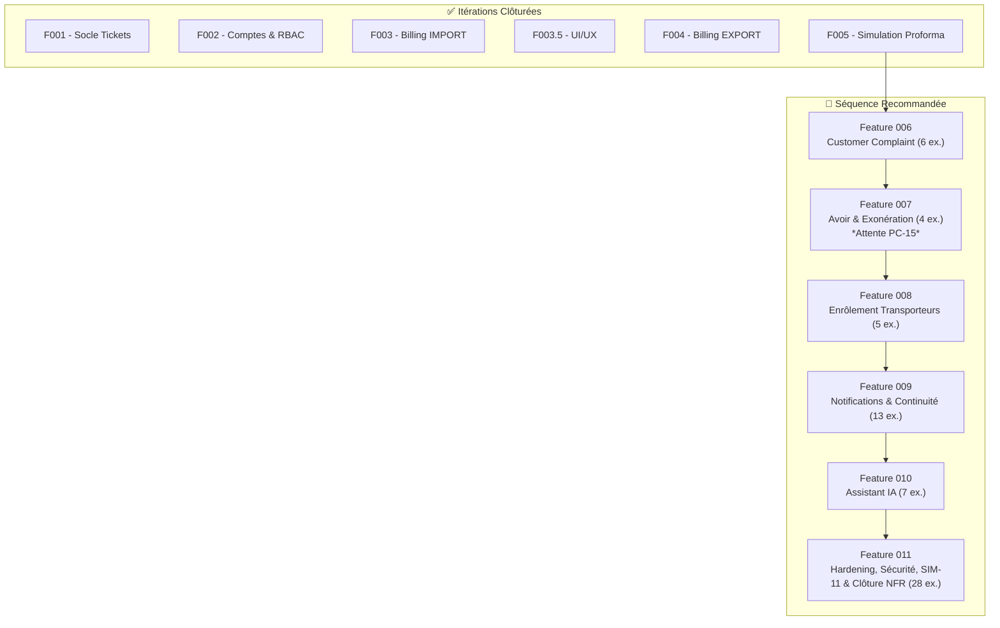

# Revue de Séquençage Post-Feature 005 & Roadmap Révisée

> **Document** : `docs/08-roadmap-post-f005.md`  
> **Date** : 30 Août 2026  
> **Contexte** : Clôture formelle de la Feature 005 (Simulation Proforma).  
> **Statut** : Cadrage validé pour la sélection de la Feature 006.

---

## 1. État Actuel et Couverture CDC

Après la livraison et la fermeture formelle de la Feature 005 :
- **Baseline de Tests** : 428 tests verts (0 erreur, 0 échec).
- **Couverture Mécanique** :
  - **F001..F003.5** : 110 exigences
  - **F004 (Billing Export)** : 5 exigences
  - **F005 (Simulation Proforma)** : 10 exigences (SIM-11 est différée et non comptée)
  - **Total Couvert** : **125 / 188 exigences (66.5 %)**

Il reste donc **63 exigences** à clôturer pour atteindre 100%.

---

## 2. Inventaire des 63 Exigences Restantes

L'union réelle des références restantes donne les 7 familles suivantes :

1. **Customer Complaint (REC)** : `REC-01..06` (6 ex.)
2. **Avoir & Exonération (AVE)** : `AVE-01..04` (4 ex.)
3. **Enrôlement Transporteurs (ENR)** : `ENR-01..05` (5 ex.)
4. **Communications & Notifications (COM, NOT)** : `COM-01..06`, `NOT-01..03` (9 ex.)
5. **Continuité Digital/Présentiel (CON)** : `CON-01..04` (4 ex.)
6. **Assistant IA (IA)** : `IA-01..07` (7 ex.)
7. **Sécurité & NFR (SEC, NFR, ERR)** : `SEC-06`, `SEC-10`, `SEC-11`, `NFR-01..11` (sauf NFR-05 couvert par F001), `ERR-01..04` (27 ex.)
8. **Dette Acceptée** : `SIM-11` (1 ex.)

*Total : 6 + 4 + 5 + 9 + 4 + 7 + 27 + 1 = 63.*

---

## 3. Analyse du Couplage : REC vs AVE

La question principale est de savoir si **Customer Complaint (REC)** et **Avoir/Exonération (AVE)** doivent fusionner en une seule F006 (Option A) ou être scindées (Option B).

### Matrice de Couplage

| Capacité | REC (Complaint) | AVE (Avoir/Exo) | Commune ? | Réutilisation F001 (existant) ? |
| :--- | :---: | :---: | :---: | :---: |
| **Workflow / Ticket** | Oui | Oui | Oui | Oui (Totalement) |
| **Documents / Messages** | Oui | Oui | Oui | Oui (Totalement) |
| **Validation Finance** | Non | **Oui** | Non | Non (Circuit à créer) |
| **Acteur cible** | Support Opérationnel | Caisse/Finance | Non | Oui |
| **Lien Facture/Paiement**| Non | **Oui** | Non | Oui (partiellement via SOC-10) |

### Points à Clarifier (PC) Bloquants
- **REC** ne souffre d'aucun blocage majeur. Les catégories (PC-08) peuvent être mockées ou paramétrées facilement.
- **AVE** est lourdement bloqué par :
  - **PC-03 (🔴 BLOQUANT)** : Le rôle `Intervenant Avoir/Exo` ou `Caisse/Finance` n'est pas formellement défini dans le modèle RBAC.
  - **PC-15 (🟠 CRITIQUE)** : Le workflow d'approbation financière d'un Avoir/Exonération est inconnu.

### Scénarios de Recette (REC-SCE)
- **REC** dispose d'un scénario contractuel clair et dédié : **REC-SCE-07**.
- **AVE** n'a **aucun** REC-SCE défini dans le CDC (cf. Partie 3 de `04-matrice-recette.md`).

**Conclusion du Couplage** : Bien qu'elles soient sémantiquement proches (Post-Sales), elles n'ont aucune dépendance technique stricte entre elles. Combiner les deux créerait une **dette artificielle bloquante** où le développement de REC serait paralysé par l'attente des décisions financières (PC-03/15) nécessaires à AVE.

---

## 4. Matrice de Scoring des Candidats

Notation sur 5 :

| Critère | A. REC seule | B. AVE seule | C. REC+AVE combinées | D. ENR (Enrôlement) |
| :--- | :---: | :---: | :---: | :---: |
| **Cohérence Métier** | 5.0 | 5.0 | 4.0 | 5.0 |
| **Autonomie Technique** | 5.0 | 5.0 | 3.0 | 4.0 |
| **Absence de Blocage (PC)**| **4.5** | 1.0 (PC-15) | 2.0 | 3.0 (PC-06) |
| **Couverture REC-SCE** | 5.0 (SCE-07) | 1.0 (Aucun) | 3.0 | 5.0 (SCE-08) |
| **Valeur Utilisateur** | 4.5 | 4.0 | 4.5 | 4.0 |
| **Facilité de Test** | 5.0 | 2.0 | 3.0 | 4.0 |
| **NOTE FINALE PONDÉRÉE**| **4.83 / 5** 🏆 | **3.00 / 5** | **3.25 / 5** | **4.16 / 5** |

---

## 5. Recommandation Formelle pour la Feature 006

**OPTION B RETENUE : SÉPARATION STRICTE.**

La prochaine étape doit être : **Feature 006 = Customer Complaint (REC)** seule.

### Périmètre exact (F006) :
- `REC-01` : Création de demande par catégorie.
- `REC-02` : Paramétrage dynamique des catégories.
- `REC-03` : File Support Opérationnel (instruction, compléments, transferts).
- `REC-04` : Clôture avec réponse formalisée.
- `REC-05` : Orientation automatique (Should).
- `REC-06` : Enquête de satisfaction (Could).

### Justification :
1. **Velocité** : REC exploite 100% de la Feature 001 (Moteur de workflow) et ne nécessite quasiment aucun nouveau modèle de base de données, à l'exception d'un référentiel de catégories et d'un champ de réponse formelle de clôture.
2. **Validation contractuelle** : Permet de valider immédiatement `REC-SCE-07`.
3. **Isolation des risques** : Laisse le temps au métier de trancher les lourds points PC-03 et PC-15 liés aux Avoirs/Exonérations (AVE) sans bloquer le pipeline de livraison.

---

## 6. Roadmap Révisée (Jusqu'à 188/188)

### Positionnement des dettes :
- La dette **SIM-11** (Contrôles croisés avancés de saisie) est intégrée dans la **Feature 011** (Hardening global) où l'ensemble de la robustesse de l'UI sera polie avant la Release finale. Elle n'est pas oubliée.

---

## Décision

La séparation de REC et AVE est la seule option viable pour maintenir une vélocité élevée et une gestion saine des dépendances décisionnelles. Le candidat **Feature 006 : Customer Complaint** est prêt pour le développement.
