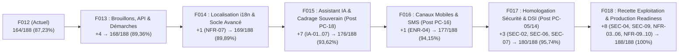

# POST-F012 FEATURE SELECTION GATE — RAPPORT D'ARBITRAGE ET ROADMAP

**Auteur** : Scrum Master & Product Owner Technique CIT Digital Platform  
**Date** : 2026-09-01  
**Commit de référence (HEAD)** : `cbc42bddd17734d47893bd730834c8bd05a94120` (Clôture F012)  
**Baseline Technique Certifiée** : **867 / 867 tests verts**, **0 warning**, **0 pending model changes**  
**Baseline CDC Officielle** : **164 / 188 conformes = 87,23 %**

---

## 1. BASELINE TECHNIQUE POST-F012

Les contrôles automatisés exécutés sur le commit `cbc42bd` confirment la stabilité intégrale de la plateforme :

```text
Génération : dotnet build → 0 Avertissement, 0 Erreur
Modèle EF Core : dotnet ef migrations has-pending-model-changes → 0 Pending Changes
Migrations créées : 0

Suites de tests :
- CIT.Plateforme.Domain.Tests          : 158 / 158 verts (100 %)
- CIT.Plateforme.Application.Tests     : 447 / 447 verts (100 %)
- CIT.Plateforme.Infrastructure.Tests  :  83 /  83 verts (100 %)
- CIT.Plateforme.Web.Tests             : 179 / 179 verts (100 %)
TOTAL : 867 / 867 VERTS (100 %)
```

---

## 2. RECONSTRUCTION DE LA BASELINE CDC NOMINATIVE (188 EXIGENCES)

La ventilation exhaustive des 188 exigences du Cahier des Charges donne la répartition formelle suivante :

| Catégorie | Nombre | Pourcentage | Commentaire |
|:---|:---:|:---:|:---|
| **CONFORMES** | **164** | **87,23 %** | 157 post-F011 + 7 certifiées dans F012 (PRI-02, IMP-03, REC-02, REC-03, SEC-08, SOC-14, COM-06) |
| **PARTIELLES / RÉSERVÉES** | **2** | **1,06 %** | SEC-02 (RBAC champs IES / PC-05), SEC-07 (Antivirus DSI) |
| **DIFFÉRÉES** | **3** | **1,60 %** | ENR-04 (SMS/WhatsApp / PC-16), SIM-11 (Validations simulation), ENR-05 (Badge transporteur) |
| **ABSENTES** | **11** | **5,85 %** | IA-01..07 (7), ERR-01, SEC-09, NFR-07, NFR-08 |
| **À CLARIFIER / EXPLOITATION** | **8** | **4,26 %** | SEC-04, SEC-06, NFR-03, NFR-04, NFR-05, NFR-06, NFR-09, NFR-10 |
| **TOTAL** | **188** | **100,00 %** | Somme exacte : 164 + 2 + 3 + 11 + 8 = 188 |

---

## 3. INVENTAIRE NOMINATIF DES 24 EXIGENCES RESTANTES

| ID | Prio | Module | Texte CDC synthétique | Statut | Dépendance / Cause |
|:---|:---:|:---|:---|:---:|:---|
| **ERR-01** | **Must** | Socle / Formulaires | Aucune perte de saisie (système de brouillons et reprise) | ABSENTE | Modèle de persistance temporaire de saisie client à créer |
| **SEC-02** | **Must** | Sécurité | RBAC au niveau des champs pour les traitements parallèles | PARTIELLE | Bloqué par **PC-05** (liste des champs réservés par rôle non fournie) |
| **SEC-07** | **Must** | Sécurité | Analyse antivirale systématique des pièces jointes | PARTIELLE | Dépendance décision DSI (fournisseur / API antivirus tiers) |
| **IA-01** | **Must** | Assistant IA | Réponses en français aux questions fréquentes par IA | ABSENTE | Bloqué par **PC-18** (choix hébergement, modèle LLM, souveraineté) |
| **IA-02** | **Must** | Assistant IA | Orientation vers la bonne démarche / bon formulaire par l'IA | ABSENTE | Bloqué par **PC-18** |
| **IA-03** | **Must** | Assistant IA | Escalade automatique vers un agent si nécessaire | ABSENTE | Bloqué par **PC-18** |
| **IA-06** | **Must** | Assistant IA | Base de connaissances administrable sans développement | ABSENTE | Bloqué par **PC-18** |
| **IA-07** | **Must** | Assistant IA | Traçabilité des échanges avec l'assistant IA | ABSENTE | Bloqué par **PC-18** |
| **SEC-04** | **Must** | Sécurité / Infra | Chiffrement systématique des flux (HTTPS / TLS) | À CLARIFIER | **PC-13** (configuration d'infrastructure et certificats hébergeur) |
| **SEC-06** | **Must** | Sécurité / Juridique| Protection données personnelles & conformité ARTCI | À CLARIFIER | **PC-14** (politique de rétention légale et d'archivage) |
| **NFR-03** | **Must** | Performance / SLA | Disponibilité ≥ 99 % sur les plages ouvrées | À CLARIFIER | Dépendance SLA hébergement de production |
| **NFR-04** | **Must** | Performance / SLA | Temps de réponse inférieur à 3 secondes | À CLARIFIER | **PC-01** (campagne de tir de charge sur infrastructure cible) |
| **NFR-05** | **Must** | Performance / SLA | Dimensionnement selon la volumétrie opérationnelle | À CLARIFIER | **PC-01** (volumétrie cible à figer par le métier) |
| **NFR-06** | **Must** | Exploitation / PRA | Sauvegardes et procédure de restauration testée | À CLARIFIER | **PC-13** (plan de sauvegarde / PRA hébergeur) |
| **NFR-10** | **Must** | Exploitation | Accessibilité de la plateforme 24/7 | À CLARIFIER | Dépendance exploitation hébergeur |
| **ENR-04** | **Should**| Enrôlement | Notification chauffeur par SMS / WhatsApp | DIFFÉRÉE | Bloqué par **PC-16** (souscription fournisseur SMS/WhatsApp) |
| **IA-04** | **Should**| Assistant IA | Synthèse automatique du dossier par IA pour l'agent | ABSENTE | Bloqué par **PC-18** |
| **IA-05** | **Should**| Assistant IA | Suggestion de réponse pré-rédigée pour l'agent | ABSENTE | Bloqué par **PC-18** |
| **SEC-09** | **Should**| Exploitation / Infra| Cloisonnement strict des environnements DEV/QUAL/PROD | ABSENTE | Dépendance infrastructure CI-CD / hébergement |
| **NFR-07** | **Should**| Socle / UX | Interface multilingue (version anglaise) | ABSENTE | Absence de localisation i18n |
| **NFR-08** | **Should**| Architecture | Architecture ouverte exposant des API sécurisées | ABSENTE | Endpoints API REST / OpenAPI partenaires non exposés |
| **NFR-09** | **Should**| Sécurité / Groupe | Hébergement conforme aux exigences Groupe | À CLARIFIER | **PC-13** (décision DSI / Groupe AGL) |
| **SIM-11** | **Could** | Tarification | Validations croisées avancées pour la simulation | DIFFÉRÉE | Règles métier optionnelles non bloquantes |
| **ENR-05** | **Could** | Enrôlement | Renouvellement de badge transporteur avec rappel auto | DIFFÉRÉE | Cycle de renouvellement annuel |

- **Ventilation par priorité** :
  - **Must** : **15** exigences
  - **Should** : **7** exigences
  - **Could** : **2** exigences
  - **Total** : **24** exigences

---

## 4. AUDIT DES DETTES RESTANTES

| Identifiant | Source | Description | Bloque F013 ? | Bloque Prod ? | Action de Clôture |
|:---|:---:|:---|:---:|:---:|:---|
| **DETTE-REC-NFR02** | F011 | Recette responsive multi-terminaux physiques | NON | NON | Campagne de validation manuelle ergonomique |
| **DETTE-CFG-SEC10** | F011 | Externalisation configuration session/secrets | NON | OUI | Paramétrage `appsettings.Production.json` lors du déploiement cible |
| **DETTE-F010-01** | F010 | Mode dégradé / impression physique tickets guichet | NON | NON | Intégration matérielle optionnelle borne |

---

## 5. AUDIT DES POINTS À CLARIFIER (PC)

| PC | Sujet | Statut | Bloque Spécification ? | Impact sur les Exigences |
|:---|:---|:---:|:---:|:---|
| **PC-01** | Volumétrie et seuils de charge NFR | Ouvert | OUI pour NFR-04/05 | NFR-04, NFR-05 |
| **PC-05** | Matrice des champs réservés par rôle (IES) | Ouvert | OUI pour SEC-02 | SEC-02 |
| **PC-13** | Hébergement cible, certificats TLS et PRA | Ouvert | OUI pour SEC-04, NFR-06, NFR-09 | SEC-04, NFR-06, NFR-09 |
| **PC-14** | Politique de rétention et archivage légal ARTCI | Ouvert | OUI pour SEC-06 | SEC-06 |
| **PC-16** | Fournisseur passerelle SMS / WhatsApp | Ouvert | OUI pour ENR-04 | ENR-04 |
| **PC-18** | Fournisseur / modèle LLM souverain et budget IA | Ouvert | **OUI pour IA-01..07** | **IA-01, IA-02, IA-03, IA-04, IA-05, IA-06, IA-07** |

---

## 6. CLASSIFICATION DU CODE EXISTANT POUR LES 24 EXIGENCES

- **A — Déjà implémenté, certification formelle seule** : 0
- **B — Partiellement implémenté, correction / complétion ciblée** :
  - `SIM-11` : moteur tarifaire F005 existant, règles croisées complémentaires.
  - `ENR-05` : entité `Enrolement` et badge existants dans F008, rappel à connecter.
- **C — Développement applicatif autonome ciblé** :
  - `ERR-01` : mécanisme de brouillons de saisie (Drafts) et reprise sans perte.
  - `NFR-08` : exposition d'endpoints API REST documentés OpenAPI.
  - `NFR-07` : couche de localisation i18n (français / anglais).
- **E — Bloqué par clarification métier / DSI** :
  - `IA-01..07` (7 exigences bloquées par PC-18)
  - `SEC-02` (bloqué par PC-05)
  - `ENR-04` (bloqué par PC-16)
- **F / G — Dépendance infrastructure, hébergeur ou cadre contractuel externe** :
  - `SEC-04`, `SEC-06`, `SEC-07`, `SEC-09`, `NFR-03`, `NFR-04`, `NFR-05`, `NFR-06`, `NFR-09`, `NFR-10`.

---

## 7. CANDIDATS DE FEATURE & SCORING

### Candidat A : Continuité de Saisie, Brouillons & Exposition API (ERR-01, NFR-08, SIM-11, ENR-05)
- **Périmètre** :
  - `ERR-01` (**Must**) : Sauvegarde automatique/manuelle des brouillons sur les formulaires de soumission (Import, Réclamations, Enrôlement) avec reprise transparente après déconnexion.
  - `NFR-08` (**Should**) : Exposition d'une façade d'API sécurisée (REST/JSON) avec documentation OpenAPI/Swagger pour intégration.
  - `SIM-11` (**Could**) : Validations croisées avancées de simulation proforma.
  - `ENR-05` (**Could**) : Procédure de renouvellement de badge transporteur avec rappel.
- **Scoring (sur 100)** :
  - Valeur Métier : 23/25
  - Gain Must : 18/20
  - Gain CDC Global : 14/15
  - Réduction de risque : 9/10
  - Fermeture de dette : 8/10
  - Autonomie (0 dépendance externe) : 10/10
  - Rapport Effort/Valeur : 9/10
  - Pénalités : 0
  - **TOTAL : 91 / 100**

### Candidat B : Assistant IA & Orientation Usager (IA-01..07)
- **Périmètre** : IA-01 à IA-07 (5 Must, 2 Should).
- **Statut** : **NOT READY — BLOQUÉ PAR PC-18**.
- **Scoring** : Non éligible tant que la DSI n'a pas tranché le modèle LLM et la souveraineté.

### Candidat C : Canaux Mobiles & SMS/WhatsApp (ENR-04)
- **Périmètre** : ENR-04 (1 Should).
- **Statut** : **NOT READY — BLOQUÉ PAR PC-16**.

### Candidat D : Internationalisation & Multilingue (NFR-07)
- **Périmètre** : NFR-07 (1 Should).
- **Scoring** : 65 / 100 (Effort élevé pour une seule exigence Should).

---

## 8. RECOMMANDATION OFFICIELLE : FEATURE 013

### Identité de la Feature 013
- **Nom** : **Feature 013 — Continuité Opérationnelle, Brouillons de Saisie, Exposition d'API & Clôture Démarches**
- **Objectif** :
  1. Implémenter le système universel de brouillons de saisie (`ERR-01`, Must) garantissant zéro perte de données lors de l'interruption d'une démarche client (reconnexion, crash navigateur, timeout).
  2. Exposer les API ouvertes et documentées (`NFR-08`, Should) pour la consultation des statuts de tickets et pièces par les partenaires logistiques.
  3. Clôturer les démarches métier différées : validations croisées avancées de tarification (`SIM-11`, Could) et renouvellement de badge transporteur (`ENR-05`, Could).
- **Périmètre d'exigences** : **ERR-01, NFR-08, SIM-11, ENR-05** (4 exigences).
- **Gain CDC maximal** : **+4 exigences** (1 Must, 1 Should, 2 Could).
- **Baseline CDC projetée** : **168 / 188 = 89,36 %**.
- **Dépendances externes** : Aucune.
- **PC bloquantes** : Aucune.
- **Migration probable** : 1 migration ciblée pour la table `BrouillonsSaisie` (si persistance serveur requise) ou stockage localisé.

---

## 9. ROADMAP VERS 188 / 188



| Étape | Nom de la Feature | Exigences couvertes | Gain | Baseline Projetée | Prérequis / Bloqueurs |
|:---:|:---|:---|:---:|:---:|:---|
| **F012** | *Remédiation Dettes & Recette Transverse* | PRI-02, IMP-03, REC-02, REC-03, SEC-08, SOC-14, COM-06 | +7 | **164 / 188 (87,23 %)** | **ACQUIS (cbc42bd)** |
| **F013** | **Brouillons de Saisie, API & Démarches** | **ERR-01, NFR-08, SIM-11, ENR-05** | **+4** | **168 / 188 (89,36 %)** | **Prêt immédiatement (0 PC)** |
| **F014** | *Localisation Multilingue i18n* | NFR-07 | +1 | 169 / 188 (89,89 %) | Autonome |
| **F015** | *Assistant IA & Cadrage Souverain* | IA-01, IA-02, IA-03, IA-04, IA-05, IA-06, IA-07 | +7 | 176 / 188 (93,62 %) | Résolution PC-18 (DSI / Choix LLM) |
| **F016** | *Canaux Mobiles SMS / WhatsApp* | ENR-04 | +1 | 177 / 188 (94,15 %) | Résolution PC-16 (Fournisseur SMS) |
| **F017** | *Homologation Sécurité Métier & DSI* | SEC-02, SEC-06, SEC-07 | +3 | 180 / 188 (95,74 %) | Résolution PC-05 (Champs IES) & PC-14 (ARTCI) |
| **F018** | *Production Readiness & Exploitation* | SEC-04, SEC-09, NFR-03, NFR-04, NFR-05, NFR-06, NFR-09, NFR-10 | +8 | 188 / 188 (100,00 %) | Déploiement infra cible & PC-01 / PC-13 |

---

## 10. CONCLUSION & VERDICT

- **Code produit modifié** : AUCUN
- **Test modifié** : AUCUN
- **Migration créée** : AUCUNE
- **Document produit** : `docs/21-post-f012-feature-selection-gate.md`
- **Statut** : **READY FOR FEATURE 013 SCOPE VALIDATION**
