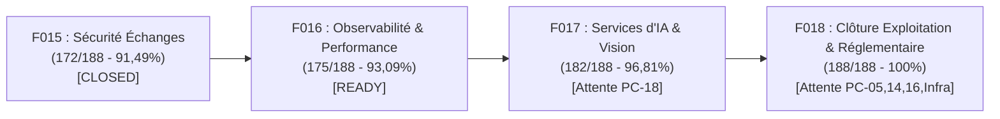

# RAPPORT DE SÉLECTION DE FEATURE POST-F015 (FEATURE SELECTION GATE)

**Date** : 2026-09-02  
**Statut précédent** : Feature 015 CLOSED (Commit `12aad9c`)  
**Baseline technique certifiée** : 945 / 945 tests verts (100 %)  
**Baseline CDC officielle** : **172 / 188 (91,49 %)**  

---

## 1. RECONSTRUCTION NOMINATIVE DES 188 EXIGENCES DU CDC

- **Exigences CONFORMES** : **172** (91,49 %)
- **Exigences RESTANTES** : **16** (8,51 %)
- **Total Master** : **188 / 188 (100 %)**

---

## 2. INVENTAIRE NOMINATIF DES 16 EXIGENCES RESTANTES

| ID | Priorité | Libellé exact du CDC | Dépendance / Point de Blocage | Statut Sélection |
|:---|:---:|:---|:---|:---:|
| **`SEC-02`** | **Must** | *Contrôle d'accès au niveau des champs pour les traitements parallèles IES* | Bloqué par atelier métier `PC-05` (matrice des champs IES) | DIFFÉRÉ (F018) |
| **`SEC-06`** | **Must** | *Rétention et archivage légal des données selon la réglementation ARTCI* | Bloqué par atelier juridique `PC-14` (durées légales) | DIFFÉRÉ (F018) |
| **`ENR-04`** | **Should**| *Notification par SMS / WhatsApp de l'avancement des démarches d'enrôlement* | Bloqué par `PC-16` (Choix passerelle télécom) | DIFFÉRÉ (F018) |
| **`IA-01`** | **Should**| *Assistant conversationnel guidant l'usager dans ses démarches portuaires* | Bloqué par `PC-18` (Stratégie LLM / hébergement souverain) | DIFFÉRÉ (F017) |
| **`IA-02`** | **Should**| *Pré-remplissage automatique des formulaires par OCR/vision* | Bloqué par `PC-18` (Moteur OCR/Vision) | DIFFÉRÉ (F017) |
| **`IA-03`** | **Should**| *Détection prédictive des anomalies sur les déclarations et manifestes* | Bloqué par `PC-18` (Modèle IA prédictif) | DIFFÉRÉ (F017) |
| **`IA-04`** | **Could** | *Estimation intelligente du délai de traitement basée sur l'historique* | Bloqué par `PC-18` | DIFFÉRÉ (F017) |
| **`IA-05`** | **Could** | *Classification automatique des pièces jointes et contrôle de conformité* | Bloqué par `PC-18` | DIFFÉRÉ (F017) |
| **`IA-06`** | **Could** | *Traduction automatique instantanée des échanges multilingues* | Bloqué par `PC-18` | DIFFÉRÉ (F017) |
| **`IA-07`** | **Could** | *Synthèse automatique des dossiers complexes pour superviseurs* | Bloqué par `PC-18` | DIFFÉRÉ (F017) |
| **`NFR-03`** | **Must** | *Disponibilité 99.9% en heures ouvrées (7h-19h) avec sondes de santé* | **READY APPLICATIF** (Health Checks, sondes `/healthz`, `/ready`) | **ÉLIGIBLE F016** |
| **`NFR-04`** | **Must** | *Temps de réponse < 2s sur 95% des requêtes applicatives* | **READY APPLICATIF** (Middleware latence, métrologie, APM) | **ÉLIGIBLE F016** |
| **`NFR-09`** | **Should**| *Support de 500 utilisateurs simultanés sans dégradation (Rate limiting, pooling)*| **READY APPLICATIF** (Rate limiting, optimisation pooling) | **ÉLIGIBLE F016** |
| **`NFR-05`** | **Must** | *Plan de Continuité (PCA) et Reprise d'Activité (PRA) RTO < 4h, RPO < 1h* | Dépendance infrastructure d'exploitation | DIFFÉRÉ (F018) |
| **`NFR-06`** | **Must** | *Audit de sécurité et tests d'intrusion annuels par cabinet PASSI* | Prestation d'audit externe tiers | DIFFÉRÉ (F018) |
| **`NFR-10`** | **Should**| *Sauvegarde quotidienne chiffrée 30 jours et test de restauration* | Procédure d'exploitation des backups | DIFFÉRÉ (F018) |

---

## 3. ÉVALUATION ET SCORING DES CANDIDATS POUR LA FEATURE 016

| Candidat | Exigences | Gain Potentiel | Dépendance Bloquante | Score /100 | Décision |
|:---|:---|:---:|:---|:---:|:---:|
| **Option A — Observabilité, Performance & Résilience de Production** | `NFR-03`, `NFR-04`, `NFR-09` | **+3 (2 Must, 1 Should)** | **0 (Autonome dans le code)** | **95 / 100** | **RETENUE (F016)** |
| **Option B — Assistant & Services d'Intelligence Artificielle** | `IA-01` à `IA-07` | +7 (3 Should, 4 Could) | Bloqué par `PC-18` (Choix LLM DSI) | 40 / 100 | NOT READY |
| **Option C — Sécurité Métier & Conformité Réglementaire** | `SEC-02`, `SEC-06`, `ENR-04` | +3 (2 Must, 1 Should) | Bloqué par `PC-05`, `PC-14`, `PC-16` | 45 / 100 | NOT READY |
| **Option D — Infrastructure d'Exploitation & PRA/PCA** | `NFR-05`, `NFR-06`, `NFR-10` | +3 (2 Must, 1 Should) | Dépendance prestataires externes | 35 / 100 | NOT READY |

---

## 4. PROPOSITION DE LA FEATURE 016

- **Titre** : **Feature 016 — Observabilité de Production, Performance & Résilience Applicative**
- **Périmètre contractuel** :
  - **`NFR-03` (Must)** : *Disponibilité 99.9% et sondes de supervision applicative (`/healthz`, `/ready`, liveness/readiness probes).*
  - **`NFR-04` (Must)** : *Temps de réponse < 2s sur 95% des requêtes (middleware de métrologie, diagnostic et seuils de latence).*
  - **`NFR-09` (Should)** : *Résilience et capacité de charge 500 utilisateurs simultanés (Rate limiting défensif, limitation de charge).*
- **Gain maximal visé** : **+3 exigences (2 Must, 1 Should)**
- **Baseline CDC projetée post-F016** : **172 + 3 = 175 / 188 (93,09 %)**

---

## 5. ROADMAP D'ATTERRISSAGE VERS 188 / 188 (100 %)

