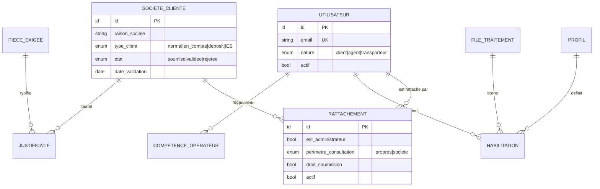
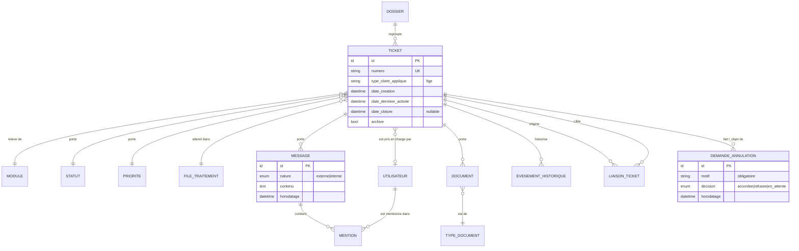
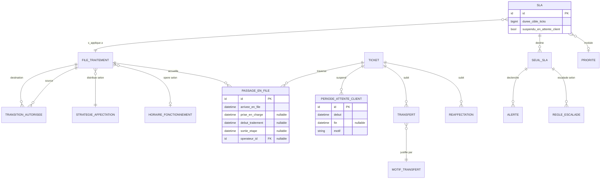
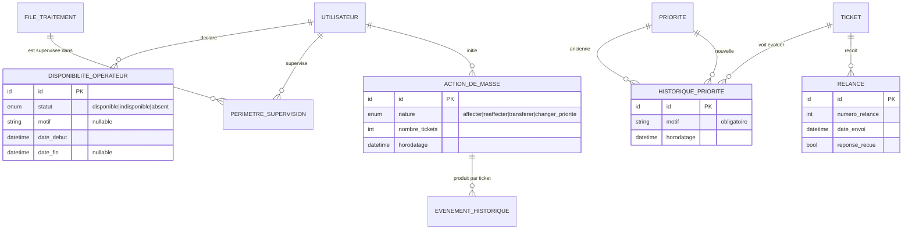
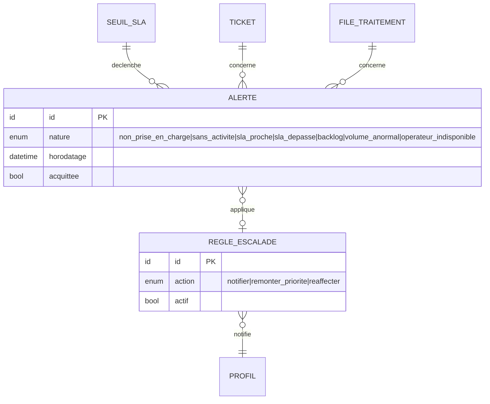
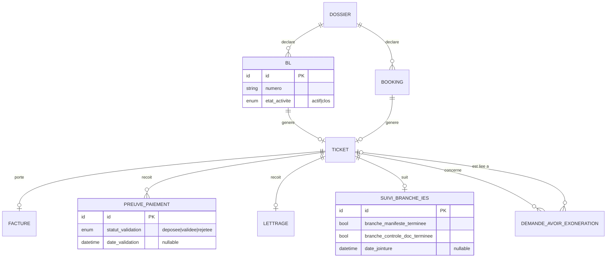
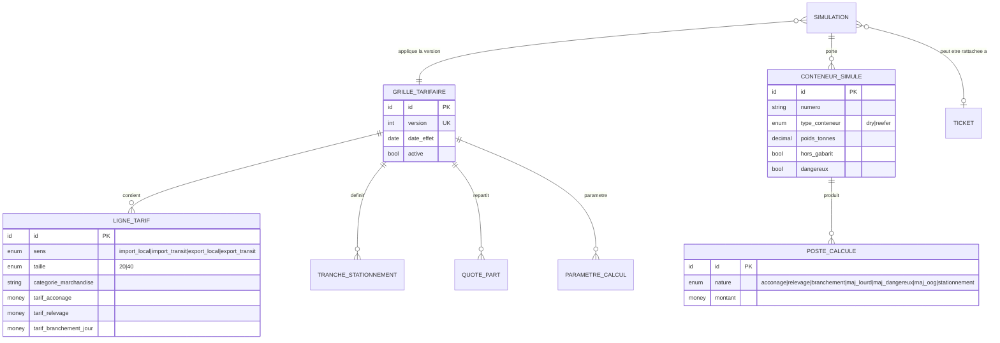
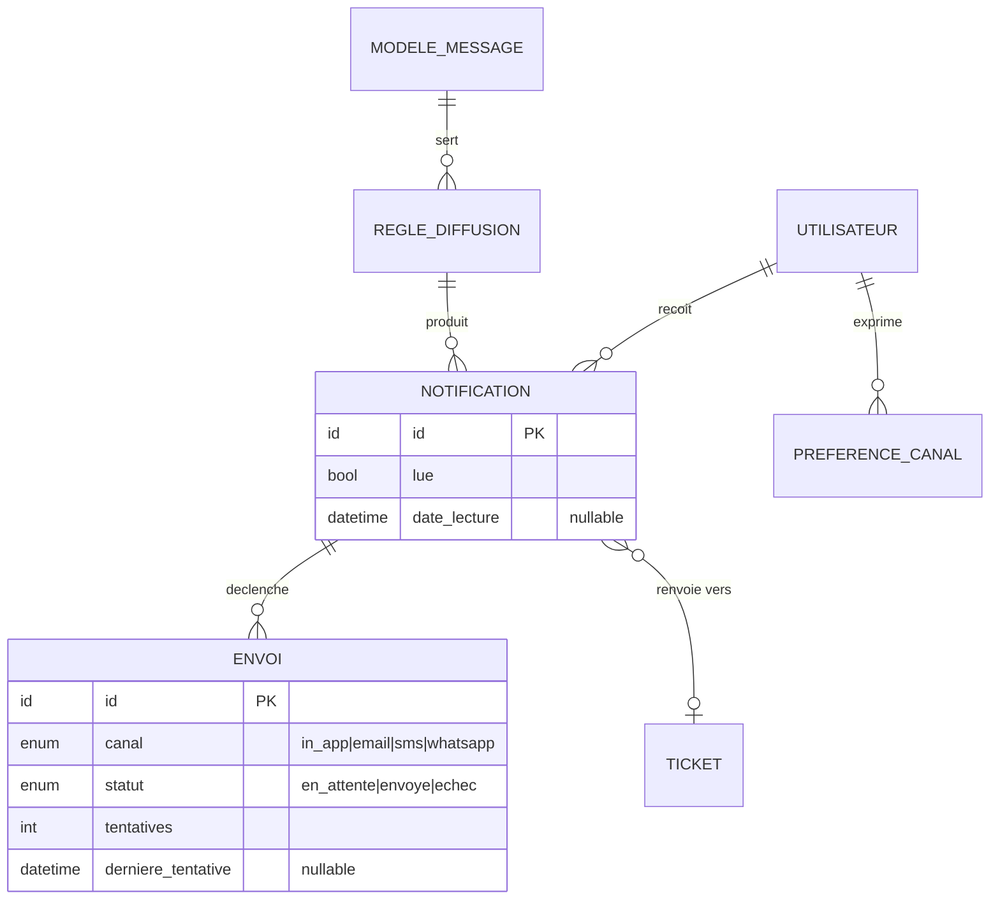
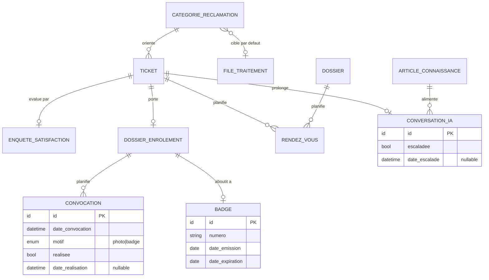
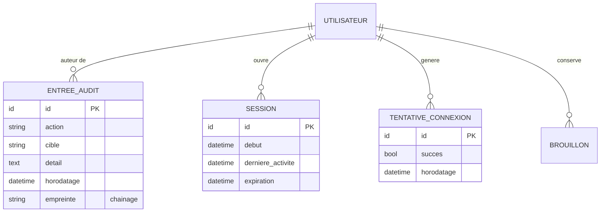

# Analyse MERISE — Plateforme Digitale CIT

> **Document** : `docs/85-analyse-merise.md`
> **Établi le** : 2026-09-03
> **Source unique** : `CDC_Plateforme_Digitale_CIT_v3` — CIT-CIV-DSI-RFP-XXXX, v1.0 du 12/08/2026
> **Méthode** : analyse **descendante**. Le modèle est déduit du cahier des charges, et **non**
> rétro-conçu depuis l'implémentation existante, qui n'a pas été consultée.
> **Couverture** : intégralité des sections §5 à §22 du CDC.

---

## 0. Cadre méthodologique

MERISE sépare deux axes et trois niveaux d'abstraction. Cette analyse les couvre ainsi :

| Niveau | Données | Traitements |
|:---|:---|:---|
| **Conceptuel** — *quoi* | **MCD** (§ 3) | **MCT** (§ 7) |
| **Organisationnel / logique** — *qui, où, quand* | **MLD** (§ 5) | **MOT** (§ 8) |
| **Physique** — *comment* | **MPD** (§ 6) | hors périmètre demandé |

La **normalisation en 3FN** (§ 4) est un contrôle appliqué entre MCD et MLD.

Toutes les règles et entités portent une **référence CDC**. Là où le CDC est muet, le point est
marqué `À VALIDER` — aucune valeur n'est inventée.

### Couverture du CDC

| Section CDC | Traitée en |
|:---|:---|
| §5 Périmètre · §6 Profils | RG § 1.1, MOT § 8.1 |
| §8 Socle tickets · §8.1 Cycle de vie · §8.2 Échanges | RG § 1.2, § 1.3, § 1.5 |
| §9.1–9.7 Workflow, files, temps, SLA | RG § 1.4, MCD § 3.3 |
| §9.8–9.14 Supervision, disponibilité, affectation, priorités, masse | RG § 1.5, MCD § 3.4 |
| §10 Comptes · §10.1 Compte entreprise | RG § 1.1, MCD § 3.1 |
| §11 Billing Office (import, export, statuts, simulation, avoir) | RG § 1.7 à § 1.9, MCD § 3.6, § 3.7 |
| §12 Customer Complaint · §13 Enrôlement | RG § 1.10, MCD § 3.9 |
| §14 Notifications · §15 Continuité | RG § 1.10, MCD § 3.8, § 3.9 |
| §16 Assistant IA | RG § 1.11, MCD § 3.9 |
| §18 Sécurité · §19 NFR | RG § 1.12, MPD § 6.5 |
| §20 Modèle de données minimal | Contrôle de couverture § 2.2 |
| §21 Erreurs et continuité | RG § 1.10, MCT § 7.9 |

---

## 1. Règles de gestion

**112 règles**, chacune tracée. Trois familles : **structure** (S), **action** (A), **calcul** (C).

### 1.1 Comptes, sociétés et habilitations

| RG | F | Règle | CDC |
|:---|:-:|:---|:---|
| **RG-01** | S | Une société cliente possède exactement **un** type parmi : normal, en compte, deposit, IES. | CPT-02 |
| **RG-02** | S | Le type de la société **détermine le workflow** applicable à ses tickets Billing Office. | CPT-02 |
| **RG-03** | S | Une société rattache **1 à N** utilisateurs. Un utilisateur client est rattaché à **une seule** société. | ENT-01, CPT-05 |
| **RG-04** | A | Un compte client n'est **activable qu'après validation par CIT**. Informations et justificatifs exigés sont paramétrables. | CPT-01 |
| **RG-05** | S | Chaque rattachement porte un **périmètre de consultation** : ses propres demandes, ou toutes celles de la société. | ENT-03 |
| **RG-06** | A | Un administrateur de société active/désactive ses collaborateurs et fixe leurs droits de consultation et de soumission. | ENT-02 |
| **RG-07** | A | Un changement de type de client est tracé et **sans effet rétroactif** sur les tickets en cours. | CPT-06 |
| **RG-08** | S | Un transporteur / chauffeur est un utilisateur **sans société rattachée**. | §6, ENR-01 |
| **RG-09** | S | Chaque profil n'accède qu'aux files, tickets, champs et actions de son rôle — **moindre privilège**. | §6, SEC-02 |
| **RG-10** | A | Les actions des administrateurs de société sont journalisées. | ENT-04 |
| **RG-11** | S | Un client n'accède qu'à ses propres tickets, documents et échanges. | CPT-04, SEC-03 |

### 1.2 Ticket et dossier

| RG | F | Règle | CDC |
|:---|:-:|:---|:---|
| **RG-12** | S | Toute demande génère **un ticket** portant un **numéro unique**, communiqué au client. | SOC-01 |
| **RG-13** | S | Le ticket centralise documents, statut, historique horodaté, échanges, décisions, motifs de rejet et documents produits. | SOC-02 |
| **RG-14** | S | Chaque ticket suit un workflow propre à son module et, pour le Billing Office, au type de client. | SOC-03 |
| **RG-15** | S | Les tickets d'une même soumission sont regroupés sous **un dossier** au numéro unique. Un dossier contient **1 à N** tickets ; un ticket appartient à **au plus un** dossier. | SOC-11 |
| **RG-16** | S | Une soumission import comporte **1 à 5 BL** et génère **un ticket par BL**, totalement indépendant. | IMP-01, IMP-02 |
| **RG-17** | S | Un ticket est à tout instant dans **une seule** file et sous **au plus un** opérateur. | SOC-04, PEC-02 |
| **RG-18** | S | Un ticket peut être **lié** à d'autres tickets, y compris d'un autre module. | SOC-10 |
| **RG-19** | A | Un ticket clôturé est **archivé** et reste consultable — historique, documents, échanges — par le client et les agents habilités. | SOC-09 |
| **RG-20** | A | Un ticket rouvert **conserve** numéro, historique, documents et échanges. | CYC-06 |
| **RG-21** | S | Les statuts sont un **référentiel paramétrable** ; certains sont sans objet selon la branche. | §11.4, §9.10 |

### 1.3 Messages et documents

| RG | F | Règle | CDC |
|:---|:-:|:---|:---|
| **RG-22** | S | Un message est de nature **externe** (client + agents) ou **interne** (agents CIT seuls). Une note interne n'est **jamais** visible du client. | MSG-01, MSG-02 |
| **RG-23** | S | Les deux natures sont **visuellement très distinctes**, horodatées et historisées. | MSG-03 |
| **RG-24** | A | Une mention d'un collaborateur déclenche une notification ; elle **n'entraîne pas de réaffectation**. | MSG-04, MSG-05 |
| **RG-25** | S | Un document est rattaché à **un** ticket, porte un **type paramétrable**, une **version**, un auteur et un horodatage. | SOC-07, §20 |
| **RG-26** | S | Les types de pièces exigées sont paramétrables **par étape**. | SOC-07, §9.10 |
| **RG-27** | A | Tout document déposé est vérifié à l'upload : intégrité, type, taille, **analyse antivirale**. | ERR-03, SEC-07 |
| **RG-28** | S | Le fil d'échange du ticket est **le canal de référence** entre client et agent. | COM-04 |

### 1.4 Workflow, files, temps et SLA

| RG | F | Règle | CDC |
|:---|:-:|:---|:---|
| **RG-29** | A | La plateforme applique **automatiquement** le workflow correspondant au module, au type de demande et au profil du client. | WKF-01 |
| **RG-30** | A | Les utilisateurs habilités peuvent **déroger** au circuit nominal par transfert ou réaffectation. | WKF-02 |
| **RG-31** | S | Les transferts autorisés entre files sont définis par une **matrice paramétrable**, éventuellement dépendante du rôle. Aucun circuit n'est codé en dur. | TRF-06, §9.4 |
| **RG-32** | S | Un ticket entrant dans une file est **en attente de prise en charge** tant qu'aucun opérateur ne l'a accepté. | PEC-01 |
| **RG-33** | S | Pour chaque passage en file : arrivée, prise en charge, opérateur, début de traitement, dernière activité. | PEC-03, SOC-12 |
| **RG-34** | C | Le **délai de prise en charge** = arrivée en file → acceptation. | PEC-04 |
| **RG-35** | C | Chaque étape mesure un **temps d'attente** (arrivée → prise en charge) et un **temps de traitement** (prise en charge → sortie). | TPS-01 |
| **RG-36** | C | Le **temps d'attente client** est mesuré séparément. | TPS-02 |
| **RG-37** | C | Trois durées sont distinguées : **temps interne**, **attente client**, **temps total** du parcours. | TPS-03 |
| **RG-38** | C | Le temps d'attente client **n'est imputé ni à l'opérateur ni à la file**. | TPS-04 |
| **RG-39** | S | L'historique restitue la **chronologie détaillée par étape**. | TPS-05 |
| **RG-40** | S | Un SLA est défini au minimum par : module, type de demande, étape, file, priorité, et éventuellement catégorie de client. | SLA-01 |
| **RG-41** | S | Un SLA porte **plusieurs seuils** : information, alerte, dépassement, escalade. | SLA-02 |
| **RG-42** | A | Un SLA peut être **suspendu ou adapté** pendant un état d'attente client. | SLA-03, TPS-04 |
| **RG-43** | C | Les **horaires de fonctionnement** peuvent entrer dans le calcul des SLA. Un dépôt hors heures ouvrées démarre le SLA selon les règles de la file. | SLA-04, NFR-11 |
| **RG-44** | A | Tout transfert ou réaffectation exige un **motif obligatoire** et est tracé dans l'historique et le journal d'audit. | TRF-03, WKF-03 |
| **RG-45** | S | Lors d'un transfert, le ticket **conserve** numéro, dossier, statut, historique, documents, commentaires et informations collectées. | TRF-02 |
| **RG-46** | A | Le client est **automatiquement notifié** d'une réorientation ayant un impact sur son parcours. | TRF-05 |
| **RG-47** | S | **Transfert de file** et **réaffectation entre opérateurs** sont deux mécanismes distincts. La réaffectation n'est pas réservée au superviseur. | TRF-01, TRF-04 |

### 1.5 Supervision, disponibilité, affectation, priorité

| RG | F | Règle | CDC |
|:---|:-:|:---|:---|
| **RG-48** | S | Le superviseur dispose d'une vue temps réel **de son périmètre** : par état de ticket, par file, par opérateur. | SUP-01 à SUP-03 |
| **RG-49** | S | La supervision porte sur l'**activité opérationnelle**, dans une finalité de **pilotage et non de contrôle individuel**. | §9.8 |
| **RG-50** | A | Le superviseur peut affecter, réaffecter, transférer, équilibrer la charge, intervenir sur un ticket bloqué, rechercher et consulter l'historique complet. | SUP-04 |
| **RG-51** | S | Un opérateur porte un statut de disponibilité — minimum : Disponible, Indisponible, Absent. | DIS-01 |
| **RG-52** | A | Un opérateur **indisponible ou absent ne reçoit pas de nouvelle affectation automatique**. | DIS-01 |
| **RG-53** | A | Le superviseur peut modifier la disponibilité, identifier les tickets d'un absent, les **réaffecter en masse**, consulter sa charge restante. | DIS-02 |
| **RG-54** | A | Les changements de disponibilité sont **tracés**. | DIS-03 |
| **RG-55** | S | Le **mode d'affectation est paramétrable par file** : prise libre, affectation manuelle, round-robin, charge, disponibilité, compétence. | AFF-01 à AFF-07 |
| **RG-56** | A | Le changement de stratégie d'affectation d'une file se fait **sans développement**. | AFF-07 |
| **RG-57** | S | Chaque ticket porte une **priorité** issue d'un référentiel paramétrable. | PRI-01 |
| **RG-58** | A | La priorité peut être attribuée **automatiquement** selon des règles métier ou modifiée par un utilisateur habilité. | PRI-01 |
| **RG-59** | C | La priorité influence l'ordre en file, le SLA applicable, les alertes et l'escalade. | PRI-02 |
| **RG-60** | A | Toute modification manuelle de priorité enregistre **ancienne et nouvelle valeur, auteur, date/heure et motif**. | PRI-03 |
| **RG-61** | A | Le client **ne peut pas** déclarer librement sa demande urgente ou critique. | PRI-04 |
| **RG-62** | A | Une action de masse est **tracée ticket par ticket** dans l'historique et le journal d'audit. | MAS-02 |

### 1.6 Alertes et escalades

| RG | F | Règle | CDC |
|:---|:-:|:---|:---|
| **RG-63** | A | Des alertes sont générées sur : non-prise en charge, absence d'activité, SLA proche, SLA dépassé, backlog de file, volume anormal, tickets affectés à un opérateur indisponible. | ALE-01 |
| **RG-64** | S | Règles, seuils, destinataires et canaux d'alerte sont **paramétrables sans développement**. | ALE-02 |
| **RG-65** | A | Le dépassement d'un SLA peut déclencher une **escalade** : notification, remontée de priorité, réaffectation. | ALE-03 |

### 1.7 Cycle de vie du ticket

| RG | F | Règle | CDC |
|:---|:-:|:---|:---|
| **RG-66** | A | Le client peut annuler librement **tant qu'aucun traitement engageant ni document officiel** n'a été produit. Le seuil est **paramétrable par workflow**. | CYC-01 |
| **RG-67** | A | Au-delà de ce seuil, le client **soumet une demande d'annulation** transmise pour décision. | CYC-02 |
| **RG-68** | A | Toute annulation ou demande d'annulation est **motivée, horodatée et historisée**. | CYC-03 |
| **RG-69** | A | Après relances sans réponse, le système émet une **suggestion de clôture**. **Aucune clôture automatique** — la décision reste humaine. | CYC-04 |
| **RG-70** | A | La suggestion n'est **jamais** émise sur un ticket ayant atteint un **état engageant**. | CYC-05 |
| **RG-71** | A | Le client **ne peut pas** rouvrir un ticket ; il peut le demander ou créer une nouvelle demande. | CYC-07 |
| **RG-72** | A | Tout rejet exige un **motif obligatoire**. | SOC-06 |
| **RG-73** | A | Les actions de workflow standard sont : valider, rejeter avec motif, demander un complément. | SOC-06 |

### 1.8 Unicité Billing Office

| RG | F | Règle | CDC |
|:---|:-:|:---|:---|
| **RG-74** | A | À la création d'un ticket import, il ne doit exister **aucun ticket actif** pour le même numéro de BL. | UNI-01 |
| **RG-75** | S | Le contrôle porte sur les tickets **actifs uniquement**. Un BL dont les tickets sont clôturés ou annulés redevient disponible. | UNI-01, UNI-02 |
| **RG-76** | A | Le contrôle porte sur **chaque BL individuellement** et **n'interdit pas** le même BL dans un autre module. | UNI-03 |
| **RG-77** | — | Une règle équivalente sur le booking export est **différée** à validation métier. | UNI-04 — `À VALIDER` |

### 1.9 Orientation par type de client

| RG | F | Règle | CDC |
|:---|:-:|:---|:---|
| **RG-78** | A | Client **normal** : facture → paiement client → validation de la preuve → contrôle documentaire → clôture. | IMP-10 à IMP-14 |
| **RG-79** | A | Client **en compte** : après facture, **pas de paiement dans le portail** → contrôle documentaire directement. | IMP-21, IMP-22 |
| **RG-80** | A | Client **deposit** : après facture → **lettrage** comptabilité → contrôle documentaire. | IMP-31, IMP-32 |
| **RG-81** | A | Client **IES** : traitement **parallèle** Manifeste + Contrôle documentaire dès la création ; retour au client **à la jointure seulement**. | IMP-40, IMP-41 |
| **RG-82** | A | Le client IES **finalise sur la plateforme IES** ; le ticket portail est clôturé à la remise des documents. | IMP-42 |
| **RG-83** | A | Le paiement suit : *En attente paiement → En attente validation paiement → Payé confirmé*. La validation est le fait d'un rôle habilité. | IMP-13, §11.4 |
| **RG-84** | A | **Export** : l'objet est le **booking**, le contrôle initial est le Back Office, le document final est le **BEE**. | EXP-01 à EXP-03 |
| **RG-85** | A | Export : le Pilote Facturation crée le **Draft IN** avant l'édition de la facture. | EXP-03 |
| **RG-86** | A | Export IES : facture et BEE sont générés **côté plateforme IES** après traitement parallèle. | EXP-04 |
| **RG-87** | A | **Alternative présentielle** : à l'issue du contrôle BL, le client peut basculer en présentiel ; le ticket en porte la trace. | IMP-15 |

### 1.10 Simulation de proforma

| RG | F | Règle | CDC |
|:---|:-:|:---|:---|
| **RG-88** | C | Le tarif est déterminé par la clé **Sens + Taille + Catégorie de marchandise**. | SIM-03 |
| **RG-89** | C | La **durée de séjour** est déduite de la date d'arrivée du navire et de la date prévisionnelle d'enlèvement. | SIM-04 |
| **RG-90** | C | **Branchement frigorifique** — Reefer uniquement : tarif journalier × (durée − franchise). | §11.5 |
| **RG-91** | C | **Majoration lourd** : pourcentage de l'acconage, au-delà d'un seuil de poids **fonction de la taille**, quelle que soit la catégorie. | §11.5 |
| **RG-92** | C | **Majorations dangereux et hors gabarit** : pourcentages de l'acconage, **cumulables**. | §11.5 |
| **RG-93** | C | **Stationnement** : calculé par **tranches** de durée hors franchise, chaque tranche à son tarif journalier. | §11.5 |
| **RG-94** | C | Le stationnement est **réparti entre bénéficiaires** selon des quotes-parts paramétrables. | §11.5 |
| **RG-95** | S | Les grilles sont **versionnées avec date d'effet** ; une simulation **référence la version appliquée** ; l'historique est conservé. | SIM-07 |
| **RG-96** | A | La proforma est **indicative** et n'engage pas CIT — mention légale obligatoire. | SIM-05 |
| **RG-97** | A | **Tous** les paramètres de calcul sont administrables sans développement. | SIM-06 |
| **RG-98** | A | Une simulation peut être **enregistrée** et **rattachée ultérieurement** à un ticket. | SIM-08 |

**Les valeurs par défaut du CDC** — franchise 2 j, majorations 30 / 50 / 50 %, seuils 15 t et 26 t,
franchises 11 j et 21 j, quotes-parts 30 / 20 / 50 — sont un **paramétrage initial** (Annexe A), non
des constantes du modèle.

### 1.11 Réclamations, enrôlement, avoirs, rendez-vous, IA

| RG | F | Règle | CDC |
|:---|:-:|:---|:---|
| **RG-99** | S | Les catégories de réclamation sont **paramétrables et dynamiques**. | REC-02 |
| **RG-100** | A | Une **règle d'orientation par catégorie** dirige le ticket vers la file ou le service destinataire. | REC-05 |
| **RG-101** | A | La clôture d'une réclamation comporte une **réponse formalisée** conservée dans le ticket. | REC-04 |
| **RG-102** | A | L'enrôlement trace la **convocation** et la **réalisation** des étapes présentielles. | ENR-03 |
| **RG-103** | A | Le déplacement physique n'est requis **que** pour la photo et la remise du badge. | ENR-03 |
| **RG-104** | A | Une demande d'avoir ou d'exonération suit **son propre workflow**, avec étapes et intervenants paramétrables, et peut être **liée** au ticket de parcours concerné. | AVE-02, AVE-04 |
| **RG-105** | A | La décision — accord ou rejet motivé — et ses documents sont déposés dans le ticket et notifiés. | AVE-03 |
| **RG-106** | S | Un rendez-vous est **rattaché au ticket ou au dossier**. La file d'attente physique reste un **système distinct**. | CON-03, CON-04 |
| **RG-107** | A | L'assistant IA **escalade vers un opérateur humain sans perte de contexte** : le fil est conservé dans le ticket. | IA-03, IA-06 |
| **RG-108** | A | Le client peut **demander explicitement** une intervention humaine. | IA-07 |

### 1.12 Sécurité, traçabilité, continuité

| RG | F | Règle | CDC |
|:---|:-:|:---|:---|
| **RG-109** | A | Le journal d'audit est **complet et non modifiable** : toute action est tracée avec auteur, date/heure et détail. | SOC-13, SEC-05 |
| **RG-110** | A | Aucune donnée saisie n'est perdue en cas d'incident : **brouillon ou reprise de saisie**. | ERR-01 |
| **RG-111** | A | En cas d'échec d'envoi : **nouvelle tentative** et traçage. **L'échec d'un canal n'empêche pas les autres.** | ERR-02 |
| **RG-112** | A | **Aucun lien** transmis par e-mail, SMS ou WhatsApp ne donne accès direct à un document : le lien conduit au ticket **après authentification**. | SEC-12 |
| **RG-113** | A | Les sessions expirent après une **inactivité paramétrable**. | SEC-10 |
| **RG-114** | A | Un compte agent peut être **désactivé immédiatement, sans suppression de son historique**. | SEC-11 |
| **RG-115** | A | Les données personnelles respectent **minimisation, durées de conservation et droits des personnes** (ARTCI). | SEC-06 |
| **RG-116** | A | Le numéro de ticket permet de reprendre un dossier au guichet **sans ressaisie**. | CON-01, CON-02 |

---

## 2. Inventaire des entités

### 2.1 Les 62 entités

| Domaine | Entités |
|:---|:---|
| **Comptes** (8) | SOCIETE_CLIENTE, UTILISATEUR, RATTACHEMENT, PROFIL, HABILITATION, PIECE_EXIGEE, JUSTIFICATIF, COMPETENCE_OPERATEUR |
| **Socle ticket** (11) | DOSSIER, TICKET, STATUT, MODULE, LIAISON_TICKET, MESSAGE, MENTION, DOCUMENT, TYPE_DOCUMENT, EVENEMENT_HISTORIQUE, BROUILLON |
| **Workflow** (10) | FILE_TRAITEMENT, TRANSITION_AUTORISEE, PASSAGE_EN_FILE, TRANSFERT, REAFFECTATION, PERIODE_ATTENTE_CLIENT, MOTIF_TRANSFERT, STRATEGIE_AFFECTATION, HORAIRE_FONCTIONNEMENT, DEMANDE_ANNULATION |
| **Supervision** (6) | PRIORITE, HISTORIQUE_PRIORITE, DISPONIBILITE_OPERATEUR, PERIMETRE_SUPERVISION, ACTION_DE_MASSE, RELANCE |
| **SLA** (4) | SLA, SEUIL_SLA, ALERTE, REGLE_ESCALADE |
| **Billing Office** (7) | BL, BOOKING, FACTURE, PREUVE_PAIEMENT, LETTRAGE, SUIVI_BRANCHE_IES, DEMANDE_AVOIR_EXONERATION |
| **Tarification** (8) | GRILLE_TARIFAIRE, LIGNE_TARIF, TRANCHE_STATIONNEMENT, QUOTE_PART, PARAMETRE_CALCUL, SIMULATION, CONTENEUR_SIMULE, POSTE_CALCULE |
| **Notifications** (5) | NOTIFICATION, MODELE_MESSAGE, REGLE_DIFFUSION, ENVOI, PREFERENCE_CANAL |
| **Périphérie** (8) | CATEGORIE_RECLAMATION, ENQUETE_SATISFACTION, DOSSIER_ENROLEMENT, CONVOCATION, BADGE, RENDEZ_VOUS, CONVERSATION_IA, ARTICLE_CONNAISSANCE |
| **Sécurité** (3) | ENTREE_AUDIT, SESSION, TENTATIVE_CONNEXION |

### 2.2 Contrôle de couverture du §20

Le CDC énumère les objets à modéliser **au minimum**. Vérification exhaustive :

| Objet exigé §20 | Entité(s) | ✓ |
|:---|:---|:-:|
| Compte client (type, utilisateurs rattachés) | SOCIETE_CLIENTE, RATTACHEMENT | ✓ |
| Compte transporteur / chauffeur | UTILISATEUR (nature *transporteur*) | ✓ |
| Dossier | DOSSIER | ✓ |
| Ticket (module, workflow, statut, priorité, file, agent, dossier, liens, horodatages) | TICKET, PASSAGE_EN_FILE, LIAISON_TICKET | ✓ |
| File (rôles, opérateurs, SLA, seuils, priorités, transitions) | FILE_TRAITEMENT, HABILITATION, SLA, TRANSITION_AUTORISEE | ✓ |
| Transfert / réaffectation | TRANSFERT, REAFFECTATION | ✓ |
| Mesure de temps | PASSAGE_EN_FILE, PERIODE_ATTENTE_CLIENT | ✓ |
| Document (type, version, auteur, horodatage, rattachement) | DOCUMENT, TYPE_DOCUMENT | ✓ |
| Échange / commentaire | MESSAGE, MENTION | ✓ |
| Événement d'historique et entrée d'audit | EVENEMENT_HISTORIQUE, ENTREE_AUDIT | ✓ |
| Notification (canal, modèle, destinataire, statut) | NOTIFICATION, ENVOI, MODELE_MESSAGE | ✓ |
| Files et transitions | FILE_TRAITEMENT, TRANSITION_AUTORISEE | ✓ |
| Règles d'affectation | STRATEGIE_AFFECTATION, COMPETENCE_OPERATEUR | ✓ |
| Priorités | PRIORITE, HISTORIQUE_PRIORITE | ✓ |
| SLA et seuils d'alerte | SLA, SEUIL_SLA | ✓ |
| Escalades | REGLE_ESCALADE | ✓ |
| Motifs de transfert | MOTIF_TRANSFERT | ✓ |
| Horaires de fonctionnement | HORAIRE_FONCTIONNEMENT | ✓ |
| Catégories de réclamation | CATEGORIE_RECLAMATION | ✓ |
| Pièces exigées par étape | PIECE_EXIGEE, TYPE_DOCUMENT | ✓ |
| Statuts / libellés | STATUT | ✓ |
| Modèles de messages | MODELE_MESSAGE | ✓ |
| Rôles et habilitations | PROFIL, HABILITATION | ✓ |
| Grilles de simulation | GRILLE_TARIFAIRE et suivantes | ✓ |

**24 / 24 objets couverts.**

---

## 3. MCD

### 3.1 Comptes et habilitations



| Association | Cardinalités | RG |
|:---|:---|:---|
| SOCIETE_CLIENTE — RATTACHEMENT | 1,N — 1,1 | RG-03 |
| UTILISATEUR — RATTACHEMENT | **0,N** — 1,1 | RG-03, RG-08 |
| UTILISATEUR — HABILITATION | 0,N — 1,1 | RG-09 |
| HABILITATION — FILE_TRAITEMENT | 0,1 | Permission bornée à une file |

**Le `0,N` côté UTILISATEUR porte RG-08.** Un transporteur est un utilisateur sans rattachement.
Imposer `1,N` rendrait l'enrôlement d'une personne physique impossible.

**RATTACHEMENT est une entité, non une simple association** : elle porte périmètre, droits et état,
exigés par RG-05 et RG-06.

### 3.2 Socle ticket



| Association | Cardinalités | RG |
|:---|:---|:---|
| DOSSIER — TICKET | 1,N — **0,1** | RG-15 |
| TICKET — FILE_TRAITEMENT | 0,N — 1,1 | RG-17 |
| TICKET — UTILISATEUR (prise en charge) | 0,N — **0,1** | RG-17, RG-32 |
| TICKET — LIAISON_TICKET | réflexive N,N | RG-18 |

**Le `0,1` sur la prise en charge porte RG-32** : un ticket arrivé en file n'a pas encore
d'opérateur. Un `1,1` interdirait l'état « en attente de prise en charge » — l'état le plus fréquent
d'une file.

**Le `0,1` de TICKET vers DOSSIER** : SOC-11 regroupe les tickets d'une **même soumission**. Une
réclamation isolée ou un enrôlement n'ont pas de dossier.

### 3.3 Workflow, temps et SLA



**`PASSAGE_EN_FILE` est l'entité centrale de la mesure du temps.** Elle porte RG-33 et RG-35 : un
ticket traversant quatre files produit quatre occurrences, chacune avec son attente et son
traitement. Stocker ces horodatages **sur le ticket** rendrait RG-39 — la chronologie détaillée par
étape — impossible, puisqu'un second passage écraserait le premier.

**`PERIODE_ATTENTE_CLIENT` est séparée** pour la même raison, et parce que RG-38 exige de soustraire
ce temps de la performance opérateur. Un ticket peut connaître **plusieurs** attentes.

**`TRANSFERT` et `REAFFECTATION` sont deux entités distinctes** : RG-47 décrit deux mécanismes —
changement de file, changement d'opérateur. Les fusionner perdrait une distinction que la
supervision exploite.

### 3.4 Supervision, affectation et priorité



**`ACTION_DE_MASSE` produit un événement d'historique par ticket**, et c'est exactement ce
qu'exige RG-62. Sans cette entité, une redistribution de 25 tickets n'apparaîtrait que comme
25 événements sans lien entre eux — impossible de reconstituer l'intention.

**`HISTORIQUE_PRIORITE` conserve ancienne et nouvelle valeur** (RG-60). Une simple trace « priorité
modifiée » ne satisferait pas PRI-03.

**`PERIMETRE_SUPERVISION` matérialise « son périmètre »** de SUP-01 à SUP-03 : un superviseur ne
voit pas toutes les files.

### 3.5 Alertes et escalades



Les **sept natures d'alerte** sont celles d'ALE-01, énumérées et non extensibles sans paramétrage.

### 3.6 Billing Office



**`SUIVI_BRANCHE_IES` matérialise RG-81.** Le parallélisme IES n'est pas un statut : c'est un état à
**deux dimensions indépendantes** dont la jointure conditionne le retour au client. Un champ statut
unique ne peut pas représenter deux branches en cours simultanément.

**Le contrôle d'unicité RG-74 porte sur BL, pas sur TICKET** — contrainte exprimée au MPD § 6.4.

### 3.7 Tarification



**`SIMULATION → GRILLE_TARIFAIRE` porte RG-95** : la simulation référence la **version** appliquée.
Sans cette association, un changement de tarif rendrait irreproductible toute simulation antérieure
— et une proforma non reproductible n'est pas opposable, même à titre indicatif.

**`LIGNE_TARIF` a pour identifiant fonctionnel la clé RG-88** : *(grille, sens, taille, catégorie)*.

### 3.8 Notifications



**`ENVOI` est séparé de `NOTIFICATION`**, et c'est ce qui porte RG-111. Une notification diffusée
sur trois canaux produit **trois envois**, chacun avec son statut et son compteur. Les fusionner
rendrait « l'échec d'un canal n'empêche pas les autres » inexprimable.

### 3.9 Réclamation, enrôlement, rendez-vous, assistant



**`CONVERSATION_IA` est rattachée au ticket**, et c'est ce qui porte RG-107 : l'escalade vers un
humain se fait **sans perte de contexte** parce que le fil est déjà dans le ticket. Une conversation
stockée à part rendrait IA-03 impossible à satisfaire.

**`BADGE` porte une date d'expiration** (ENR-05) : sans elle, le rappel avant expiration n'a rien
sur quoi s'appuyer.

### 3.10 Sécurité et audit



**`ENTREE_AUDIT` porte une empreinte de chaînage** : RG-109 exige un journal **non modifiable**. Le
chaînage rend toute altération détectable — une contrainte d'insertion seule ne protège pas d'un
accès direct à la base.

---

## 4. Vérification 3FN

### 4.1 Première forme normale — atomicité

| Point à risque | Traitement | Sans quoi |
|:---|:---|:---|
| Dossier avec **1 à 5 BL** | Entité **BL** | `bl_1..bl_5` violerait la 1FN et interdirait RG-16 |
| Diffusion **multi-canal** | Entité **ENVOI** | Un attribut `canaux` multivalué casserait RG-111 |
| **Quotes-parts** de répartition | Entité **QUOTE_PART** | Le nombre de bénéficiaires est paramétrable (RG-97) |
| **Tranches** de stationnement | Entité **TRANCHE_STATIONNEMENT** | Les bornes sont paramétrables (RG-93) |
| **Compétences** d'un opérateur | Entité **COMPETENCE_OPERATEUR** | Nécessaire à l'affectation par compétence (RG-55) |
| **Horaires** de fonctionnement | Entité **HORAIRE_FONCTIONNEMENT** | Un horaire par jour de semaine (RG-43) |

**1FN respectée** sur les 62 entités.

### 4.2 Deuxième forme normale — dépendances partielles

Seules les entités à **identifiant composé** sont concernées.

| Entité | Identifiant fonctionnel | Attributs | Verdict |
|:---|:---|:---|:---|
| LIGNE_TARIF | *(grille, sens, taille, catégorie)* | tarifs acconage / relevage / branchement | Dépendent des **4** éléments — 2FN ✓ |
| POSTE_CALCULE | *(conteneur simulé, nature)* | montant, détail | Dépendent du couple entier — 2FN ✓ |
| TRANSITION_AUTORISEE | *(file source, file destination, profil)* | actif | Dépend des 3 — 2FN ✓ |
| HABILITATION | *(utilisateur, permission, file)* | — | Pas d'attribut non-clé — 2FN ✓ |
| PREFERENCE_CANAL | *(utilisateur, canal)* | actif | Dépend du couple — 2FN ✓ |
| QUOTE_PART | *(grille, bénéficiaire)* | pourcentage | Dépend du couple — 2FN ✓ |

**2FN respectée.**

### 4.3 Troisième forme normale — dépendances transitives

Cinq pièges écartés :

| Piège | Ce qu'il aurait produit | Traitement |
|:---|:---|:---|
| `type_client` sur le TICKET | `ticket → société → type` : transitive | Voir § 4.4 — dénormalisation **assumée** |
| Libellé de file sur le TICKET | `ticket → file → libellé` : transitive | Seule la clé de file est portée |
| Montant total sur SIMULATION | Calculable depuis POSTE_CALCULE : redondant | Total **calculé**, non stocké |
| Tarif appliqué sur CONTENEUR_SIMULE | `conteneur → grille → tarif` : transitive | Le tarif est atteint par la grille référencée |
| Nom de l'opérateur sur PASSAGE_EN_FILE | `passage → utilisateur → nom` : transitive | Seule la clé est portée |

### 4.4 Les deux dénormalisations assumées

**Elles ne sont pas des entorses par négligence : elles sont exigées par le CDC.**

**1 — `type_client_applique` sur TICKET (RG-07).** CPT-06 impose qu'un changement de type soit
**sans effet rétroactif sur les tickets en cours**. Or le type vit sur la société : un client passant
de *normal* à *en compte* verrait ses tickets changer de workflow — ce que le CDC interdit
explicitement.

C'est la distinction entre une **donnée de référence** (le type actuel de la société) et une
**donnée d'événement** (le type qui s'appliquait au moment de la demande). Elles ont des cycles de
vie différents : ce sont **deux faits différents**. La 3FN n'est pas violée — elle est correctement
appliquée à deux faits distincts.

**2 — `version de grille` sur SIMULATION (RG-95).** Même raisonnement : SIM-07 exige qu'une
simulation référence la version appliquée, et que l'historique soit conservé.

### 4.5 Verdict

**Le modèle est en 3FN**, avec deux dénormalisations documentées, chacune imposée par une exigence
explicite du CDC.

---

## 5. MLD

Notation : `__clé primaire__`, `#clé étrangère`, `?` nullable, `(U)` unicité.

### 5.1 Comptes

```
SOCIETE_CLIENTE (__id__, raison_sociale, type_client, etat, date_soumission,
                 date_validation?, #demandeur_id)
UTILISATEUR     (__id__, email (U), nom_affiche, nature, actif, date_creation)
RATTACHEMENT    (__id__, #utilisateur_id, #societe_id, est_administrateur,
                 perimetre_consultation, droit_soumission, actif, date_rattachement)
                 (U) (utilisateur_id, societe_id)
PROFIL          (__id__, code (U), libelle, actif)
HABILITATION    (__id__, #utilisateur_id, code_permission, #file_id?)
                 (U) (utilisateur_id, code_permission, file_id)
PIECE_EXIGEE    (__id__, code (U), libelle, obligatoire, #etape_id?, actif)
JUSTIFICATIF    (__id__, #societe_id, #piece_exigee_id, #document_id, date_depot)
COMPETENCE_OPERATEUR (__id__, #utilisateur_id, code_competence, niveau?)
                 (U) (utilisateur_id, code_competence)
```

### 5.2 Socle ticket

```
MODULE               (__id__, code (U), libelle)
STATUT               (__id__, code (U), libelle_fr, libelle_en, #module_id, ordre, engageant)
DOSSIER              (__id__, numero (U), #societe_id, date_creation, type_client_applique)
TICKET               (__id__, numero (U), #dossier_id?, #module_id, #statut_id,
                      #file_courante_id, #operateur_id?, #priorite_id, #societe_id?,
                      #auteur_id, type_client_applique, date_creation,
                      date_derniere_activite, date_cloture?, archive, version_concurrence)
LIAISON_TICKET       (__id__, #ticket_origine_id, #ticket_cible_id, nature, date_liaison)
                      (U) (ticket_origine_id, ticket_cible_id)
MESSAGE              (__id__, #ticket_id, #auteur_id, nature, contenu, horodatage)
MENTION              (__id__, #message_id, #utilisateur_mentionne_id, notifiee)
TYPE_DOCUMENT        (__id__, code (U), libelle, #etape_id?, actif)
DOCUMENT             (__id__, #ticket_id, #type_document_id, #depose_par_id, nom_fichier,
                      cle_stockage, version, taille_octets, horodatage, statut_antivirus)
EVENEMENT_HISTORIQUE (__id__, #ticket_id, #auteur_id?, #action_de_masse_id?, action,
                      detail, horodatage)
BROUILLON            (__id__, #utilisateur_id, cle_formulaire, contenu, date_maj)
                      (U) (utilisateur_id, cle_formulaire)
DEMANDE_ANNULATION   (__id__, #ticket_id, #demandeur_id, motif, decision, #decideur_id?,
                      date_demande, date_decision?)
```

### 5.3 Workflow

```
FILE_TRAITEMENT       (__id__, code (U), libelle, #module_id, #strategie_affectation_id,
                       #horaire_id?, actif)
STRATEGIE_AFFECTATION (__id__, code (U), libelle)
HORAIRE_FONCTIONNEMENT(__id__, libelle, jour_semaine, heure_debut, heure_fin)
TRANSITION_AUTORISEE  (__id__, #file_source_id, #file_destination_id, #profil_id?, actif)
                       (U) (file_source_id, file_destination_id, profil_id)
MOTIF_TRANSFERT       (__id__, code (U), libelle, actif)
PASSAGE_EN_FILE       (__id__, #ticket_id, #file_id, arrivee_en_file, prise_en_charge?,
                       debut_traitement?, sortie_etape?, #operateur_id?)
PERIODE_ATTENTE_CLIENT(__id__, #ticket_id, debut, fin?, motif)
TRANSFERT             (__id__, #ticket_id, #file_origine_id, #file_destination_id,
                       #auteur_id, #destinataire_id?, #motif_transfert_id, commentaire,
                       horodatage)
REAFFECTATION         (__id__, #ticket_id, #operateur_origine_id?, #operateur_destination_id,
                       #auteur_id, motif, horodatage)
RELANCE               (__id__, #ticket_id, numero_relance, date_envoi, reponse_recue)
```

### 5.4 Supervision et SLA

```
PRIORITE              (__id__, code (U), libelle, rang, actif)
HISTORIQUE_PRIORITE   (__id__, #ticket_id, #priorite_ancienne_id, #priorite_nouvelle_id,
                       #auteur_id, motif, horodatage)
DISPONIBILITE_OPERATEUR(__id__, #utilisateur_id, statut, motif?, date_debut, date_fin?)
PERIMETRE_SUPERVISION (__id__, #superviseur_id, #file_id)
                       (U) (superviseur_id, file_id)
ACTION_DE_MASSE       (__id__, #auteur_id, nature, nombre_tickets, horodatage)
SLA                   (__id__, #module_id, #file_id, #priorite_id?, type_demande?,
                       type_client?, duree_cible_ticks, suspendu_en_attente_client)
SEUIL_SLA             (__id__, #sla_id, nature, pourcentage)
                       (U) (sla_id, nature)
ALERTE                (__id__, #ticket_id?, #file_id?, #seuil_sla_id?, #operateur_id?,
                       nature, horodatage, acquittee, #acquittee_par_id?)
REGLE_ESCALADE        (__id__, #seuil_sla_id, action, #destinataire_profil_id, actif)
```

### 5.5 Billing Office

```
BL              (__id__, numero, #dossier_id, #ticket_id?, etat_activite)
BOOKING         (__id__, numero, #dossier_id, #ticket_id?, etat_activite)
FACTURE         (__id__, #ticket_id (U), #document_id, numero, montant, date_edition,
                 #editee_par_id)
PREUVE_PAIEMENT (__id__, #ticket_id, #document_id, date_depot, statut_validation,
                 #validee_par_id?, date_validation?, motif_rejet?)
LETTRAGE        (__id__, #ticket_id (U), reference_iris, date_confirmation, #confirme_par_id)
SUIVI_BRANCHE_IES(__id__, #ticket_id (U), branche_manifeste_terminee,
                 branche_controle_doc_terminee, date_jointure?)
DEMANDE_AVOIR_EXONERATION (__id__, #ticket_id (U), #ticket_lie_id?, nature, montant?,
                 decision?, motif_decision?, date_decision?, #decideur_id?)
```

### 5.6 Tarification

```
GRILLE_TARIFAIRE     (__id__, version (U), date_effet, active, #cree_par_id, date_creation)
LIGNE_TARIF          (__id__, #grille_id, sens, taille, categorie_marchandise,
                      tarif_acconage, tarif_relevage, tarif_branchement_jour)
                      (U) (grille_id, sens, taille, categorie_marchandise)
TRANCHE_STATIONNEMENT(__id__, #grille_id, borne_inf_jours, borne_sup_jours?, tarif_jour)
QUOTE_PART           (__id__, #grille_id, beneficiaire, pourcentage)
                      (U) (grille_id, beneficiaire)
PARAMETRE_CALCUL     (__id__, #grille_id, code, valeur)
                      (U) (grille_id, code)
SIMULATION           (__id__, numero (U), #grille_id, #utilisateur_id, #ticket_id?,
                      sens, date_arrivee_navire, date_enlevement_prevue, date_creation)
CONTENEUR_SIMULE     (__id__, #simulation_id, numero, taille, type_conteneur,
                      poids_tonnes, hors_gabarit, dangereux, categorie_marchandise)
POSTE_CALCULE        (__id__, #conteneur_simule_id, nature_poste, montant, detail_calcul)
                      (U) (conteneur_simule_id, nature_poste)
```

### 5.7 Notifications et périphérie

```
MODELE_MESSAGE   (__id__, code (U), canal, sujet, corps, actif)
REGLE_DIFFUSION  (__id__, evenement, canal, #modele_id, obligatoire, actif)
                  (U) (evenement, canal)
NOTIFICATION     (__id__, #destinataire_id, #ticket_id?, #regle_diffusion_id?, titre,
                  corps, lue, date_creation, date_lecture?)
ENVOI            (__id__, #notification_id, canal, statut, tentatives,
                  derniere_tentative?, motif_echec?)
PREFERENCE_CANAL (__id__, #utilisateur_id, canal, actif)
                  (U) (utilisateur_id, canal)
CATEGORIE_RECLAMATION (__id__, code (U), libelle, #file_cible_id?, actif)
ENQUETE_SATISFACTION  (__id__, #ticket_id (U), note, commentaire?, date_reponse)
DOSSIER_ENROLEMENT    (__id__, #ticket_id (U), #transporteur_id, etat, date_validation?)
CONVOCATION           (__id__, #dossier_enrolement_id, date_convocation, motif,
                       realisee, date_realisation?)
BADGE                 (__id__, #dossier_enrolement_id (U), numero (U), date_emission,
                       date_expiration)
RENDEZ_VOUS           (__id__, #ticket_id?, #dossier_id?, #client_id, date_rdv,
                       statut, date_constat?)
CONVERSATION_IA       (__id__, #ticket_id?, #utilisateur_id, escaladee, date_escalade?)
ARTICLE_CONNAISSANCE  (__id__, titre, contenu, source, actif)
```

### 5.8 Sécurité

```
ENTREE_AUDIT        (__id__, #auteur_id?, action, cible, detail, horodatage, empreinte)
SESSION             (__id__, #utilisateur_id, debut, derniere_activite, expiration, active)
TENTATIVE_CONNEXION (__id__, #utilisateur_id?, identifiant_saisi, succes, horodatage)
```

### 5.9 Associations porteuses

| Association conceptuelle *n,n* | Relation porteuse | Propriétés propres |
|:---|:---|:---|
| UTILISATEUR ↔ SOCIETE_CLIENTE | `RATTACHEMENT` | Périmètre, droits, état (RG-05) |
| TICKET ↔ TICKET | `LIAISON_TICKET` | Nature, date (RG-18) |
| FILE ↔ FILE | `TRANSITION_AUTORISEE` | Profil, actif (RG-31) |
| TICKET ↔ FILE | `PASSAGE_EN_FILE` | Quatre horodatages (RG-33) |
| UTILISATEUR ↔ PERMISSION | `HABILITATION` | Bornage par file (RG-09) |
| SUPERVISEUR ↔ FILE | `PERIMETRE_SUPERVISION` | — (RG-48) |
| UTILISATEUR ↔ CANAL | `PREFERENCE_CANAL` | Actif (COM-05) |
| GRILLE ↔ BÉNÉFICIAIRE | `QUOTE_PART` | Pourcentage (RG-94) |

**Huit associations porteuses**, chacune parce qu'elle porte des propriétés propres — jamais une
simple table de jonction.

---

## 6. MPD

Cible : **SQL Server**, cohérente avec l'architecture évoquée au CDC §23.

### 6.1 Conventions de types

| Élément | Type | Justification |
|:---|:---|:---|
| Clé primaire | `UNIQUEIDENTIFIER` | Génération applicative, pas de collision inter-environnements (SEC-09) |
| Horodatage | `DATETIME2(3)` **UTC** | RG-33 impose des mesures comparables ; le fuseau serait une source d'erreur |
| Montant | `DECIMAL(18,2)` | `FLOAT` proscrit sur des montants — arrondis non déterministes |
| Pourcentage | `DECIMAL(5,2)` | Quotes-parts et seuils SLA |
| Durée | `BIGINT` en ticks | Le type `TIME` plafonne à 24 h ; un SLA peut être plus long (RG-40) |
| Libellé paramétrable | `NVARCHAR(200)` | Bilinguisme NFR-07 |
| Contenu long | `NVARCHAR(MAX)` | Messages, détails d'audit |
| Booléen | `BIT` | — |
| Concurrence | `ROWVERSION` | Prise en charge concurrente (RG-32) |
| Clé de stockage document | `NVARCHAR(512)` | Référence, jamais le binaire |

**Les documents ne sont pas stockés en base** : la table porte une **clé de stockage**. SEC-04
impose la protection des documents stockés — un stockage hors base permet un chiffrement et une
sauvegarde propres (NFR-06), et évite de gonfler la base de binaires.

### 6.2 Numérotation

RG-12 et RG-15 exigent des numéros **uniques** de ticket et de dossier.

```sql
CREATE SEQUENCE seq_numero_ticket  AS BIGINT START WITH 1 INCREMENT BY 1;
CREATE SEQUENCE seq_numero_dossier AS BIGINT START WITH 1 INCREMENT BY 1;
```

Une séquence, non un `MAX(numero) + 1` : sous concurrence, le second produit des doublons. Le format
lisible — préfixe, année, rang — est composé à partir de la valeur de séquence.

### 6.3 Index

| Table | Index | Motif |
|:---|:---|:---|
| `TICKET` | `(file_courante_id, statut_id, priorite_id, date_creation)` | Écran de file — la requête la plus fréquente (SOC-04, RG-59) |
| `TICKET` | `numero` **unique** | RG-12, recherche guichet RG-116 |
| `TICKET` | `(societe_id, date_creation DESC)` | Espace client |
| `TICKET` | `(operateur_id, statut_id)` | Charge par opérateur (SUP-03) |
| `TICKET` | `date_derniere_activite` **filtré** sur non clos | Alerte « sans activité » (ALE-01) |
| `PASSAGE_EN_FILE` | `(ticket_id, arrivee_en_file)` | Chronologie RG-39 |
| `PASSAGE_EN_FILE` | `(file_id, prise_en_charge)` **filtré** sur NULL | Backlog non pris en charge (SUP-02) |
| `PERIODE_ATTENTE_CLIENT` | `(ticket_id, debut)` | Suspension SLA RG-42 |
| `NOTIFICATION` | `(destinataire_id, lue)` | Compteur de non-lues (NOT-03) |
| `ENVOI` | `(statut, derniere_tentative)` **filtré** sur échec | Reprise RG-111 |
| `LIGNE_TARIF` | `(grille_id, sens, taille, categorie)` **unique** | Clé RG-88 |
| `ENTREE_AUDIT` | `(horodatage DESC)` | Consultation chronologique |
| `EVENEMENT_HISTORIQUE` | `(ticket_id, horodatage)` | Historique du ticket |
| `BL` | `numero` **unique filtré** sur actif | RG-74 — voir § 6.4 |
| `SESSION` | `(utilisateur_id, active)` | Expiration RG-113 |

**Cinq index filtrés** : ils ne portent que sur les lignes utiles, ce qui compte sur des tables qui
grossissent indéfiniment.

### 6.4 Contraintes structurantes

**Unicité du BL actif — RG-74, RG-75.** La contrainte la plus délicate du modèle : l'unicité ne
porte **pas** sur tous les BL, mais seulement sur ceux dont le ticket est actif.

```sql
CREATE UNIQUE INDEX UX_BL_actif
    ON BL (numero)
    WHERE etat_activite = 'actif';
```

Un `UNIQUE` simple interdirait la nouvelle demande autorisée après clôture (RG-75) ; un contrôle
applicatif seul laisserait passer deux créations concurrentes.

**Journal d'audit non modifiable — RG-109.**

```sql
CREATE TRIGGER TR_JournalAudit_AppendOnly ON ENTREE_AUDIT
INSTEAD OF UPDATE, DELETE AS
BEGIN
    RAISERROR('Le journal d''audit est en ajout seul (SOC-13 / SEC-05).', 16, 1);
END;
```

Le chaînage par empreinte complète le dispositif : le déclencheur empêche la modification par
l'application, l'empreinte la rend **détectable** même par accès direct.

**Cohérence du parallélisme IES — RG-81.**

```sql
ALTER TABLE SUIVI_BRANCHE_IES ADD CONSTRAINT CK_Jointure_IES
    CHECK (date_jointure IS NULL
        OR (branche_manifeste_terminee = 1 AND branche_controle_doc_terminee = 1));
```

**Bornes de tranches de stationnement — RG-93.**

```sql
ALTER TABLE TRANCHE_STATIONNEMENT ADD CONSTRAINT CK_Bornes
    CHECK (borne_sup_jours IS NULL OR borne_sup_jours > borne_inf_jours);
```

**Séquence de paiement — RG-83.** L'ordre *En attente → En attente validation → Payé confirmé* est
une contrainte **de transition**, non d'état : elle relève de la matrice `TRANSITION_AUTORISEE` et du
moteur de workflow, pas d'un `CHECK`.

**Quotes-parts à 100 % — RG-94.** La somme des pourcentages d'une grille doit valoir 100. Une
contrainte de table ne peut pas l'exprimer — elle porte sur un agrégat. Le contrôle est
**applicatif, à la validation de la grille**, et documenté comme tel.

### 6.5 Sécurité et rétention

| Exigence | Traduction physique |
|:---|:---|
| SEC-04 — chiffrement au repos | Chiffrement transparent de la base ; documents chiffrés côté stockage |
| SEC-06 — durées de conservation ARTCI | Colonnes `date_cloture` et `archive` sur TICKET ; purge pilotée — **durées `À VALIDER`** |
| SEC-11 — désactivation immédiate sans perte d'historique | `UTILISATEUR.actif = 0` ; **aucune suppression** |
| SEC-12 — aucun lien direct vers un document | Les documents ne sont **pas** servis statiquement : accès via contrôle d'habilitation |
| NFR-06 — sauvegardes | Base **et** répertoire documentaire — deux jeux à sauvegarder ensemble |

**Suppression** : `ON DELETE NO ACTION` partout. Aucune cascade — un ticket archivé (RG-19) ne doit
jamais disparaître par effet de bord de la suppression d'un référentiel.

### 6.6 Volumétrie

`À VALIDER` — NFR-05 renvoie explicitement la volumétrie à la phase de cadrage. Sans elle, aucun
partitionnement ni dimensionnement n'est décidable. Les tables candidates au partitionnement le jour
où la volumétrie sera connue : `ENTREE_AUDIT`, `EVENEMENT_HISTORIQUE`, `PASSAGE_EN_FILE`, `ENVOI`.

---

## 7. MCT — modèle conceptuel des traitements

Le MCT décrit le **quoi**, indépendamment de qui l'exécute. Notation : événement → opération →
règle d'émission → résultat.

### 7.1 Création et validation d'un compte client

```
        [Demande de création de compte]
                    │
                    ▼
        ╔══════════════════════════════════════╗
        ║  OP-00  CONTRÔLER LA COMPLÉTUDE      ║
        ║  informations + justificatifs exigés ║  RG-04
        ╚══════════════════════════════════════╝
                    │
                    ▼
        ╔══════════════════════════════════════╗
        ║  OP-01  INSTRUIRE LA DEMANDE         ║
        ╚══════════════════════════════════════╝
                    │
        ┌───────────┴───────────┐
     validée                 rejetée
        │                       │
        ▼                       ▼
  Compte activé          Compte non activé
  + type figé  RG-01           + motif
```

**Règle d'émission** : le compte n'est **activable** qu'après validation (RG-04). Le type est fixé à
la création et détermine le workflow (RG-02).

### 7.2 Soumission d'une demande import

```
        [Client soumet le formulaire]
                    │
                    ▼
        ╔═══════════════════════════════════╗
        ║  OP-10  CONTRÔLER LA DEMANDE      ║
        ║  - complétude                     ║
        ║  - pièces exigées                 ║  RG-26
        ║  - antivirus des documents        ║  RG-27
        ║  - unicité de chaque BL           ║  RG-74
        ╚═══════════════════════════════════╝
                    │
        ┌───────────┴────────────┐
   (a) tous BL libres      (b) au moins un BL actif
        │                        │
        ▼                        ▼
  ╔═══════════════╗       « Demande en cours »
  ║ OP-11 CRÉER   ║        + accès au ticket existant
  ║ dossier +     ║          si droits  RG-74
  ║ 1 ticket / BL ║  RG-15, RG-16
  ╚═══════════════╝
        │
        ▼
  [Tickets créés]  →  OP-20
```

**Règle d'émission** : (a) n'est émis **que si tous** les BL sont libres. Le CDC ne prévoit pas de
création partielle.

### 7.3 Traitement en file

```
        [Ticket arrive en file]
                    │
                    ▼
        ╔══════════════════════════════════════╗
        ║  OP-20  METTRE EN ATTENTE            ║
        ║  horodater l'arrivée                 ║  RG-33
        ║  appliquer la stratégie de la file   ║  RG-55
        ╚══════════════════════════════════════╝
                    │
   [Opérateur accepte]   [Superviseur affecte]   [Distribution auto]
                    └──────────┬──────────┘
                               ▼
        ╔══════════════════════════════════════╗
        ║  OP-21  PRENDRE EN CHARGE            ║
        ║  affecter, horodater, clore l'attente║  RG-32, RG-34
        ╚══════════════════════════════════════╝
                               │
                               ▼
        ╔══════════════════════════════════════╗
        ║  OP-22  INSTRUIRE                    ║
        ╚══════════════════════════════════════╝
                               │
        ┌──────────┬───────────┼───────────┬──────────────┐
     Valider    Rejeter    Complément   Transférer    Réaffecter
        │      (motif       (attente       (motif        (motif
        │   obligatoire)     client)     obligatoire) obligatoire)
        │      RG-72          RG-36         RG-44         RG-44
        ▼        ▼              ▼             ▼             ▼
  Étape suiv.   Clos      Attente client  Autre file  Autre opérateur
  RG-78..82                                    │
                                          notifier si
                                          impact client  RG-46
```

**La distribution automatique n'affecte jamais un opérateur indisponible** (RG-52).

### 7.4 Orientation par type de client

```
        [Contrôle BL validé / Booking codifié]
                    │
                    ▼
        ╔══════════════════════════════════════════╗
        ║  OP-30  ORIENTER SELON LE TYPE           ║
        ║  lecture de type_client_applique (figé)  ║  RG-07
        ╚══════════════════════════════════════════╝
                    │
   ┌────────────┬───┴────────┬─────────────┐
 normal      en compte     deposit        IES
   │            │             │            │
   ▼            ▼             ▼            ▼
Facturation  Facturation  Facturation  (parallèle dès
   │            │             │         la création)
   ▼            ▼             ▼            │
Paiement    Contrôle doc. Lettrage         ▼
   │           RG-79          │        Jointure des
   ▼                          ▼        deux branches  RG-81
Validation                Contrôle doc.     │
paiement  RG-83              RG-80          ▼
   │                                   Retour client
   ▼                                   puis IES  RG-82
Contrôle doc.
   │
   ▼
Clôture + archivage  RG-19
```

**Le cas IES est le seul non séquentiel.** Sa règle d'émission est une **jointure** : le résultat
n'est émis que lorsque **les deux** branches sont terminées.

**Variante export** (RG-84 à RG-86) : l'objet est le booking, le contrôle initial est le Back
Office, le Draft IN précède la facture, le document final est le BEE.

### 7.5 Transfert et réaffectation

```
        [Opérateur constate une mauvaise orientation]
                    │
                    ▼
        ╔══════════════════════════════════════╗
        ║  OP-40  VÉRIFIER LA TRANSITION       ║
        ║  matrice file source → destination   ║  RG-31
        ║  + habilitation de l'auteur          ║
        ╚══════════════════════════════════════╝
                    │
        ┌───────────┴───────────┐
   autorisée               non autorisée
        │                       │
        ▼                       ▼
  ╔═══════════════════╗   Transfert refusé
  ║ OP-41 TRANSFÉRER  ║
  ║ motif obligatoire ║  RG-44
  ║ conserver numéro, ║
  ║ dossier, statut,  ║  RG-45
  ║ historique, docs  ║
  ╚═══════════════════╝
        │
        ├──► Notifier le client si impact  RG-46
        └──► Tracer historique + audit     RG-44
```

### 7.6 Relance et clôture pour absence de réponse

```
        [Délai de relance atteint]
                    │
                    ▼
        ╔════════════════════════════════════╗
        ║  OP-50  ÉVALUER LA RELANCE         ║
        ╚════════════════════════════════════╝
                    │
        ┌───────────┴────────────┐
   état engageant           état non engageant
        │                        │
        ▼                        ▼
   Aucune action          Émettre la relance
   RG-70                        │
                    ┌───────────┴───────────┐
              réponse client          relances épuisées
                    │                        │
                    ▼                        ▼
             Reprise du       ╔═══════════════════════════╗
             traitement       ║  OP-51  SUGGÉRER LA       ║
                              ║  CLÔTURE                  ║  RG-69
                              ╚═══════════════════════════╝
                                          │
                              [Agent habilité décide]
                                          │
                              ┌───────────┴──────────┐
                          Clôturer              Poursuivre
```

**RG-69 est la règle la plus importante de ce schéma** : le système **suggère**, il ne clôt pas. Le
CDC l'écrit deux fois. Un automatisme fermerait des dossiers réellement en cours.

### 7.7 Annulation

```
        [Client demande l'annulation]
                    │
                    ▼
        ╔════════════════════════════════════════════╗
        ║  OP-60  ÉVALUER LE SEUIL D'ANNULATION      ║
        ║  paramétrable par workflow                 ║  RG-66
        ╚════════════════════════════════════════════╝
                    │
        ┌───────────┴────────────┐
   avant le seuil          après le seuil
        │                        │
        ▼                        ▼
  Annulation directe    ╔══════════════════════════╗
  (motivée, tracée)     ║ OP-61 SOUMETTRE UNE      ║
  RG-68                 ║ DEMANDE D'ANNULATION     ║  RG-67
                        ╚══════════════════════════╝
                                    │
                        [File / responsable habilité décide]
                                    │
                        ┌───────────┴──────────┐
                    Accordée                Refusée
                       (motivée, tracée)  RG-68
```

### 7.8 SLA, alerte et escalade

```
        [Événement de workflow ou échéance]
                    │
                    ▼
        ╔══════════════════════════════════════════╗
        ║  OP-70  CALCULER LE TEMPS CONSOMMÉ       ║
        ║  hors périodes d'attente client          ║  RG-38, RG-42
        ║  selon horaires de fonctionnement        ║  RG-43
        ╚══════════════════════════════════════════╝
                    │
        ┌──────┬────┴────┬─────────┐
      < 50 %  ≥ 50 %   ≥ 80 %   ≥ 100 %
        │       │        │         │
        ▼       ▼        ▼         ▼
     Aucune  Alerte   Alerte    Alerte
             info    d'alerte   dépassement
                                    │
                                    ▼
                        ╔════════════════════════╗
                        ║ OP-71  ESCALADER       ║
                        ║ notifier / remonter la ║  RG-65
                        ║ priorité / réaffecter  ║
                        ╚════════════════════════╝
```

**Le calcul soustrait l'attente client** (RG-38). Sans cette soustraction, la mesure sanctionnerait
l'opérateur pour un délai imputable au client — ce que TPS-04 interdit explicitement.

### 7.9 Diffusion d'une notification

```
        [Événement de workflow]
                    │
                    ▼
        ╔═══════════════════════════════════════╗
        ║  OP-80  RÉSOUDRE LES DESTINATAIRES    ║
        ║  + canaux selon règle de diffusion    ║  RG-100 / NOT-02
        ║  + préférences client, hors           ║
        ║    notifications obligatoires         ║  COM-05
        ╚═══════════════════════════════════════╝
                    │
                    ▼
        ╔═══════════════════════════════════════╗
        ║  OP-81  CRÉER 1 NOTIFICATION          ║
        ║         + N ENVOIS (un par canal)     ║  RG-111
        ║  lien conduisant au TICKET, jamais    ║
        ║  à un document                        ║  RG-112
        ╚═══════════════════════════════════════╝
                    │
        ┌───────────┴───────────┐
     succès                  échec
        │                       │
        ▼                       ▼
   Envoi = envoyé      ╔══════════════════════╗
                       ║ OP-82  REPRENDRE     ║
                       ║ n'affecte pas les    ║  RG-111
                       ║ autres canaux        ║
                       ╚══════════════════════╝
```

### 7.10 Simulation de proforma

```
        [Client lance une simulation]
                    │
                    ▼
        ╔══════════════════════════════════════════════════╗
        ║  OP-90  RÉSOUDRE LA GRILLE EN VIGUEUR            ║  RG-95
        ╚══════════════════════════════════════════════════╝
                    │
                    ▼
        ╔══════════════════════════════════════════════════╗
        ║  OP-91  CALCULER LA DURÉE DE SÉJOUR              ║  RG-89
        ╚══════════════════════════════════════════════════╝
                    │
                    ▼   pour chaque conteneur
        ╔══════════════════════════════════════════════════╗
        ║  OP-92  CALCULER LES POSTES — ordre imposé       ║
        ║   1. acconage, relevage    ← clé RG-88           ║
        ║   2. branchement si Reefer ← RG-90               ║
        ║   3. majorations lourd/dang./OOG  ← RG-91, RG-92 ║
        ║      (pourcentages DE l'acconage)                ║
        ║   4. stationnement par tranches   ← RG-93        ║
        ║   5. répartition bénéficiaires    ← RG-94        ║
        ╚══════════════════════════════════════════════════╝
                    │
                    ▼
        ╔══════════════════════════════════════════════════╗
        ║  OP-93  TOTALISER + MENTION LÉGALE               ║  RG-96
        ╚══════════════════════════════════════════════════╝
```

**L'ordre est imposé par les règles elles-mêmes** : les majorations sont des pourcentages **de
l'acconage**, qui doit donc être calculé avant. Le stationnement est indépendant, mais sa
répartition suit son calcul.

### 7.11 Réclamation

```
        [Client crée une réclamation]
                    │
                    ▼
        ╔══════════════════════════════════════╗
        ║  OP-100  ORIENTER PAR CATÉGORIE      ║  RG-100
        ╚══════════════════════════════════════╝
                    │
                    ▼
        ╔══════════════════════════════════════╗
        ║  OP-101  INSTRUIRE                   ║
        ║  demander complément / joindre /     ║
        ║  échanger / orienter vers un service ║  REC-03
        ╚══════════════════════════════════════╝
                    │
                    ▼
        ╔══════════════════════════════════════╗
        ║  OP-102  CLÔTURER AVEC RÉPONSE       ║
        ║  réponse formalisée conservée        ║  RG-101
        ╚══════════════════════════════════════╝
                    │
                    ▼
              [Enquête de satisfaction]  REC-06
```

### 7.12 Enrôlement transporteur

```
        [Transporteur soumet son dossier]
                    │
                    ▼
        ╔══════════════════════════════════════╗
        ║  OP-110  ROUTER VERS LA GATE         ║  ENR-02
        ╚══════════════════════════════════════╝
                    │
                    ▼
        ╔══════════════════════════════════════╗
        ║  OP-111  VÉRIFIER LE DOSSIER         ║
        ╚══════════════════════════════════════╝
                    │
        ┌───────────┼───────────┐
    Complément   Rejeté      Validé
        │                       │
        ▼                       ▼
   Attente          ╔══════════════════════════╗
   transporteur     ║ OP-112  CONVOQUER        ║  RG-102
                    ║ photo puis badge         ║
                    ╚══════════════════════════╝
                                │
                                ▼
                    ╔══════════════════════════╗
                    ║ OP-113  CONSTATER LA     ║
                    ║ RÉALISATION              ║  RG-102
                    ╚══════════════════════════╝
                                │
                                ▼
                          Badge émis
                          + rappel avant expiration  ENR-05
```

### 7.13 Escalade de l'assistant IA

```
        [Client interroge l'assistant]
                    │
                    ▼
        ╔══════════════════════════════════════╗
        ║  OP-120  RÉPONDRE                    ║
        ║  base de connaissances               ║  IA-04
        ╚══════════════════════════════════════╝
                    │
        ┌───────────┴────────────┐
  situation traitable    intervention humaine
        │                requise ou demandée
        ▼                        │
   Réponse rendue                ▼
                    ╔══════════════════════════════╗
                    ║ OP-121  ESCALADER            ║
                    ║ SANS PERTE DE CONTEXTE       ║  RG-107
                    ║ le fil est conservé dans le  ║
                    ║ ticket                       ║
                    ╚══════════════════════════════╝
```

**RG-107 est ce qui rend l'escalade utile** : sans conservation du fil, le client recommencerait son
explication — exactement ce qu'IA-03 veut éviter.

---

## 8. MOT — modèle organisationnel des traitements

Le MOT ajoute le **qui, où, quand** et la **nature** — manuel, automatisé, semi-automatisé.

### 8.1 Postes de travail

Déduits des profils du CDC §6. Le CDC décrit des **profils**, non une organisation de postes
physiques : la colonne « Lieu » est `À VALIDER` partout où il ne la précise pas.

| Poste | Acteur | Lieu | CDC |
|:---|:---|:---|:---|
| P1 — Espace client | Client / collaborateur | À distance | §17.1 |
| P2 — Espace transporteur | Transporteur, chauffeur | À distance | ENR-01 |
| P3 — Front Office Manifeste | Pilote Manifeste | `À VALIDER` | §6 |
| P4 — Back Office Export | Agent Back Office | `À VALIDER` | §6 |
| P5 — Facturation Terre | Pilote Facturation | `À VALIDER` | §6 |
| P6 — Caisse / Finance | Rôle habilité | `À VALIDER` | IMP-13 |
| P7 — Comptabilité Client | Comptable Client | `À VALIDER` | IMP-31 |
| P8 — Contrôle Documentaire | Pilote Contrôle Doc. | `À VALIDER` | §6 |
| P9 — Support Opérationnel | Agent Support | `À VALIDER` | REC-03 |
| P10 — Gate | Agent Gate | **Gate — présentiel** | ENR-03 |
| P11 — Supervision | Superviseur | `À VALIDER` | §9.8 |
| P12 — Administration fonctionnelle | Admin fonctionnel | `À VALIDER` | §17.3 |
| P13 — Administration technique | Admin technique | `À VALIDER` | §6 |
| P14 — Guichet Billing Office | Agent de guichet | **Billing Office — présentiel** | CON-02, CON-03 |
| P15 — Automate | Système | Serveur | — |

### 8.2 Création et validation de compte

| # | Opération | Poste | Nature | Périodicité | Règle |
|---:|:---|:---|:---|:---|:---|
| 1 | Saisir la demande, déposer les justificatifs | P1 | Manuel | À l'initiative du client | CPT-01 |
| 2 | Contrôler la complétude | P15 | **Automatisé** | Temps réel | RG-04 |
| 3 | Instruire et décider | P12 | Manuel | Heures ouvrées | CPT-01 |
| 4 | Activer le compte et figer le type | P15 | **Automatisé** | À la validation | RG-01 |
| 5 | Notifier le demandeur | P15 | **Automatisé** | À la décision | COM-01 |
| 6 | Rattacher des collaborateurs, fixer leurs droits | P1 (admin société) | Manuel | À l'initiative | ENT-02 |

### 8.3 Parcours import — client normal

| # | Opération | Poste | Nature | Périodicité | Règle |
|---:|:---|:---|:---|:---|:---|
| 1 | Saisir la demande, joindre les pièces | P1 | Manuel | À l'initiative | IMP-01 |
| 2 | Contrôler type, taille, antivirus | P15 | **Automatisé** | Temps réel | RG-27 |
| 3 | Contrôler l'unicité des BL | P15 | **Automatisé** | Temps réel | RG-74 |
| 4 | Créer dossier + tickets | P15 | **Automatisé** | Temps réel | RG-16 |
| 5 | Notifier les numéros de ticket | P15 | **Automatisé** | Temps réel | IMP-03 |
| 6 | Router vers la file Contrôle BL | P15 | **Automatisé** | Temps réel | IMP-04 |
| 7 | Prendre en charge | P3 | Manuel | Heures ouvrées | PEC-02 |
| 8 | Vérifier les documents | P3 | Manuel | Heures ouvrées | IMP-04 |
| 9 | Décider : valider / rejeter / complément | P3 | Manuel | Heures ouvrées | IMP-04 |
| 10 | Orienter selon le type de client | P15 | **Automatisé** | Temps réel | RG-78 |
| 11 | Demander la facture | P1 | Manuel | À l'initiative | IMP-10 |
| 12 | Contrôler dans IPAKI | P5 | **Manuel hors portail** | Heures ouvrées | IMP-11 |
| 13 | Éditer et joindre la facture | P5 | Semi-automatisé | Heures ouvrées | IMP-11 |
| 14 | Payer (Wave / banque) | P1 | **Manuel hors portail** | — | IMP-12 |
| 15 | Joindre la preuve de paiement | P1 | Manuel | — | IMP-12 |
| 16 | Valider la preuve | P6 | Manuel | Heures ouvrées | IMP-13 |
| 17 | Opérer dans les systèmes | P8 | **Manuel hors portail** | Heures ouvrées | IMP-14 |
| 18 | Déposer BS et BADT, clôturer | P8 | Manuel | Heures ouvrées | IMP-14 |
| 19 | Archiver | P15 | **Automatisé** | À la clôture | RG-19 |

**Les étapes 12, 14 et 17 sont hors portail** — c'est explicite au CDC. La plateforme **encadre** ces
temps sans les mesurer : la note de périmètre du §9 le dit. Un MOT qui les présenterait comme
automatisées décrirait un système qui n'existe pas.

### 8.4 Parcours import — variantes

| Type | Divergence à partir de l'étape 13 | Poste | Règle |
|:---|:---|:---|:---|
| **En compte** | Étapes 14 à 16 **supprimées** → directement Contrôle documentaire | P8 | RG-79 |
| **Deposit** | Lettrage dans IRIS **hors portail**, puis confirmation dans le ticket | P7 | RG-80 |
| **IES** | Manifeste et Contrôle documentaire **en parallèle dès l'étape 6** ; retour à la jointure ; finalisation sur IES | P3 + P8 | RG-81, RG-82 |

### 8.5 Parcours export

| # | Opération | Poste | Nature | Règle |
|---:|:---|:---|:---|:---|
| 1 | Soumettre un ou plusieurs bookings | P1 | Manuel | EXP-01 |
| 2 | Créer un ticket par booking | P15 | **Automatisé** | EXP-01 |
| 3 | Router vers la file Back Office | P15 | **Automatisé** | EXP-02 |
| 4 | Créer et codifier le booking dans IPAKI | P4 | **Manuel hors portail** | EXP-02 |
| 5 | Prononcer : codifié / rejeté / complément | P4 | Manuel | EXP-02 |
| 6 | Orienter selon le type de client | P15 | **Automatisé** | EXP-03 |
| 7 | Créer le **Draft IN** | P5 | **Manuel hors portail** | RG-85 |
| 8 | Éditer la facture | P5 | Semi-automatisé | EXP-03 |
| 9 | *(suite identique à l'import selon le type)* | — | — | RG-78 à RG-82 |
| 10 | Déposer le **BEE**, clôturer | P8 | Manuel | EXP-03 |

### 8.6 Traitements automatiques périodiques

| Traitement | Poste | Nature | Périodicité | Règle |
|:---|:---|:---|:---|:---|
| Évaluer les SLA et seuils | P15 | Automatisé | **`À VALIDER`** | RG-41 |
| Générer les alertes | P15 | Automatisé | `À VALIDER` | RG-63 |
| Escalader les dépassements | P15 | Automatisé | À l'atteinte du seuil | RG-65 |
| Relancer l'absence de réponse | P15 | Automatisé | **`À VALIDER`** — « délais paramétrables » | RG-69 |
| **Suggérer** la clôture | P15 | Automatisé | Après épuisement des relances | RG-69 |
| **Décider** la clôture | P3–P9 | **Manuel** | À la décision | RG-69 |
| Reprendre les envois en échec | P15 | Automatisé | `À VALIDER` | RG-111 |
| Rappeler l'expiration de badge | P15 | Automatisé | `À VALIDER` | ENR-05 |
| Expirer les sessions inactives | P15 | Automatisé | En continu | RG-113 |
| Purger selon les durées de conservation | P15 | Automatisé | **`À VALIDER`** | RG-115 |

**Aucune cadence n'est fixée par le CDC.** Toutes sont `À VALIDER` : ce sont des décisions métier, et
les inventer donnerait une fausse impression de complétude.

### 8.7 Supervision

| # | Opération | Poste | Nature | Périodicité | Règle |
|---:|:---|:---|:---|:---|:---|
| 1 | Consulter la vue temps réel par état | P11 | Manuel | En continu | SUP-01 |
| 2 | Consulter la vue par file | P11 | Manuel | En continu | SUP-02 |
| 3 | Consulter la charge par opérateur | P11 | Manuel | En continu | SUP-03 |
| 4 | Affecter un ticket non pris en charge | P11 | Manuel | Au besoin | SUP-04 |
| 5 | Réaffecter, transférer, débloquer | P11 | Manuel | Au besoin | SUP-04 |
| 6 | Modifier la disponibilité d'un opérateur | P11 | Manuel | Au besoin | DIS-02 |
| 7 | Identifier les tickets d'un absent | P15 | **Automatisé** | À la demande | DIS-02 |
| 8 | **Redistribuer en masse** | P11 | Manuel déclenché | Au besoin | MAS-01 |
| 9 | Tracer l'action **ticket par ticket** | P15 | **Automatisé** | À l'action | RG-62 |

**L'étape 9 est ce qui rend l'action de masse acceptable** : une redistribution de 25 tickets laisse
25 traces individuelles, pas une seule ligne globale.

### 8.8 Continuité digital / présentiel

| # | Opération | Poste | Nature | Règle |
|---:|:---|:---|:---|:---|
| 1 | Commencer en ligne | P1 | Manuel | CON-01 |
| 2 | Choisir la finalisation présentielle | P1 | Manuel | RG-87 |
| 3 | Prendre rendez-vous | P1 | Manuel | RG-106 |
| 4 | Tracer la bascule dans le ticket | P15 | **Automatisé** | RG-87 |
| 5 | Se présenter, prendre son ticket d'attente | Client | **Manuel — système distinct** | CON-04 |
| 6 | Rechercher par numéro / client / BL | P14 | Manuel | CON-02 |
| 7 | Reprendre **sans ressaisie** | P14 | Manuel | RG-116 |
| 8 | Constater la présence | P14 | Manuel | CON-03 |

**L'étape 5 relève d'un système distinct.** CON-04 est explicite : la file d'attente physique et la
plateforme restent deux systèmes ; l'intégration API est une évolution future, **non requise**.

### 8.9 Réclamation

| # | Opération | Poste | Nature | Règle |
|---:|:---|:---|:---|:---|
| 1 | Créer la réclamation, choisir la catégorie | P1 | Manuel | REC-01 |
| 2 | Orienter selon la catégorie | P15 | **Automatisé** | RG-100 |
| 3 | Instruire, demander un complément | P9 | Manuel | REC-03 |
| 4 | Orienter vers un service concerné | P9 | Manuel | REC-03 |
| 5 | Clôturer avec réponse formalisée | P9 | Manuel | RG-101 |
| 6 | Solliciter l'enquête de satisfaction | P15 | **Automatisé** | REC-06 |

### 8.10 Avoir et exonération

| # | Opération | Poste | Nature | Règle |
|---:|:---|:---|:---|:---|
| 1 | Soumettre la demande avec justificatifs | P1 | Manuel | AVE-01 |
| 2 | Lier au ticket de parcours concerné | P1 ou P15 | Semi-automatisé | RG-104 |
| 3 | Instruire selon le workflow propre | `À VALIDER` — intervenants paramétrables | Manuel | RG-104 |
| 4 | Décider : accord / rejet motivé | `À VALIDER` | Manuel | RG-105 |
| 5 | Déposer les documents de décision | idem | Manuel | RG-105 |
| 6 | Notifier le client | P15 | **Automatisé** | RG-105 |

**Le poste des étapes 3 à 5 est `À VALIDER`** : AVE-02 dit « étapes et intervenants paramétrables »
sans les nommer. Les attribuer serait inventer une organisation.

### 8.11 Enrôlement transporteur

| # | Opération | Poste | Nature | Règle |
|---:|:---|:---|:---|:---|
| 1 | Renseigner le dossier à distance | P2 | Manuel | ENR-01 |
| 2 | Router vers la Gate | P15 | **Automatisé** | ENR-02 |
| 3 | Vérifier le dossier | P10 | Manuel | ENR-02 |
| 4 | Demander un complément ou valider | P10 | Manuel | ENR-02 |
| 5 | Notifier (SMS / WhatsApp prioritaires) | P15 | **Automatisé** | ENR-04 |
| 6 | Convoquer | P10 | Semi-automatisé | RG-102 |
| 7 | **Prendre la photo** | P10 | **Manuel — présentiel obligatoire** | RG-103 |
| 8 | Remettre le badge | P10 | **Manuel — présentiel obligatoire** | RG-103 |
| 9 | Tracer la réalisation | P10 | Manuel | RG-102 |
| 10 | Rappeler avant expiration | P15 | **Automatisé** | ENR-05 |

**Les étapes 7 et 8 sont les seules du système où la présence physique est irréductible.** Tout le
reste de l'enrôlement est distanciel — c'est précisément l'objet du module.

---

## 9. Points ouverts

Ce que le CDC ne tranche pas. **Aucune valeur n'a été supposée.**

| # | Point | Impact | CDC |
|---:|:---|:---|:---|
| 1 | Durées cibles et seuils SLA | MPD : paramétrage | SLA-05 — « à déterminer avec le métier » |
| 2 | Cadence et nombre de relances | MOT § 8.6 | CYC-04 — « paramétrables » |
| 3 | Périodicité d'évaluation des SLA | MOT § 8.6 | Non précisé |
| 4 | Contenu de la matrice de transitions | MPD : données de référence | §9.4 — « valeurs à définir » |
| 5 | Étapes où l'annulation libre cesse | MCT § 7.7 | CYC-01 — « paramétrables par workflow » |
| 6 | Définition des « états engageants » | RG-70 | CYC-05 — exemples seulement |
| 7 | Règle d'unicité du booking export | RG-77 | UNI-04 — « après validation métier » |
| 8 | Lieux des postes de travail | MOT § 8.1 | Non décrit |
| 9 | Horaires de fonctionnement | Calcul SLA | SLA-04, NFR-11 |
| 10 | Durées de conservation ARTCI | MPD § 6.5 | SEC-06 |
| 11 | **Volumétrie** | Index, partitionnement | NFR-05 — renvoyée au cadrage |
| 12 | Catégories de marchandise | LIGNE_TARIF | Référentiel, Annexe A |
| 13 | Intervenants du workflow avoir/exonération | MOT § 8.10 | AVE-02 — « paramétrables » |
| 14 | Compétences pour l'affectation | COMPETENCE_OPERATEUR | AFF-06 — référentiel non fourni |
| 15 | Seuils de backlog et de volume anormal | ALERTE | ALE-01 — « X minutes », « un seuil » |

---

## 10. Synthèse

| Livrable | Contenu |
|:---|:---|
| **Règles de gestion** | **116 règles**, toutes tracées à une référence CDC |
| **MCD** | **62 entités**, 10 vues par domaine, cardinalités justifiées |
| **Couverture §20** | **24 / 24** objets exigés |
| **3FN** | 1FN, 2FN, 3FN vérifiées. **Deux** dénormalisations, imposées par CPT-06 et SIM-07 |
| **MLD** | 62 relations, **8 associations porteuses** |
| **MPD** | SQL Server : types, 2 séquences, 15 index dont 5 filtrés, 6 contraintes structurantes |
| **MCT** | **13 traitements conceptuels**, règles d'émission explicites |
| **MOT** | **15 postes**, **10 chaînes organisationnelles**, nature de chaque opération |
| **Points ouverts** | **15**, tous renvoyés au métier |

### Les quatre choix de modélisation qui portent le plus

**`PASSAGE_EN_FILE` comme entité.** Sans elle, RG-39 — la chronologie détaillée par étape — est
inatteignable : un second passage écraserait les horodatages du premier. C'est l'entité qui rend la
mesure du temps réellement conforme au CDC.

**`type_client_applique` figé sur le ticket.** Dénormalisation imposée par CPT-06 : un changement de
type ne doit pas rejouer le workflow des tickets en cours.

**`ENVOI` séparé de `NOTIFICATION`.** C'est ce qui rend ERR-02 exprimable : trois canaux, trois
statuts, trois compteurs, et l'échec de l'un qui n'empêche pas les autres.

**`ACTION_DE_MASSE` reliée aux événements d'historique.** MAS-02 exige une trace **ticket par
ticket**. Sans le lien vers l'action d'origine, on perd l'intention ; sans les événements
individuels, on perd la traçabilité. Il faut les deux.

### Ce que l'analyse révèle du CDC lui-même

Trois exigences reviennent avec une insistance particulière, et structurent tout le modèle :

**La traçabilité.** Motif obligatoire sur chaque décision, historique par ticket, journal d'audit
non modifiable, action de masse tracée unitairement. Le CDC ne demande pas seulement de savoir
*quoi* — il demande de savoir *qui, quand et pourquoi*.

**Le refus de l'automatisme sur les décisions.** CYC-04 le dit deux fois : aucune clôture
automatique. Le système suggère, alerte, escalade — il ne décide pas à la place d'un agent.

**La paramétrabilité sans développement.** Files, transitions, SLA, priorités, catégories, statuts,
modèles de messages, grilles tarifaires, stratégies d'affectation. Presque chaque référentiel du
modèle existe **parce que** le CDC refuse qu'une valeur métier soit codée en dur.

---

**Ce modèle est déduit du CDC seul.** Il n'a pas été confronté à l'implémentation existante — cette
comparaison serait un exercice distinct, et c'est le seul moyen de savoir si les deux convergent.
