# Tasks: Feature 004 — Billing Office EXPORT & Unicité Booking

> **Dossier** : `specs/004-billing-office-export/`  
> **Date** : 30 Août 2026  
> **Version** : 1.0  
> **Statut** : **VALIDÉ POUR /speckit.implement**  
> **Sources de vérité** : `spec.md`, `plan.md`, `research.md`, `data-model.md`, `contracts/use-cases.md`, `quickstart.md`, `.specify/memory/constitution.md`

---

## 1. Vue d'Ensemble & Dépendances

```mermaid
flowchart TD
    subgraph P1 ["Phase 1 : Baseline & Extensions Domaine"]
        T001["T001: Baseline 310 tests"] --> T002["T002: Tests Domain Ticket.NumeroBooking & TypeAnnulationExport"]
        T002 --> T003["T003: Implémentation Domain Ticket & TypeAnnulationExport"]
        T003 --> T004["T004: Tests Domain BrancheIes.BackOffice"]
        T004 --> T005["T005: Implémentation Domain BrancheIes.BackOffice"]
    end

    subgraph P2 ["Phase 2 : Infrastructure, Persistence & Unicité Booking"]
        T005 --> T006["T006: Configuration EF Core Index Filtré & Collation"]
        T006 --> T007["T007: Migration EF Core AjoutSupportBillingExport"]
        T007 --> T008["T008: Tests SQL Server CAS-BOOK-01..08"]
        T008 --> T009["T009: Tests SQL Server BOOK-NORM-01..05"]
        T009 --> T010["T010: Seed File Back Office Export & Permissions"]
    end

    subgraph P3 ["Phase 3 : Soumission Multi-Bookings (C5-01 / EXP-01, UNI-04)"]
        T010 --> T011["T011: Tests App SoumettreDemandeExportCommand"]
        T011 --> T012["T012: Implémentation SoumettreDemandeExportCommand"]
        T012 --> T013["T013: Tests App Indépendance Transactionnelle Multi-Bookings"]
    end

    subgraph P4 ["Phase 4 : Back Office Export & IPAKI (C5-02, C5-03, C5-04 / EXP-02)"]
        T013 --> T014["T014: Tests App ConsulterFileBillingExportQuery"]
        T014 --> T015["T015: Implémentation ConsulterFileBillingExportQuery"]
        T015 --> T016["T016: Tests App ValiderTicketExportCommand & Rejet"]
        T016 --> T017["T017: Implémentation ValiderTicketExportCommand"]
        T017 --> T018["T018: Tests App GestionComplementExportCommand"]
        T018 --> T019["T019: Implémentation GestionComplementExportCommand"]
    end

    subgraph P5 ["Phase 5 : Facturation, Draft IN & Paiement (C5-05, C5-06 / EXP-03)"]
        T019 --> T020["T020: Tests App EmettreFactureExportCommand (Draft IN + Facture)"]
        T020 --> T021["T021: Implémentation EmettreFactureExportCommand"]
        T021 --> T022["T022: Tests App Aiguillage par TypeClient (Normal, EnCompte, Deposit)"]
        T022 --> T023["T023: Tests App ValiderPaiementExportCommand (Client Normal)"]
        T023 --> T024["T024: Implémentation ValiderPaiementExportCommand"]
    end

    subgraph P6 ["Phase 6 : Contrôle Documentaire & Délivrance BEE (C5-07 / EXP-03)"]
        T024 --> T025["T025: Tests App FinaliserControleDocumentaireExportCommand"]
        T025 --> T026["T026: Implémentation FinaliserControleDocumentaireExportCommand (BEE)"]
    end

    subgraph P7 ["Phase 7 : Circuit IES Export (C5-08 / EXP-04)"]
        T026 --> T027["T027: Tests App Circuit IES Export & Parallélisme BO/CD"]
        T027 --> T028["T028: Implémentation AcheverBrancheIesExportCommand"]
        T028 --> T029["T029: Tests Non-Régression IES Import F003"]
    end

    subgraph P8 ["Phase 8 : ACR-01 & Composants Web Blazor"]
        T029 --> T030["T030: Tests App Projection Dashboard Client ACR-01 Export"]
        T030 --> T031["T031: Extension Projection ObtenirDashboardClientQuery"]
        T031 --> T032["T032: Tests bUnit SoumettreDemandeExport (Zéro GUID)"]
        T032 --> T033["T033: Implémentation Page SoumettreDemandeExport.razor"]
        T033 --> T034["T034: Tests bUnit FileBackOfficeExport.razor"]
        T034 --> T035["T035: Implémentation Page FileBackOfficeExport.razor"]
        T035 --> T036["T036: Intégration NavMenu & Fiches Ticket/Dossier"]
    end

    subgraph P9 ["Phase 9 : Scénario Contractuel REC-SCE-05 & Tests E2E"]
        T036 --> T037["T037: Tests E2E REC-SCE-05 Cas 1 (Client Normal)"]
        T037 --> T038["T038: Tests E2E REC-SCE-05 Cas 2 (Client En Compte)"]
        T038 --> T039["T039: Tests E2E REC-SCE-05 Cas 3 (Client Deposit)"]
        T039 --> T040["T040: Tests E2E REC-SCE-05 Cas 4 (Client IES Export)"]
    end

    subgraph P10 ["Phase 10 : Hardening, Sécurité & Clôture"]
        T040 --> T041["T041: Tests Sécurité Multi-Tenant & RBAC Export"]
        T041 --> T042["T042: Audit Architecture & Scan Zéro GUID / Zéro DbContext Razor"]
        T042 --> T043["T043: Validation Complète Baseline & Non-Régression"]
    end
```

---

## Phase 1 : Baseline & Extensions Domaine

- [x] **T001** : Vérifier la baseline de départ (310 tests verts sur l'ensemble de la solution).
  - *Commande* : `dotnet test`
  - *Attendu* : 37 Domain, 177 Application, 36 Infrastructure, 60 Web.
- [x] **T002** [P] : Créer les tests unitaires de domaine pour `Ticket.NumeroBooking` et `TypeAnnulationExport`.
  - *Fichier* : `tests/CIT.Plateforme.Domain.Tests/Tickets/TicketExportTests.cs`
  - *Contenu* : Création d'un ticket avec numéro de booking, vérification des propriétés, marquage du rejet Back Office `TypeAnnulationExport.RejetBackOffice`.
- [x] **T003** : Étendre l'agrégat `Ticket` et créer l'énumération `TypeAnnulationExport`.
  - *Fichiers* :
    - `src/CIT.Plateforme.Domain/Tickets/TypeAnnulationExport.cs` (RejetBackOffice = 0)
    - `src/CIT.Plateforme.Domain/Tickets/Ticket.cs` (propriétés additives `NumeroBooking` et `TypeAnnulationExport`)
- [x] **T004** [P] : Créer les tests unitaires de domaine pour `BrancheIes.BackOffice`.
  - *Fichier* : `tests/CIT.Plateforme.Domain.Tests/Tickets/BrancheIesExportTests.cs`
  - *Contenu* : Vérification que `BrancheIes.BackOffice == 2` et que les valeurs 0 (`Manifeste`) et 1 (`ControleDocumentaire`) restent stables.
- [x] **T005** : Étendre l'énumération `BrancheIes` avec la valeur `BackOffice = 2`.
  - *Fichier* : `src/CIT.Plateforme.Domain/Tickets/BrancheIes.cs`

---

## Phase 2 : Infrastructure, Persistence & Unicité Booking (UNI-04 / CLAR-BOOK-01)

- [x] **T006** : Configurer la persistence EF Core pour `NumeroBooking` et l'index unique filtré dans `PlateformeDbContext`.
  - *Fichier* : `src/CIT.Plateforme.Infrastructure/Persistence/PlateformeDbContext.cs`
  - *Règle* : `HasMaxLength(64).UseCollation("Latin1_General_CI_AS")`, index `IX_Tickets_NumeroBooking_Actif` filtré sur `[NumeroBooking] IS NOT NULL AND [Statut] IN (0, 1, 2)`.
- [x] **T007** : Générer la migration EF Core `AjoutSupportBillingExport` et vérifier l'absence de pending changes.
  - *Fichier* : `src/CIT.Plateforme.Infrastructure/Migrations/*_AjoutSupportBillingExport.cs`
  - *Vérification* : `dotnet ef migrations has-pending-model-changes`
- [x] **T008** : Implémenter les tests SQL Server réels de concurrence et cycle de vie (`CAS-BOOK-01` à `CAS-BOOK-08`).
  - *Fichier* : `tests/CIT.Plateforme.Infrastructure.Tests/BillingExport/UniciteBookingConcurrenceSqlTests.cs`
  - *Cas couverts* :
    - `CAS-BOOK-01` : Deux sociétés simultanées ➔ 1 succès, 1 rejet.
    - `CAS-BOOK-02` : Même société, 2 collaborateurs simultanés ➔ 1 succès, 1 rejet.
    - `CAS-BOOK-03` : Booking actif (statut 0, 1, 2) ➔ Blocage.
    - `CAS-BOOK-04` : Booking clôturé (statut 3) ➔ Réutilisation autorisée.
    - `CAS-BOOK-05` : Booking annulé (statut 4) ➔ Réutilisation autorisée.
    - `CAS-BOOK-06` : Booking rejeté Back Office ➔ Réutilisation autorisée.
    - `CAS-BOOK-07` : Rollback transactionnel sans verrou fantôme.
    - `CAS-BOOK-08` : Multi-bookings avec un doublon ➔ Indépendance des créations.
- [x] **T009** : Implémenter les tests SQL Server réels de normalisation (`BOOK-NORM-01` à `BOOK-NORM-05` / `CLAR-BOOK-01`).
  - *Fichier* : `tests/CIT.Plateforme.Infrastructure.Tests/BillingExport/NormalisationBookingSqlTests.cs`
  - *Cas couverts* :
    - `BOOK-NORM-01` : `ABC123` puis `abc123` ➔ Doublon (insensibilité casse).
    - `BOOK-NORM-02` : `" ABC123 "` puis `ABC123` ➔ Doublon (espaces externes).
    - `BOOK-NORM-03` : `ABC-123` puis `ABC123` ➔ Deux distincts acceptés.
    - `BOOK-NORM-04` : `ABC 123` puis `ABC123` ➔ Deux distincts acceptés.
    - `BOOK-NORM-05` : Saisie `" abc123 "` ➔ Stocké et affiché `"abc123"`.
- [x] **T010** : Ajouter le Seed de la file `Back Office Export` et des permissions `BillingExport*`.
  - *Fichier* : `src/CIT.Plateforme.Infrastructure/Persistence/PlateformeDbContextSeed.cs`

---

## Phase 3 : Soumission Multi-Bookings (Contrat C5-01 / EXP-01, UNI-04)

- [x] **T011** [P] : Créer les tests unitaires applicatifs pour `SoumettreDemandeExportCommand` (C5-01).
  - *Fichier* : `tests/CIT.Plateforme.Application.Tests/BillingExport/SoumettreDemandeExportCommandTests.cs`
  - *Scénarios* : Soumission valide 1..N bookings, vérification `Trim()`, refus si `DroitSoumission == false`, conflit d'unicité `UNI-04`.
- [x] **T012** : Implémenter `SoumettreDemandeExportCommand` et son Handler (C5-01).
  - *Fichiers* :
    - `src/CIT.Plateforme.Application/BillingExport/Commandes/SoumettreDemandeExportCommand.cs`
    - `src/CIT.Plateforme.Application/BillingExport/Commandes/SoumettreDemandeExportCommandHandler.cs`
  - *Règle* : 1 Dossier type `EXPORT` créé + 1 Ticket par booking (nettoyé via `Trim()`), statut `EnAttenteDePriseEnCharge` dans la file `Back Office Export`.
- [x] **T013** : Créer les tests d'indépendance transactionnelle multi-bookings (D4 / Décision A2).
  - *Fichier* : `tests/CIT.Plateforme.Application.Tests/BillingExport/MultiBookingsIndependanceTests.cs`
  - *Attendu* : Si Booking 1 réussit et Booking 2 est en conflit, le résultat détaille les statuts sans annuler le Booking 1 valide.

---

## Phase 4 : Back Office Export & Traçage IPAKI (Contrats C5-02, C5-03, C5-04 / EXP-02)

- [x] **T014** [P] : Créer les tests unitaires pour `ConsulterFileBillingExportQuery` (C5-02).
  - *Fichier* : `tests/CIT.Plateforme.Application.Tests/BillingExport/ConsulterFileBillingExportQueryTests.cs`
- [x] **T015** : Implémenter `ConsulterFileBillingExportQuery` et son Handler (C5-02).
  - *Fichiers* :
    - `src/CIT.Plateforme.Application/BillingExport/Requetes/ConsulterFileBillingExportQuery.cs`
    - `src/CIT.Plateforme.Application/BillingExport/Requetes/ConsulterFileBillingExportQueryHandler.cs`
- [x] **T016** [P] : Créer les tests unitaires pour `ValiderTicketExportCommand` (C5-03).
  - *Fichier* : `tests/CIT.Plateforme.Application.Tests/BillingExport/ValiderTicketExportCommandTests.cs`
  - *Scénarios* : Validation codification IPAKI, rejet motivé avec `TypeAnnulationExport.RejetBackOffice` et libération booking, demande de complément motivée passant à `EnAttenteClient`.
- [x] **T017** : Implémenter `ValiderTicketExportCommand` et son Handler (C5-03).
  - *Fichiers* :
    - `src/CIT.Plateforme.Application/BillingExport/Commandes/ValiderTicketExportCommand.cs`
    - `src/CIT.Plateforme.Application/BillingExport/Commandes/ValiderTicketExportCommandHandler.cs`
- [x] **T018** [P] : Créer les tests unitaires pour `GestionComplementExportCommand` (C5-04).
  - *Fichier* : `tests/CIT.Plateforme.Application.Tests/BillingExport/GestionComplementExportCommandTests.cs`
- [x] **T019** : Implémenter `GestionComplementExportCommand` et son Handler (C5-04).
  - *Fichiers* :
    - `src/CIT.Plateforme.Application/BillingExport/Commandes/GestionComplementExportCommand.cs`
    - `src/CIT.Plateforme.Application/BillingExport/Commandes/GestionComplementExportCommandHandler.cs`

---

## Phase 5 : Facturation, Draft IN & Paiement (Contrats C5-05, C5-06 / EXP-03)

- [x] **T020** [P] : Créer les tests unitaires pour `EmettreFactureExportCommand` (C5-05).
  - *Fichier* : `tests/CIT.Plateforme.Application.Tests/BillingExport/EmettreFactureExportCommandTests.cs`
  - *Scénarios* : Dépôt obligatoire des pièces `DraftIn` et `FactureExport`.
- [x] **T021** : Implémenter `EmettreFactureExportCommand` et son Handler (C5-05).
  - *Fichiers* :
    - `src/CIT.Plateforme.Application/BillingExport/Commandes/EmettreFactureExportCommand.cs`
    - `src/CIT.Plateforme.Application/BillingExport/Commandes/EmettreFactureExportCommandHandler.cs`
- [x] **T022** : Créer les tests unitaires d'aiguillage post-facturation par profil `TypeClient` (`EXP-03`).
  - *Fichier* : `tests/CIT.Plateforme.Application.Tests/BillingExport/AiguillageTypeClientExportTests.cs`
  - *Vérifications* :
    - `Client Normal` ➔ Attente preuve paiement (`EnAttenteClient`).
    - `Client En Compte` ➔ File Contrôle Documentaire directe.
    - `Client Deposit` ➔ File Comptabilité Client (lettrage IRIS).
- [x] **T023** [P] : Créer les tests unitaires pour `ValiderPaiementExportCommand` (C5-06).
  - *Fichier* : `tests/CIT.Plateforme.Application.Tests/BillingExport/ValiderPaiementExportCommandTests.cs`
  - *Scénarios* : Validation par `BillingPaiementValider` ➔ orientation Contrôle Documentaire ; rejet motivé ➔ retour en attente paiement client.
- [x] **T024** : Implémenter `ValiderPaiementExportCommand` et son Handler (C5-06).
  - *Fichiers* :
    - `src/CIT.Plateforme.Application/BillingExport/Commandes/ValiderPaiementExportCommand.cs`
    - `src/CIT.Plateforme.Application/BillingExport/Commandes/ValiderPaiementExportCommandHandler.cs`

---

## Phase 6 : Contrôle Documentaire & Délivrance du BEE (Contrat C5-07 / EXP-03)

- [x] **T025** [P] : Créer les tests unitaires pour `FinaliserControleDocumentaireExportCommand` (C5-07).
  - *Fichier* : `tests/CIT.Plateforme.Application.Tests/BillingExport/FinaliserControleDocumentaireExportCommandTests.cs`
  - *Scénarios* : Dépôt du document officiel `Bee` (PDF), passage à l'état `Cloture`, libération du booking pour réutilisation.
- [x] **T026** : Implémenter `FinaliserControleDocumentaireExportCommand` et son Handler (C5-07).
  - *Fichiers* :
    - `src/CIT.Plateforme.Application/BillingExport/Commandes/FinaliserControleDocumentaireExportCommand.cs`
    - `src/CIT.Plateforme.Application/BillingExport/Commandes/FinaliserControleDocumentaireExportCommandHandler.cs`

---

## Phase 7 : Circuit Spécifique Client IES Export (Contrat C5-08 / EXP-04)

- [x] **T027** [P] : Créer les tests unitaires pour le circuit IES Export et le traitement parallèle BO / CD (`EXP-04`).
  - *Fichier* : `tests/CIT.Plateforme.Application.Tests/BillingExport/CircuitClientIesExportTests.cs`
  - *Scénarios* : Création des 2 branches (`BackOffice` et `ControleDocumentaire`), achèvement indépendant, constatation de jointure, clôture ticket portail.
- [x] **T028** : Implémenter `AcheverBrancheIesExportCommand` et son Handler (C5-08).
  - *Fichiers* :
    - `src/CIT.Plateforme.Application/BillingExport/Commandes/AcheverBrancheIesExportCommand.cs`
    - `src/CIT.Plateforme.Application/BillingExport/Commandes/AcheverBrancheIesExportCommandHandler.cs`
- [x] **T029** : Rejouer et valider la non-régression stricte sur les tests IES Import F003 (`RecSce04ImportIesTests.cs`).
  - *Commande* : `dotnet test --filter "FullyQualifiedName~ImportIes"`

---

## Phase 8 : Intégration ACR-01 & Interface Web Blazor (Feature 003.5)

- [x] **T030** [P] : Créer les tests unitaires pour la projection ACR-01 des actions requises Export.
  - *Fichier* : `tests/CIT.Plateforme.Application.Tests/BillingExport/Acr01ExportProjectionTests.cs`
  - *Scénarios* : Ticket Export en `EnAttenteClient` (complément BO, paiement attendu) générant l'ancre `/tickets/{id}#complement` ou `#paiement`.
- [x] **T031** : Étendre `ObtenirDashboardClientQuery` pour intégrer dynamiquement les tickets `BillingExport`.
  - *Fichier* : `src/CIT.Plateforme.Application/TableauDeBord/Requetes/ObtenirDashboardClientQueryHandler.cs`
- [x] **T032** [P] : Créer les tests bUnit pour la page `SoumettreDemandeExport.razor` (Zéro GUID manuel).
  - *Fichier* : `tests/CIT.Plateforme.Web.Tests/BillingExport/SoumettreDemandeExportComponentTests.cs`
- [x] **T033** : Implémenter la page Blazor `SoumettreDemandeExport.razor` (`/billing-export/nouvelle-demande`).
  - *Fichier* : `src/CIT.Plateforme.Web/Components/Pages/BillingExport/SoumettreDemandeExport.razor`
  - *Règle* : Saisie 1..N bookings, téléversement confirmation booking, auto-résolution de `SocieteId` via `IContexteUtilisateurWeb`.
- [x] **T034** [P] : Créer les tests bUnit pour la page `FileBackOfficeExport.razor`.
  - *Fichier* : `tests/CIT.Plateforme.Web.Tests/BillingExport/FileBackOfficeExportComponentTests.cs`
- [x] **T035** : Implémenter la page Blazor `FileBackOfficeExport.razor` (`/billing-export/back-office`).
  - *Fichier* : `src/CIT.Plateforme.Web/Components/Pages/BillingExport/FileBackOfficeExport.razor`
- [x] **T036** : Intégrer les entrées Export dans `NavMenu.razor` et adapter les fiches `FicheTicket.razor` et `FicheDossier.razor` pour afficher les métadonnées Export (Booking, Draft IN, BEE).
  - *Fichiers* :
    - `src/CIT.Plateforme.Web/Components/Layout/NavMenu.razor`
    - `src/CIT.Plateforme.Web/Components/Pages/Tickets/FicheTicket.razor`
    - `src/CIT.Plateforme.Web/Components/Pages/Dossiers/FicheDossier.razor`

---

## Phase 9 : Validation Contractuelle E2E — Scénario REC-SCE-05

- [x] **T037** : Implémenter le test E2E `REC-SCE-05` — Cas 1 : Client Normal.
  - *Fichier* : `tests/CIT.Plateforme.Web.Tests/E2E/RecSce05ExportE2ETests.cs`
  - *Parcours* : Soumission 2 bookings ➔ Codification Back Office validée ➔ Facturation (Draft IN + Facture) ➔ Dépôt preuve paiement ➔ Validation Caisse ➔ Dépôt BEE Contrôle Doc ➔ Clôture & téléchargement BEE.
- [x] **T038** : Implémenter le test E2E `REC-SCE-05` — Cas 2 : Client En Compte.
  - *Fichier* : `tests/CIT.Plateforme.Web.Tests/E2E/RecSce05ExportE2ETests.cs`
  - *Parcours* : Soumission booking ➔ Codification Back Office ➔ Facturation ➔ Bascule directe CD sans paiement ➔ Dépôt BEE ➔ Clôture.
- [x] **T039** : Implémenter le test E2E `REC-SCE-05` — Cas 3 : Client Deposit.
  - *Fichier* : `tests/CIT.Plateforme.Web.Tests/E2E/RecSce05ExportE2ETests.cs`
  - *Parcours* : Soumission booking ➔ Codification Back Office ➔ Facturation ➔ Lettrage comptabilité deposit ➔ Contrôle Doc & BEE ➔ Clôture.
- [x] **T040** : Implémenter le test E2E `REC-SCE-05` — Cas 4 : Client IES Export.
  - *Fichier* : `tests/CIT.Plateforme.Web.Tests/E2E/RecSce05ExportE2ETests.cs`
  - *Parcours* : Soumission booking IES ➔ Branches parallèles Back Office et Contrôle Doc ➔ Finalisation IES ➔ Clôture portail.

---

## Phase 10 : Hardening, Sécurité & Validation Finale

- [x] **T041** : Implémenter les tests de sécurité multi-tenant, cloisonnement et RBAC sur les endpoints Export.
  - *Fichier* : `tests/CIT.Plateforme.Web.Tests/BillingExport/SecuriteExportTests.cs`
  - *Vérifications* : Client sans droit de soumission (403), agent sans rôle Back Office (403), tentative d'accès ticket d'une autre société (403/IDOR).
- [x] **T042** : Effectuer l'audit d'intégrité statique du code :
  - Zéro GUID manuel dans les composants Razor.
  - Zéro injection de `PlateformeDbContext` ou repositories directs dans Razor.
  - Aucun secret ou chaîne de connexion en clair.
- [x] **T043** : Exécuter la suite complète de tests de non-régression et vérifier le build.
  - *Commandes* :
    - `dotnet build`
    - `dotnet test`
  - *Critère d'acceptation* : 100% de tests verts (baseline initiale 310 tests + tous les nouveaux tests F004, 0 échec, 0 avertissement).
