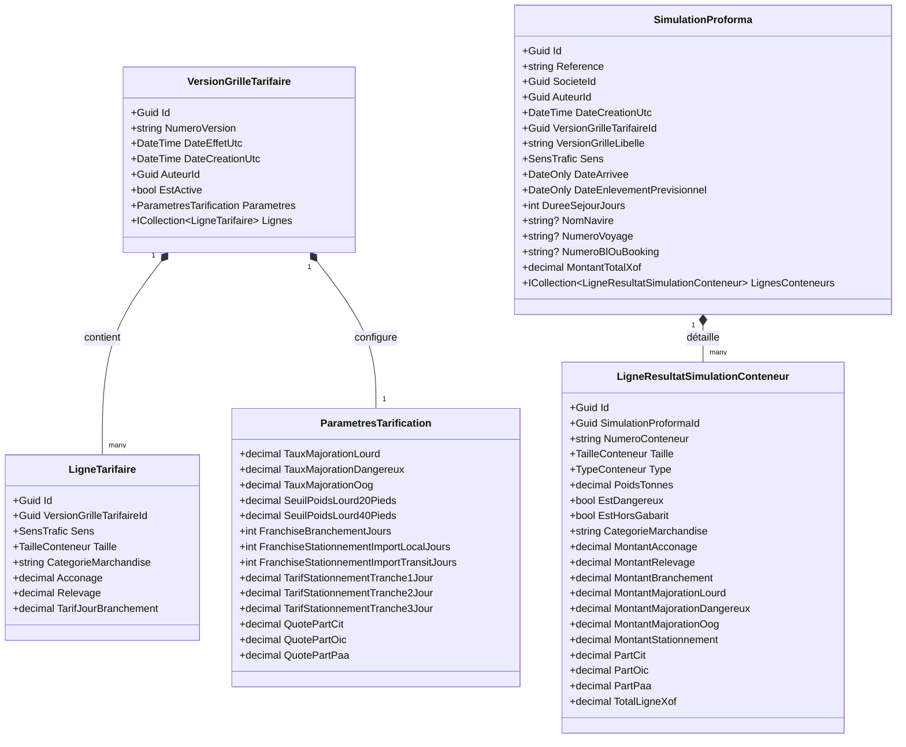

# Modèle de Données — Feature 005 : Simulation de Proforma

> **Dossier** : `specs/005-simulation-proforma/`  
> **Date** : 30 Août 2026  
> **Statut** : **VALIDÉ**  
> **Auteur** : Antigravity (Pair Programming AI)  
> **Sources de vérité** : `spec.md`, `research.md`, `contracts/use-cases.md`, `.specify/memory/constitution.md`

---

## 1. Vue d'Ensemble du Modèle

Le modèle de données de la Feature 005 sépare clairement :
1. **Le Référentiel Tarifaire & Paramètres Versionnés** (`VersionGrilleTarifaire`, `LigneTarifaire`, `ParametresTarification`) ;
2. **L'Historique des Simulations & Snapshots de Calcul** (`SimulationProforma`, `LigneResultatSimulationConteneur`) ;
3. **L'Extension Additive du Socle Dossier** (`Dossier.ReferenceSimulationProforma`).



---

## 2. Entités du Domaine & Objets de Valeur

### 2.1. Énumérations du Domaine (`CIT.Plateforme.Domain.Tarification`)

```csharp
namespace CIT.Plateforme.Domain.Tarification;

public enum SensTrafic
{
    ImportLocal = 1,
    ImportTransit = 2,
    ExportLocal = 3,
    ExportTransit = 4
}

public enum TailleConteneur
{
    VingtPieds = 20,
    QuarantePieds = 40
}

public enum TypeConteneur
{
    Dry = 1,
    Reefer = 2
}
```

---

### 2.2. Entité `VersionGrilleTarifaire`

- **Namespace** : `CIT.Plateforme.Domain.Tarification`
- **Responsabilité** : Agrégat racine de la tarification. Fige les prix unitaires et les règles de calcul pour une période d'effet donnée.
- **Invariants** :
  - `NumeroVersion` non vide (max 32 car., ex. `"v1.0"`).
  - Unicité de la combinaison $(\text{Sens}, \text{Taille}, \text{Categorie})$ au sein d'une même version.
  - Montants d'acconage, relevage et tarif jour $\ge 0$.
  - Somme des quotes-parts $(\text{CIT} + \text{OIC} + \text{PAA}) == 1.0\text{ (soit 100 \%)}$.

---

### 2.3. Entité `SimulationProforma`

- **Namespace** : `CIT.Plateforme.Domain.Tarification`
- **Responsabilité** : Agrégat racine d'une simulation enregistrée par un client.
- **Propriétés & Métadonnées** :
  - `Id` : Identifiant unique GUID.
  - `Reference` : Numéro unique lisible généré automatiquement (format `SIM-YYYYMMDD-XXXX`).
  - `SocieteId` : Identifiant de la société propriétaire (cloisonnement multi-tenant).
  - `AuteurId` : Utilisateur créateur.
  - `DateCreationUtc` : Date et heure précises de la simulation.
  - `VersionGrilleTarifaireId` : Référence de la grille appliquée.
  - `VersionGrilleLibelle` : Libellé textuel de la version pour audit rapide.
  - `Sens` : `SensTrafic`.
  - `DateArrivee` & `DateEnlevementPrevisionnel` : `DateOnly`.
  - `DureeSejourJours` : Calculé = $(\text{Enlevement} - \text{Arrivee}) + 1$.
  - `NomNavire`, `NumeroVoyage`, `NumeroBlOuBooking` : Données indicatives optionnelles.
  - `MontantTotalXof` : Somme exacte des totaux de conteneurs.

---

### 2.4. Entité `LigneResultatSimulationConteneur`

- **Namespace** : `CIT.Plateforme.Domain.Tarification`
- **Responsabilité** : Ligne de résultat détaillée par conteneur, rattachée à la simulation.
- **Propriétés** :
  - Données déclaratives du conteneur (`NumeroConteneur`, `Taille`, `Type`, `PoidsTonnes`, `EstDangereux`, `EstHorsGabarit`, `CategorieMarchandise`).
  - Détail chiffré des 7 postes (`MontantAcconage`, `MontantRelevage`, `MontantBranchement`, `MontantMajorationLourd`, `MontantMajorationDangereux`, `MontantMajorationOog`, `MontantStationnement`).
  - Détail de la répartition (`PartCit`, `PartOic`, `PartPaa`).
  - `TotalLigneXof` : Montant total de la ligne conteneur.

---

## 3. Extension Additive du Socle Existants

### 3.1. Agrégat `Dossier` (`CIT.Plateforme.Domain.Tickets`)
- **Propriété additive** :
  ```csharp
  public string? ReferenceSimulationProforma { get; private set; }
  ```
- **Méthode** :
  ```csharp
  public void AssocierSimulationProforma(string referenceSimulation)
  {
      if (string.IsNullOrWhiteSpace(referenceSimulation)) return;
      ReferenceSimulationProforma = referenceSimulation.Trim();
  }
  ```

---

## 4. Schéma Relationnel SQL Server & Configuration EF Core

```sql
-- Table des Versions de Grilles Tarifaires
CREATE TABLE [VersionsGrillesTarifaires] (
    [Id] UNIQUEIDENTIFIER NOT NULL PRIMARY KEY,
    [NumeroVersion] NVARCHAR(32) NOT NULL,
    [DateEffetUtc] DATETIME2 NOT NULL,
    [DateCreationUtc] DATETIME2 NOT NULL,
    [AuteurId] UNIQUEIDENTIFIER NOT NULL,
    [EstActive] BIT NOT NULL,
    -- Paramètres sérialisés ou colonnes aplaties (Owned Entity)
    [TauxMajorationLourd] DECIMAL(5, 2) NOT NULL,
    [TauxMajorationDangereux] DECIMAL(5, 2) NOT NULL,
    [TauxMajorationOog] DECIMAL(5, 2) NOT NULL,
    [SeuilPoidsLourd20Pieds] DECIMAL(8, 2) NOT NULL,
    [SeuilPoidsLourd40Pieds] DECIMAL(8, 2) NOT NULL,
    [FranchiseBranchementJours] INT NOT NULL,
    [FranchiseStationnementImportLocalJours] INT NOT NULL,
    [FranchiseStationnementImportTransitJours] INT NOT NULL,
    [TarifStationnementTranche1Jour] DECIMAL(18, 2) NOT NULL,
    [TarifStationnementTranche2Jour] DECIMAL(18, 2) NOT NULL,
    [TarifStationnementTranche3Jour] DECIMAL(18, 2) NOT NULL,
    [QuotePartCit] DECIMAL(5, 2) NOT NULL,
    [QuotePartOic] DECIMAL(5, 2) NOT NULL,
    [QuotePartPaa] DECIMAL(5, 2) NOT NULL
);

-- Index d'activation et date d'effet
CREATE INDEX [IX_VersionsGrillesTarifaires_DateEffetUtc] ON [VersionsGrillesTarifaires] ([DateEffetUtc] DESC);

-- Table des Lignes Tarifaires
CREATE TABLE [LignesTarifaires] (
    [Id] UNIQUEIDENTIFIER NOT NULL PRIMARY KEY,
    [VersionGrilleTarifaireId] UNIQUEIDENTIFIER NOT NULL,
    [Sens] INT NOT NULL,
    [Taille] INT NOT NULL,
    [CategorieMarchandise] NVARCHAR(64) NOT NULL,
    [Acconage] DECIMAL(18, 2) NOT NULL,
    [Relevage] DECIMAL(18, 2) NOT NULL,
    [TarifJourBranchement] DECIMAL(18, 2) NOT NULL,
    CONSTRAINT [FK_LignesTarifaires_Versions] FOREIGN KEY ([VersionGrilleTarifaireId]) REFERENCES [VersionsGrillesTarifaires]([Id]) ON DELETE CASCADE
);

CREATE UNIQUE INDEX [IX_LignesTarifaires_Cle] ON [LignesTarifaires] ([VersionGrilleTarifaireId], [Sens], [Taille], [CategorieMarchandise]);

-- Table des Simulations Enregistrées
CREATE TABLE [SimulationsProforma] (
    [Id] UNIQUEIDENTIFIER NOT NULL PRIMARY KEY,
    [Reference] NVARCHAR(64) NOT NULL,
    [SocieteId] UNIQUEIDENTIFIER NOT NULL,
    [AuteurId] UNIQUEIDENTIFIER NOT NULL,
    [DateCreationUtc] DATETIME2 NOT NULL,
    [VersionGrilleTarifaireId] UNIQUEIDENTIFIER NOT NULL,
    [VersionGrilleLibelle] NVARCHAR(32) NOT NULL,
    [Sens] INT NOT NULL,
    [DateArrivee] DATE NOT NULL,
    [DateEnlevementPrevisionnel] DATE NOT NULL,
    [DureeSejourJours] INT NOT NULL,
    [NomNavire] NVARCHAR(128) NULL,
    [NumeroVoyage] NVARCHAR(64) NULL,
    [NumeroBlOuBooking] NVARCHAR(64) NULL,
    [MontantTotalXof] DECIMAL(18, 2) NOT NULL
);

CREATE UNIQUE INDEX [IX_SimulationsProforma_Reference] ON [SimulationsProforma] ([Reference]);
CREATE INDEX [IX_SimulationsProforma_SocieteId] ON [SimulationsProforma] ([SocieteId], [DateCreationUtc] DESC);

-- Table des Lignes de Résultats de Simulation
CREATE TABLE [LignesResultatSimulationConteneur] (
    [Id] UNIQUEIDENTIFIER NOT NULL PRIMARY KEY,
    [SimulationProformaId] UNIQUEIDENTIFIER NOT NULL,
    [NumeroConteneur] NVARCHAR(32) NOT NULL,
    [Taille] INT NOT NULL,
    [Type] INT NOT NULL,
    [PoidsTonnes] DECIMAL(8, 2) NOT NULL,
    [EstDangereux] BIT NOT NULL,
    [EstHorsGabarit] BIT NOT NULL,
    [CategorieMarchandise] NVARCHAR(64) NOT NULL,
    [MontantAcconage] DECIMAL(18, 2) NOT NULL,
    [MontantRelevage] DECIMAL(18, 2) NOT NULL,
    [MontantBranchement] DECIMAL(18, 2) NOT NULL,
    [MontantMajorationLourd] DECIMAL(18, 2) NOT NULL,
    [MontantMajorationDangereux] DECIMAL(18, 2) NOT NULL,
    [MontantMajorationOog] DECIMAL(18, 2) NOT NULL,
    [MontantStationnement] DECIMAL(18, 2) NOT NULL,
    [PartCit] DECIMAL(18, 2) NOT NULL,
    [PartOic] DECIMAL(18, 2) NOT NULL,
    [PartPaa] DECIMAL(18, 2) NOT NULL,
    [TotalLigneXof] DECIMAL(18, 2) NOT NULL,
    CONSTRAINT [FK_LignesResultat_Simulation] FOREIGN KEY ([SimulationProformaId]) REFERENCES [SimulationsProforma]([Id]) ON DELETE CASCADE
);
```
