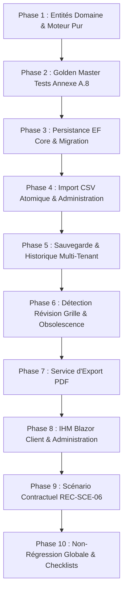

# Plan Technique d'Implémentation — Feature 005 : Simulation de Proforma

> **Dossier** : `specs/005-simulation-proforma/`  
> **Date** : 30 Août 2026  
> **Statut** : **VALIDÉ**  
> **Auteur** : Antigravity (Pair Programming AI)  
> **Sources de vérité** : `spec.md`, `research.md`, `data-model.md`, `contracts/use-cases.md`, `.specify/memory/constitution.md`

---

## 1. Vue d'Ensemble & Objectifs

L'implémentation de la **Feature 005 — Simulation de Proforma** introduit le moteur tarifaire multi-conteneurs de CIT, l'administration versionnée des grilles, la sauvegarde client sécurisée et la génération documentaire PDF.

### Principes Directeurs
1. **Domaine Pur & Testable** : Le moteur de calcul `MoteurCalculProforma` est un service de domaine pur, sans dépendance externe (EF Core, HTTP, DateTime.UtcNow interne), testable instantanément.
2. **Reproductibilité & Zéro Dérive** : Les 5 cas Golden Master de l'Annexe A.8 (`GOLDEN-SIM-01` à `GOLDEN-SIM-05`) doivent matcher à l'identique au franc près.
3. **Sécurité & Multi-Tenant** : Cloisonnement strict des simulations sauvegardées par société (Anti-IDOR) et habilitation dédiée `Permission.TarificationAdministrer` pour la gestion des grilles.
4. **Ergonomie F003.5** : Zéro GUID manuel, formulaires réactifs multi-conteneurs, calcul en temps réel et export PDF.
5. **Non-Régression du Baseline** : Les **352 tests existants** (F001 à F004) doivent rester 100% verts à chaque étape.

---

## 2. Découpage en 10 Phases d'Implémentation

### Phase 1 : Entités Domaine & Moteur de Calcul Pur (`SIM-01` à `SIM-04`, `SIM-06`)
- Création du namespace `CIT.Plateforme.Domain.Tarification`.
- Énumérations : `SensTrafic`, `TailleConteneur`, `TypeConteneur`.
- Entités & Value Objects : `VersionGrilleTarifaire`, `LigneTarifaire`, `ParametresTarification`, `DossierSimulation`, `ConteneurSimulation`, `ResultatSimulationProforma`, `LigneResultatConteneur`.
- Implémentation du service de domaine pur `MoteurCalculProforma`.
- Exceptions de domaine : `TarifNonTrouveException`, `SimulationInvalideException`.
- Tests unitaires de domaine pour chaque poste de calcul (acconage, relevage, branchement, majorations, stationnement, répartition).

### Phase 2 : Validation des Golden Master Tests (`REC-SCE-06`, Annexe A.8)
- Création de `tests/CIT.Plateforme.Domain.Tests/Tarification/GoldenMasterProformaTests.cs`.
- Implémentation des 5 cas de référence stricts :
  - `GOLDEN-SIM-01` ➔ `test01` = **199 129 XOF**
  - `GOLDEN-SIM-02` ➔ `test02` = **2 054 980 XOF**
  - `GOLDEN-SIM-03` ➔ `test03` = **245 500 XOF**
  - `GOLDEN-SIM-04` ➔ `test04` = **2 053 400 XOF**
  - `GOLDEN-SIM-05` ➔ `test06` = **2 245 300 XOF**
- Tests aux frontières (seuils de poids 15t/26t, franchises 2j/11j/21j, séjours courts/longs).

### Phase 3 : Infrastructure, EF Core & Migration SQL Server (`SIM-07`, `SIM-08`)
- Configuration des DbSets dans `PlateformeDbContext` :
  - `DbSet<VersionGrilleTarifaire> VersionsGrillesTarifaires`
  - `DbSet<LigneTarifaire> LignesTarifaires`
  - `DbSet<SimulationProforma> SimulationsProforma`
  - `DbSet<LigneResultatSimulationConteneur> LignesResultatsSimulation`
- Extension additive de l'entité `Dossier` avec `ReferenceSimulationProforma` (`CLAR-SIM-05`).
- Configuration EF Core (index uniques, clés étrangères, conversions d'énumérations).
- Création de la migration EF Core `AjoutSupportSimulationProforma`.
- Repositories : `IVersionGrilleTarifaireRepository`, `ISimulationProformaRepository`.
- Seeding SQL Server de la grille tarifaire initiale v1.0 (Annexe A).

### Phase 4 : Administration Tarifaire & Import CSV Atomique (`SIM-06`, `SIM-10`, `CLAR-SIM-01`)
- Définition de la permission `Permission.TarificationAdministrer` dans `NatureUtilisateur.cs`.
- Contrat `C6-06` : `CreerVersionGrilleTarifaireCommand`.
- Contrat `C6-07` : `ImporterGrilleTarifaireCsvCommand` et service `ImportateurGrilleTarifaireCsv`.
- Contrat `C6-08` : `ConsulterVersionsGrillesTarifairesQuery`.
- Tests applicatifs et d'infrastructure SQL Server (validation tout ou rien, rejet des formats invalides).

### Phase 5 : Contrats de Sauvegarde & Consultation Multi-Tenant (`SIM-05`, `SIM-08`)
- Contrat `C6-01` : `CalculerSimulationProformaQuery` (calcul instantané sans persistance).
- Contrat `C6-02` : `SauvegarderSimulationProformaCommand` (génération de référence unique `SIM-YYYYMMDD-XXXX`).
- Contrat `C6-04` : `ListerSimulationsProformaQuery` (historique société).
- Tests de sécurité anti-IDOR (vérification de rejet des accès croisés entre sociétés).

### Phase 6 : Détection de Révision de Grille & Obsolescence (`CLAR-SIM-04`)
- Contrat `C6-03` : `ConsulterSimulationProformaQuery`.
- Détection dynamique si une version de grille plus récente est active par rapport à `VersionGrilleTarifaireId`.
- Calcul du delta indicatif en cas de recalcul sur la grille active.

### Phase 7 : Service d'Export PDF Proforma (`SIM-09`)
- Définition de l'interface `IGenerateurDocumentProformaPdf`.
- Implémentation du générateur PDF dans la couche Infrastructure.
- Contrat `C6-05` : `GenererDocumentProformaPdfQuery`.
- Tests de génération et vérification de la présence de la mention légale obligatoire (`SIM-05`).

### Phase 8 : IHM Blazor Interactive & Navigation (`SIM-11`)
- Page Client de Simulation : `/simulation/proforma` (`SimulationProformaPage.razor`).
- Page Historique Client : `/simulation/historique` (`HistoriqueSimulationsPage.razor`).
- Page Détail Simulation : `/simulation/{id}` (`DetailSimulationPage.razor`).
- Page Administration Tarifaire : `/admin/tarification` (`GestionGrillesTarifaires.razor`).
- Intégration des liens dans `NavMenu.razor` et extension du formulaire de soumission Billing pour `ReferenceSimulationProforma`.

### Phase 9 : Scénario Contractuel REC-SCE-06 & Tests E2E
- Création de `tests/CIT.Plateforme.Web.Tests/Simulation/RecSce06SimulationE2ETests.cs`.
- Rejeu complet du parcours client et du parcours administrateur (mise à jour de paramètre sans code et répercussion immédiate sur le calcul).

### Phase 10 : Non-Régression Globale, Checklists & Finalisation
- Rejeu complet de la suite de tests (`dotnet test`).
- Vérification de la compatibilité des migrations EF Core (`has-pending-model-changes`).
- Mise à jour de `checklists/requirements.md` et rédaction de `implementation-report.md`.

---

## 3. Matrice de Traçabilité des Contrats & Exigences

| Exigence | Priorité | Contrat d'Application | Composant IHM | Test Automatisé |
| :--- | :---: | :--- | :--- | :--- |
| **`SIM-01`** | **Must** | `C6-01` | `SimulationProformaPage.razor` | `CalculerSimulationProformaQueryTests.cs` |
| **`SIM-02`** | **Must** | `C6-01` | `MoteurCalculProforma.cs` | `GoldenMasterProformaTests.cs` |
| **`SIM-03`** | **Must** | `C6-01` | `MoteurCalculProforma.cs` | `LigneTarifaireTests.cs` |
| **`SIM-04`** | **Must** | `C6-01` | `MoteurCalculProforma.cs` | `DureeSejourCalculTests.cs` |
| **`SIM-05`** | **Must** | `C6-01`, `C6-03` | `DetailSimulationPage.razor` | `MentionLegaleAffichageTests.cs` |
| **`SIM-06`** | **Must** | `C6-06`, `C6-08` | `GestionGrillesTarifaires.razor` | `ParametresTarificationTests.cs` |
| **`SIM-07`** | **Must** | `C6-06`, `C6-08` | `GestionGrillesTarifaires.razor` | `VersionnageGrilleTarifaireTests.cs` |
| **`SIM-08`** | **Should** | `C6-02`, `C6-04` | `HistoriqueSimulationsPage.razor` | `SauvegarderSimulationTests.cs` |
| **`SIM-09`** | **Should** | `C6-05` | `DetailSimulationPage.razor` | `GenererDocumentProformaPdfTests.cs` |
| **`SIM-10`** | **Should** | `C6-07` | `GestionGrillesTarifaires.razor` | `ImportateurGrilleTarifaireCsvTests.cs` |
| **`SIM-11`** | **Could** | `C6-01` | `SimulationProformaPage.razor` | `ControlesCoherenceDynamiquesTests.cs` |

---

## 4. Stratégie de Test & Sécurité

### 4.1. Répartition des Niveaux de Test
1. **Tests Unitaires de Domaine (`Domain.Tests`)** :
   - Tests exhaustifs du moteur de calcul pur sans mocks.
   - Les 5 tests Golden Master `GOLDEN-SIM-01` à `05` vérifiant la stricte égalité au franc près.
   - Tests de limites sur le poids (14.99t, 15.00t, 15.01t) et la durée de séjour.
2. **Tests Applicatifs (`Application.Tests`)** :
   - Orchestration des commandes et requêtes C6-01 à C6-08.
   - Validation de l'import CSV (formats valides, formats corrompus, erreurs de conversion).
   - Cloisonnement multi-tenant (tentative de lecture d'une simulation d'une autre entreprise).
3. **Tests d'Infrastructure & SQL Server (`Infrastructure.Tests`)** :
   - Sauvegarde et relecture sur instance SQL Server réelle avec EF Core.
   - Index uniques et contraintes de clés étrangères.
4. **Tests Web & Scénarios Contractuels (`Web.Tests`)** :
   - Parcours complet E2E `REC-SCE-06`.
   - Interaction des composants Razor Blazor (zéro GUID manuel).

---

## 5. Vérification de Non-Régression & Protection du Baseline

- Baseline avant Feature 005 : **352 tests passants** (0 échec).
- L'extension de `Dossier` pour `ReferenceSimulationProforma` est strictement additive (`string?` nullable).
- Aucun composant ou règle métier des Features 001, 002, 003, 003.5 ou 004 n'est modifié dans son comportement fonctionnel.
