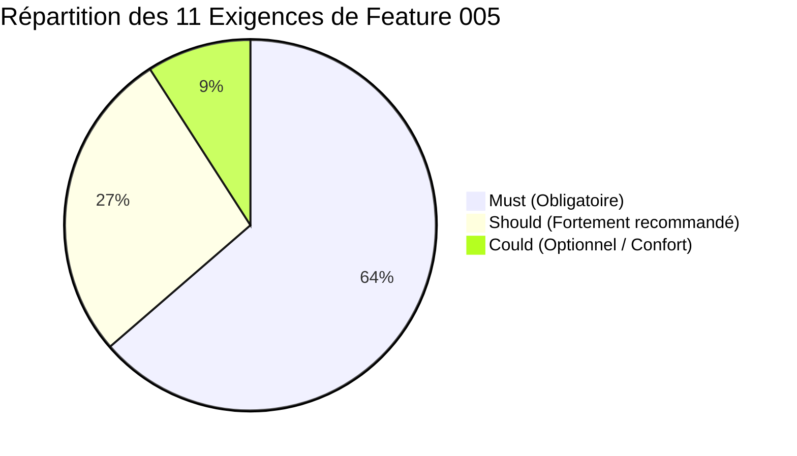

# Spécification Fonctionnelle — Feature 005 : Simulation de Proforma

> **Dossier** : `specs/005-simulation-proforma/`  
> **Date** : 30 Août 2026  
> **Statut** : **SPÉCIFICATION CLARIFIÉE & VALIDÉE — PRÊT POUR /SPECKIT.PLAN**  
> **Auteur** : Antigravity (Pair Programming AI)  
> **Sources de vérité CDC** :
> - `docs/00-analyse-cdc.md` (§11.5, §22, §25, Annexe A)
> - `docs/01-matrice-exigences.md` (Section F : `SIM-01` à `SIM-11`)
> - `docs/02-points-a-clarifier.md`
> - `docs/04-matrice-recette.md` (`REC-SCE-06`, Annexe A.8)
> - `docs/07-roadmap-post-ui.md`
> - Constitution du projet : `.specify/memory/constitution.md`

---

## 1. Contexte & Objectif Métier

Dans les opérations portuaires opérées par Côte d'Ivoire Terminal (CIT), les clients ont besoin d'estimer en amont les frais portuaires prévisionnels liés à leurs conteneurs (importation ou exportation) avant d'engager formellement leurs demandes de facturation et leurs opérations de dédouanement.

Actuellement, CIT utilise un outil de calcul interne sous tableur Excel. La **Feature 005 — Simulation de Proforma** a pour objectif de transposer cette logique de calcul éprouvée au sein de la plateforme digitale CIT, tout en la rendant :
1. **Directement accessible aux clients** depuis leur portail sans prérequis bloquant ;
2. **Entièrement paramétrable et administrable sans développement** par les administrateurs fonctionnels (grilles tarifaires, franchises, taux de majoration, seuils, tranches de stationnement, clés de répartition) ;
3. **Versionnée avec date d'effet** pour garantir l'historique et la reproductibilité des simulations ;
4. **Indépendante et indicative** : la simulation ne constitue pas une facture définitive, ne crée pas d'engagement juridique de CIT, et n'est pas un prérequis obligatoire pour créer un ticket de facturation (clarification `SIM-01`).

---

## 2. Périmètre Contractuel & Décompte des Exigences

La Feature 005 couvre **exclusivement les 11 exigences `SIM-01` à `SIM-11`** de la section F de la matrice des exigences du CDC :

| Référence | Priorité | Description Synthétique du CDC | Scénario de Recette | Statut |
| :--- | :---: | :--- | :---: | :---: |
| **`SIM-01`** | **Must** | Lancement libre et optionnel d'une simulation avant (si souhaité) de démarrer la facturation | `REC-SCE-06` | Clarifié |
| **`SIM-02`** | **Must** | Moteur de calcul par conteneur (acconage, relevage, branchement frigo, majorations lourd/dangereux/OOG, stationnement par tranches, répartition) | `REC-SCE-06` | Clarifié |
| **`SIM-03`** | **Must** | Détermination du tarif de base par la clé composite : `Sens` + `Taille` + `Catégorie de marchandise` | `REC-SCE-06` | Clarifié |
| **`SIM-04`** | **Must** | Déduction de la durée de séjour (arrivée navire ➔ enlèvement prévisionnel) pour branchement frigo et stationnement | `REC-SCE-06` | Clarifié |
| **`SIM-05`** | **Must** | Restitution détaillée par conteneur, total général du dossier et mention légale obligatoire de non-engagement | `REC-SCE-06` | Clarifié |
| **`SIM-06`** | **Must** | Paramétrage intégral sans développement (grilles, taux, seuils, franchises, tranches, quotes-parts, référentiels — valeurs initiales Annexe A) | `REC-SCE-06` | Clarifié |
| **`SIM-07`** | **Must** | Versionnage des grilles tarifaires avec date d'effet et traçabilité de la version appliquée | `REC-SCE-06` | Clarifié |
| **`SIM-08`** | **Should** | Sauvegarde de la simulation sur le profil client et possibilité de rattachement ultérieur à un ticket | `REC-SCE-06` | Clarifié |
| **`SIM-09`** | **Should** | Export / impression du résultat de simulation au format PDF | `REC-SCE-06` | Clarifié |
| **`SIM-10`** | **Should** | Import d'une nouvelle grille tarifaire par fichier structuré (CSV délimité) par l'administrateur | `REC-SCE-06` | Clarifié |
| **`SIM-11`** | **Could** | Contrôles de cohérence dynamiques à la saisie avec messages d'aide contextuels | — | Clarifié |

---

## 3. Scénario Contractuel de Recette (REC-SCE-06)

Extrait textuel du CDC §22 (`docs/04-matrice-recette.md`) :

> **Identifiant** : `REC-SCE-06`  
> **Intitulé** : **Simulation de proforma**  
> **Description exacte** : *« Calcul multi-conteneurs (Dry et Reefer, avec majorations lourd/dangereux/OOG et stationnement par tranches) contrôlé au franc près contre l'outil Excel de référence sur les cas de l'Annexe A.8 ; vérification qu'une modification de paramètre (tarif, taux, franchise) sans développement se répercute correctement sur le calcul. »*  
> **Préconditions** : Grille tarifaire initiale chargée (Annexe A) · Moteur de calcul déployé.  
> **Acteurs** : Client · Administrateur fonctionnel.

---

## 4. Données d'Entrée & Règles de Calcul Métier (Annexe A)

### 4.1. Données d'Entrée

#### A. Au niveau du Dossier de Simulation
- **Sens de l'opération** : `Import Local`, `Import Transit`, `Export Local`, `Export Transit` (référentiel paramétrable).
- **Date d'arrivée du navire** (ou date d'entrée terminal).
- **Date prévisionnelle d'enlèvement** (ou date de sortie terminal).
- **Informations contextuelles indicatives** (optionnelles) : Nom du navire, N° de voyage, N° BL ou Booking, Nom du client / société.

> **Calcul de la durée de séjour** :  
> $\text{Durée de séjour (jours)} = (\text{Date enlèvement} - \text{Date arrivée}) + 1$ (bornes incluses selon la convention contractuelle de l'Annexe A.8).

#### B. Au niveau de chaque Conteneur (Multi-conteneurs)
Pour chaque conteneur $i \in [1, N]$ :
- **Numéro d'identification du conteneur** (ex. `MSCU1234567`).
- **Taille** : `20"` ou `40"`.
- **Type** : `Dry` (standard) ou `Reefer` (frigorifique).
- **Poids brut** : en tonnes (valeur numérique décimale positive).
- **Statut Dangereux (IMO / Hazardous)** : `Oui` / `Non`.
- **Statut Hors Gabarit (OOG / Out Of Gauge)** : `Oui` / `Non`.
- **Catégorie de marchandise** :
  - Pour *Import Local* : `C1` (Première nécessité), `C2` (Alimentaires de base / agricoles), `C3` (Marchandises diverses).
  - Pour *Export Local* : `C1` (Agricoles de base & halieutiques), `C2` (Autres agricoles & dérivés), `C3` (Marchandises diverses).
  - Pour *Import Transit* : `C4` (Conteneurs en transit toutes marchandises).
  - Pour *Export Transit* : `C5` (Conteneurs en transit toutes marchandises).

---

### 4.2. Règles de Décomposition des Postes Tarifaires (par conteneur)

Les montants sont exprimés en **Francs CFA (XOF)**, devise entière sans décimales. Chaque poste est calculé et arrondi au franc près.

$$\text{Total Conteneur} = \text{Acconage} + \text{Relevage} + \text{Branchement} + \text{Maj. Lourd} + \text{Maj. Dangereux} + \text{Maj. OOG} + \text{Stationnement}$$

#### 1. Acconage ($\text{Acc}$)
Tarif de base lu dans la grille tarifaire active selon le triplet : $(\text{Sens}, \text{Taille}, \text{Catégorie})$.

#### 2. Relevage ($\text{Rel}$)
Tarif fixe lu dans la grille tarifaire active selon la même clé.

#### 3. Branchement Frigorifique ($\text{Brf}$)
- **Condition** : Uniquement si $\text{Type} == \text{Reefer}$. Pour un conteneur $\text{Dry}$, $\text{Brf} = 0$.
- **Tarif journalier** : Lu dans la grille tarifaire active ($\text{TarifJourBrf}$).
- **Franchise** : $F_{\text{brf}} = 2\text{ jours}$ (paramétrable).
- **Formule** :
  $$\text{Jours Facturables}_{\text{brf}} = \max(0, \text{Durée Séjour} - F_{\text{brf}})$$
  $$\text{Brf} = \text{TarifJourBrf} \times \text{Jours Facturables}_{\text{brf}}$$

#### 4. Majoration Lourd ($\text{Maj}_{\text{lourd}}$)
- **Seuil de déclenchement** : Poids $> 15\text{ t}$ pour un conteneur $20"$, ou Poids $> 26\text{ t}$ pour un conteneur $40"$ (paramétrables).
- **Taux** : $30\text{ \%}$ du montant d'acconage de base (paramétrable).
- **Formule** :
  $$\text{Maj}_{\text{lourd}} = \begin{cases} 0.30 \times \text{Acc} & \text{si Poids} > \text{Seuil}(\text{Taille}) \\ 0 & \text{sinon} \end{cases}$$

#### 5. Majoration Dangereux ($\text{Maj}_{\text{dang}}$)
- **Condition** : Déclaré dangereux ($\text{Dangereux} == \text{Oui}$).
- **Taux** : $50\text{ \%}$ du montant d'acconage de base (paramétrable).
- **Formule** :
  $$\text{Maj}_{\text{dang}} = \begin{cases} 0.50 \times \text{Acc} & \text{si Dangereux} \\ 0 & \text{sinon} \end{cases}$$

#### 6. Majoration Hors Gabarit ($\text{Maj}_{\text{oog}}$)
- **Condition** : Déclaré hors gabarit ($\text{OOG} == \text{Oui}$).
- **Taux** : $50\text{ \%}$ du montant d'acconage de base (paramétrable).
- **Formule** :
  $$\text{Maj}_{\text{oog}} = \begin{cases} 0.50 \times \text{Acc} & \text{si OOG} \\ 0 & \text{sinon} \end{cases}$$

> **Règle de Cumul Démontrée** : Les majorations Lourd, Dangereux et OOG s'appliquent **toutes individuellement sur l'Acconage de base** et s'additionnent. Elles ne s'appliquent jamais en cascade sur un montant déjà majoré (démontré par le cas `test01` de l'Annexe A.8).

#### 7. Stationnement ($\text{Stat}$) & Répartition Bénéficiaires
- **Applicabilité initiale** : Appliqué à l'Import (Local et Transit) ; non appliqué à l'Export dans le paramétrage initial de CIT (paramétrable par sens).
- **Franchise de stationnement** ($F_{\text{stat}}$) :
  - Import Local : $11\text{ jours}$ (paramétrable).
  - Import Transit : $21\text{ jours}$ (paramétrable).
  - Export : non applicable ($0\text{ jours}$).
- **Jours facturables de stationnement** :
  $$J_{\text{stat}} = \max(0, \text{Durée Séjour} - F_{\text{stat}})$$
- **Calcul par tranches journalières cumulatives** :
  - **Tranche 1 (1 à 5 jours facturables)** : $J_1 = \min(5, J_{\text{stat}})$, tarif = $850\text{ XOF/jour}$.
  - **Tranche 2 (6 à 15 jours facturables)** : $J_2 = \min(10, \max(0, J_{\text{stat}} - 5))$, tarif = $1\,250\text{ XOF/jour}$.
  - **Tranche 3 (16 jours et au-delà)** : $J_3 = \max(0, J_{\text{stat}} - 15)$, tarif = $1\,850\text{ XOF/jour}$.
  $$\text{Stat} = (J_1 \times 850) + (J_2 \times 1\,250) + (J_3 \times 1\,850)$$
- **Répartition entre bénéficiaires** :
  - Part CIT : $30\text{ \%} \times \text{Stat}$
  - Part OIC : $20\text{ \%} \times \text{Stat}$
  - Part PAA (Port Autonome d'Abidjan) : $50\text{ \%} \times \text{Stat}$

---

### 4.3. Grille Tarifaire Initiale de Référence (Annexe A.1)

| Sens | Taille | Catégorie de Marchandise | Acconage (XOF) | Relevage (XOF) | Branchement Frigo (/jour) |
| :--- | :---: | :--- | :---: | :---: | :---: |
| **Import Local** | 20" | C1 : Produits de première nécessité | 66 800 | 25 000 | 35 000 |
| **Import Local** | 20" | C2 : Produits alimentaires de base, agricoles | 95 000 | 25 000 | 35 000 |
| **Import Local** | 20" | C3 : Marchandises diverses | 140 000 | 25 000 | 35 000 |
| **Import Local** | 40" | C1 : Produits de première nécessité | 133 600 | 50 000 | 67 000 |
| **Import Local** | 40" | C2 : Produits alimentaires de base, agricoles | 190 000 | 50 000 | 67 000 |
| **Import Local** | 40" | C3 : Marchandises diverses | 280 000 | 50 000 | 67 000 |
| **Export Local** | 20" | C1 : Produits agricoles de base et halieutiques | 69 500 | 25 000 | 35 000 |
| **Export Local** | 20" | C2 : Autres produits agricoles et dérivés | 122 500 | 25 000 | 35 000 |
| **Export Local** | 20" | C3 : Marchandises diverses | 130 000 | 25 000 | 35 000 |
| **Export Local** | 40" | C1 : Produits agricoles de base et halieutiques | 139 000 | 50 000 | 65 000 |
| **Export Local** | 40" | C2 : Autres produits agricoles et dérivés | 245 000 | 50 000 | 65 000 |
| **Export Local** | 40" | C3 : Marchandises diverses | 260 000 | 50 000 | 65 000 |
| **Import Transit** | 20" | C4 : Conteneurs en transit (toutes marchandises) | 72 230 | 25 000 | 35 000 |
| **Import Transit** | 40" | C4 : Conteneurs en transit (toutes marchandises) | 144 460 | 50 000 | 67 000 |
| **Export Transit** | 20" | C5 : Conteneurs en transit (toutes marchandises) | 69 000 | 25 000 | 35 000 |
| **Export Transit** | 40" | C5 : Conteneurs en transit (toutes marchandises) | 138 000 | 50 000 | 65 000 |

---

### 4.4. Cas de Référence de Recette Contractuels (Annexe A.8)

*Hypothèse commune : Séjour de 29 jours (Date arrivée 10/02, Enlèvement 10/03 inclus).*

| Cas | Entrées CDC (Sens, Taille, Type, Poids, OOG, Dang, Cat) | Résultat Attendu | Exigences CDC Exercées |
| :--- | :--- | :---: | :--- |
| **test01** | `Import Transit`, 20", `Dry`, 100 t, `OOG=Oui`, `Dang=Oui`, `C4` | **199 129 XOF** | `SIM-02`, `SIM-03`, `SIM-04`, `SIM-06` (Lourd + Dang + OOG + Transit Stat) |
| **test02** | `Import Local`, 40", `Reefer`, 200 t, `OOG=Non`, `Dang=Non`, `C1` | **2 054 980 XOF** | `SIM-02`, `SIM-03`, `SIM-04`, `SIM-06` (Reefer 27j + Lourd 40" + Stat 18j) |
| **test03** | `Export Local`, 20", `Dry`, 300 t, `OOG=Oui`, `Dang=Non`, `C2` | **245 500 XOF** | `SIM-02`, `SIM-03`, `SIM-04`, `SIM-06` (Export Local + OOG + Lourd 20") |
| **test04** | `Export Transit`, 40", `Reefer`, 100 t, `OOG=Non`, `Dang=Oui`, `C5` | **2 053 400 XOF** | `SIM-02`, `SIM-03`, `SIM-04`, `SIM-06` (Export Transit + Reefer + Dang) |
| **test06** | `Import Local`, 40", `Reefer`, 300 t, `OOG=Non`, `Dang=Non`, `C3` | **2 245 300 XOF** | `SIM-02`, `SIM-03`, `SIM-04`, `SIM-06` (Reefer + Lourd + Stat Tranches 1/2/3) |

> **Note sur `test05`** : Dans le document source CDC Annexe A.8, la numérotation des cas saute directement de `test04` à `test06`. Aucun cas `test05` n'a été spécifié par le métier.

---

## 5. Décisions de Clarification (CLAR-SIM-01 à CLAR-SIM-05)

### CLAR-SIM-01 — Format d'Import de Grille Tarifaire (`SIM-10`)
- **Décision** : Le format d'import structuré de grille tarifaire est le **CSV standard avec séparateur point-virgule (`;`) et encodage UTF-8**.
- **Colonnes obligatoires** : `Sens;Taille;Categorie;Acconage;Relevage;BranchementJour`.
- **Validation** : Atomique (tout ou rien). En cas de ligne syntaxiquement incorrecte ou valeur invalide, l'import complet est rejeté avec un rapport d'erreurs détaillé par ligne.

### CLAR-SIM-02 — Date de Référence pour la Grille Tarifaire Applicable
- **Décision** : La grille tarifaire appliquée est la **grille active à la date d'exécution de la simulation (`DateCreationUtc`)**.
- **Traçabilité** : L'identifiant et le numéro de version de la grille tarifaire sont figés dans l'entité de simulation (`VersionGrilleTarifaireId`).

### CLAR-SIM-03 — Comportement sur Combinaison Non Tarifée
- **Décision** : Si une combinaison de conteneur $(\text{Sens}, \text{Taille}, \text{Catégorie})$ est absente de la grille tarifaire active, le calcul est **bloqué avec rejet explicite**.
- **Règle** : Aucun tarif par défaut à $0\text{ XOF}$ n'est appliqué silencieusement.

### CLAR-SIM-04 — Validité Temporelle & Révision de Grille (`PC-SIM-03`)
- **Décision** : Une simulation enregistrée est conservée indéfiniment dans l'historique client et reste immuable.
- **Avertissement UX** : Si une version de grille plus récente est devenue active depuis la date d'enregistrement de la simulation, l'interface affiche un badge informatif : *"⚠️ Grille tarifaire révisée — recalcul recommandé"* avec un bouton d'action *"Recalculer sur la grille active"*.

### CLAR-SIM-05 — Rattachement d'une Simulation Enregistrée (`SIM-08` / `PC-SIM-02`)
- **Décision** : La simulation enregistrée dispose d'une référence unique (ex. `SIM-20260830-XXXX`).
- **Rattachement** : Les formulaires de soumission de demande Billing Import (F003) et Billing Export (F004) comportent un champ facultatif *"Référence Simulation Proforma"* permettant d'associer la simulation au ticket/dossier.

---

## 6. Exigences d'Administration & Versionnage (SIM-06, SIM-07, SIM-10)

1. **Administration intégrale sans développement (`SIM-06`)** :
   - Grille tarifaire de base (Acconage, Relevage, Tarif jour branchement).
   - Taux des majorations (Lourd, Dangereux, OOG).
   - Seuils de déclenchement du poids lourd par taille de conteneur.
   - Franchises de branchement frigorifique et de stationnement par sens.
   - Bornes des tranches de stationnement et tarifs journaliers associés.
   - Quotes-parts de répartition du stationnement (CIT, OIC, PAA).
   - Référentiels (Sens, Tailles, Types, Catégories).
2. **Versionnage avec date d'effet (`SIM-07`)** :
   - Chaque grille porte un numéro de version et une date de début d'effet (`DateEffetUtc`).
   - Une simulation exécutée fige et référence formellement la version de grille appliquée.
   - L'historique complet des versions est immuable.
3. **Import de grille (`SIM-10`, Should)** :
   - Importation d'une nouvelle version de grille via fichier CSV selon `CLAR-SIM-01`.

---

## 7. Persistance, Restitution & Mention Légale (SIM-05, SIM-08, SIM-09)

1. **Mention Légale Obligatoire (`SIM-05`)** :
   > *« Cette simulation de proforma est fournie à titre purement indicatif sur la base des éléments déclarés. Elle ne constitue pas une facture définitive et n'engage pas Côte d'Ivoire Terminal (CIT). Les frais réels seront établis lors de la facturation officielle. »*
2. **Sauvegarde & Historique Client (`SIM-08`, Should)** :
   - Le client peut enregistrer sa simulation avec une référence unique (`SIM-YYYYMMDD-XXXX`).
   - Il la retrouve sur son tableau de bord / profil entreprise.
   - Il peut la rattacher ultérieurement lors d'une demande Billing Office.
3. **Export Documentaire PDF (`SIM-09`, Should)** :
   - Génération d'une proforma téléchargeable et imprimable récapitulant les paramètres saisis, le détail poste par poste par conteneur, le total général et la mention légale.

---

## 8. Cloisonnement, Sécurité & Expérience Utilisateur

1. **Cloisonnement Multi-Tenant (Anti-IDOR)** :
   - Les simulations enregistrées sont rattachées à la société du collaborateur (`SocieteId`).
   - Un utilisateur d'une entreprise tierce ne peut consulter ni exporter une simulation enregistrée d'une autre entreprise (vérifié via `CloisonnementService`).
2. **Ergonomie & Shell F003.5** :
   - **Zéro GUID manuel** : Sélection intuitive des référentiels (listes déroulantes).
   - Formulaire multi-conteneurs dynamique (ajout/suppression de lignes, duplication rapide).
   - Calcul instantané interactif et affichage synthétique avec accordéon de détail par conteneur.
   - Intégration dans le menu de navigation client (`/simulation/proforma`).

---

## 9. User Stories & Critères d'Acceptation

### US1 — Simulation Interactive Multi-Conteneurs (`SIM-01`, `SIM-02`, `SIM-03`, `SIM-04`, `SIM-05`)
**En tant que** client portuaire,  
**Je veux** saisir les caractéristiques de mon dossier et de mes conteneurs,  
**Afin d'** obtenir une estimation détaillée et chiffrée de mes frais prévisionnels au franc près.

- **Critère US1.1 (Calcul unitaire conforme Annexe A.8)** :
  - *Given* une grille tarifaire active chargée selon l'Annexe A.1,
  - *When* le client saisit les paramètres du cas `test06` (Import Local, 40", Reefer, 300t, C3, séjour 29j),
  - *Then* le système calcule un montant total de $2\,245\,300\text{ XOF}$ avec la décomposition exacte des 7 postes.
- **Critère US1.2 (Multi-conteneurs)** :
  - *Given* un dossier comportant 3 conteneurs distincts,
  - *When* le client clique sur "Calculer la proforma",
  - *Then* le système affiche le tableau récapitulatif par conteneur, la répartition de stationnement, et le total consolidé du dossier.
- **Critère US1.3 (Mention légale)** :
  - *Given* un résultat de simulation calculé,
  - *Then* la mention d'avertissement légal indiquant le caractère non engageant de la proforma est visiblement affichée.

### US2 — Enregistrement & Consultation de l'Historique (`SIM-08`)
**En tant que** client connecté,  
**Je veux** enregistrer ma simulation et la retrouver dans mon espace client,  
**Afin de** la réexploiter ou la comparer plus tard.

- **Critère US2.1 (Enregistrement)** :
  - *Given* une simulation calculée avec succès,
  - *When* le client clique sur "Enregistrer la simulation",
  - *Then* une référence unique est générée, la simulation est persistée et associée à la société du client.
- **Critère US2.2 (Cloisonnement)** :
  - *Given* une simulation enregistrée par l'entreprise A,
  - *When* un utilisateur de l'entreprise B tente d'y accéder,
  - *Then* l'accès est refusé (403/Forbidden).

### US3 — Export PDF de la Proforma (`SIM-09`)
**En tant que** client,  
**Je veux** télécharger ma simulation au format PDF,  
**Afin de** la transmettre à mes services financiers ou partenaires logistiques.

- **Critère US3.1 (Génération PDF)** :
  - *Given* une simulation calculée ou enregistrée,
  - *When* le client clique sur "Télécharger PDF",
  - *Then* un fichier PDF conforme est généré, contenant le détail des conteneurs, le total général et la mention légale.

### US4 — Administration des Grilles & Paramètres (`SIM-06`, `SIM-07`, `SIM-10`)
**En tant qu'** administrateur fonctionnel CIT,  
**Je veux** créer ou importer une nouvelle version de grille tarifaire avec une date d'effet future,  
**Afin d'** appliquer les évolutions tarifaires sans intervention technique sur le code source.

- **Critère US4.1 (Création et prise d'effet)** :
  - *Given* une grille v2 créée avec une date d'effet à $J+1$,
  - *When* une simulation est lancée à $J$, elle utilise la grille v1 ;
  - *When* une simulation est lancée à $J+2$, elle utilise automatiquement la grille v2.
- **Critère US4.2 (Import CSV atomique)** :
  - *Given* un fichier CSV valide selon `CLAR-SIM-01`,
  - *When* l'administrateur l'importe,
  - *Then* une nouvelle version de grille est créée avec ses lignes tarifaires associées.

---

## 10. Frontières Fonctionnelles & Périmètre Négatif

### IN SCOPE :
- Moteur de calcul tarifaire multi-conteneurs fidèle à l'Annexe A.
- Paramétrage administrable des tarifs, franchises, taux, seuils et répartition.
- Versionnage des grilles avec date d'effet.
- IHM interactive client de simulation.
- Sauvegarde facultative et historique des simulations client.
- Génération du document récapitulatif PDF.
- Import CSV de grilles tarifaires.

### OUT OF SCOPE :
- **Facturation officielle & encaissement** : La simulation n'émet aucune facture comptable et n'appelle aucune passerelle de paiement (couvert par F003/F004).
- **Création automatique de tickets / dossiers** : La simulation est autonome ; elle ne crée pas de ticket d'instruction Back Office ou Manifeste.
- **Gestion des Avoirs et Exonérations** (`AVE-01` à `AVE-04` — Feature ultérieure).
- **Réclamations clients** (`REC-01` à `REC-06` — Feature ultérieure).
- **Enrôlement transporteurs** (`ENR-01` à `ENR-05` — Feature ultérieure).

---

## 11. Évolution de la Couverture du Cahier des Charges

- **Couverture actuelle (F001 à F004)** : 115 / 188 exigences (61,17 %)
- **Périmètre cible de Feature 005** : +11 exigences (`SIM-01` à `SIM-11`)
- **Couverture projetée après clôture de F005** : **126 / 188 exigences (67,02 %)**
