# Tâches d'Implémentation — Feature 005 : Simulation de Proforma

> **Dossier** : `specs/005-simulation-proforma/`  
> **Date** : 30 Août 2026  
> **Statut** : **PRÊT POUR /SPECKIT.IMPLEMENT**  
> **Auteur** : Antigravity (Pair Programming AI)  
> **Sources de vérité** : `spec.md`, `plan.md`, `research.md`, `data-model.md`, `contracts/use-cases.md`, `quickstart.md`, `checklists/requirements.md`, `.specify/memory/constitution.md`

---

## 1. Vue d'Ensemble des Dépendances d'Exécution

```mermaid
graph TD
    T001["T001: Preflight & Baseline (352 tests)"] --> T002["T002: Enums & Types Domaine Tarification"]
    T002 --> T003["T003: Value Objects & Entités Domaine"]
    T003 --> T004["T004: Tests TEST-FIRST Golden Master Annexe A.8"]
    T004 --> T005["T005: Tests TEST-FIRST Majorations & Frontières"]
    T005 --> T006["T006: Tests TEST-FIRST Stationnement & Reefer"]
    T006 --> T007["T007: Implémentation MoteurCalculProforma (Domaine Pur)"]
    T007 --> T008["T008: Validation Tests Domaine & Golden Masters"]
    
    T008 --> T009["T009: Configuration EF Core PlateformeDbContext"]
    T009 --> T010["T010: Extension Additive Dossier.ReferenceSimulationProforma"]
    T010 --> T011["T011: Migration EF Core AjoutSupportSimulationProforma"]
    T011 --> T012["T012: Repositories Tarification & Simulation"]
    T012 --> T013["T013: Tests d'Intégration SQL Server Tarification & Seeding v1.0"]

    T013 --> T014["T014: Tests TEST-FIRST Import CSV Atomique"]
    T014 --> T015["T015: Implémentation ImportateurGrilleTarifaireCsv & C6-07"]
    T015 --> T016["T016: Implémentation C6-06 CreerVersionGrille & C6-08 ConsulterGrilles"]
    T016 --> T017["T017: Permission TarificationAdministrer & Tests Sécurité Admin"]

    T017 --> T018["T018: Tests TEST-FIRST C6-01 CalculerSimulationQuery"]
    T018 --> T019["T019: Implémentation C6-01 CalculerSimulationQueryHandler"]
    T019 --> T020["T020: Tests TEST-FIRST C6-02 Sauvegarder & C6-04 Lister"]
    T020 --> T021["T021: Implémentation C6-02 SauvegarderSimulationCommandHandler"]
    T021 --> T022["T022: Implémentation C6-04 ListerSimulationsQueryHandler"]
    T022 --> T023["T023: Tests Cloisonnement Multi-Tenant Anti-IDOR (C6-02/C6-04)"]

    T023 --> T024["T024: Tests TEST-FIRST C6-03 Détection Obsolescence Grille"]
    T024 --> T025["T025: Implémentation C6-03 ConsulterSimulationQueryHandler"]

    T025 --> T026["T026: Abstraction & Tests TEST-FIRST C6-05 Export PDF"]
    T026 --> T027["T027: Implémentation GenerateurDocumentProformaPdf & C6-05"]

    T027 --> T028["T028: Tests Non-Régression Rattachement Billing Import & Export"]
    T028 --> T029["T029: Prise en compte ReferenceSimulationProforma dans F003 / F004"]

    T029 --> T030["T030: Enregistrement DI des Services Feature 005"]
    T030 --> T031["T031: IHM Blazor SimulationProformaPage.razor (/simulation/proforma)"]
    T031 --> T032["T032: IHM Blazor HistoriqueSimulationsPage.razor (/simulation/historique)"]
    T032 --> T033["T033: IHM Blazor DetailSimulationPage.razor (/simulation/{id})"]
    T033 --> T034["T034: IHM Blazor GestionGrillesTarifaires.razor (/admin/tarification)"]
    T034 --> T035["T035: Intégration Navigation NavMenu.razor & Formulaires Billing"]
    T035 --> T036["T036: Contrôles de Cohérence Dynamiques Optionnels SIM-11 (Could)"]

    T036 --> T037["T037: Tests E2E Web RecSce06SimulationE2ETests.cs"]
    T037 --> T038["T038: Tests Web IHM Zéro GUID & Autorisation Blazor"]
    T038 --> T039["T039: Rejeu Intégral Solution (352 + nouveaux tests)"]
    T039 --> T040["T040: Rapport d'Implémentation & Clôture Feature 005"]
```

---

## 2. Liste Détaillée des 40 Tâches d'Implémentation

### Phase 1 : Preflight & Fondations Domaine (T001 à T003)

- [X] **T001** : Preflight & Validation du Baseline existant (352 tests verts).
  - *Commande* : `dotnet test` (Vérifier 40 Domain, 194 Application, 52 Infrastructure, 66 Web).
- [X] **T002** [P] : Créer les énumérations du domaine de tarification.
  - *Fichiers* :
    - `src/CIT.Plateforme.Domain/Tarification/SensTrafic.cs` (`ImportLocal=1, ImportTransit=2, ExportLocal=3, ExportTransit=4`)
    - `src/CIT.Plateforme.Domain/Tarification/TailleConteneur.cs` (`VingtPieds=20, QuarantePieds=40`)
    - `src/CIT.Plateforme.Domain/Tarification/TypeConteneur.cs` (`Dry=1, Reefer=2`)
- [X] **T003** [P] : Créer les entités et objets de valeur du domaine tarifaire.
  - *Fichiers* :
    - `src/CIT.Plateforme.Domain/Tarification/LigneTarifaire.cs`
    - `src/CIT.Plateforme.Domain/Tarification/ParametresTarification.cs`
    - `src/CIT.Plateforme.Domain/Tarification/VersionGrilleTarifaire.cs`
    - `src/CIT.Plateforme.Domain/Tarification/DossierSimulation.cs`
    - `src/CIT.Plateforme.Domain/Tarification/ConteneurSimulation.cs`
    - `src/CIT.Plateforme.Domain/Tarification/ResultatSimulationProforma.cs`
    - `src/CIT.Plateforme.Domain/Tarification/LigneResultatConteneur.cs`
    - `src/CIT.Plateforme.Domain/Tarification/Exceptions/TarifNonTrouveException.cs`

---

### Phase 2 : Moteur de Calcul Pur & Tests Golden Master (T004 à T008)

- [X] **T004** : [TEST-FIRST] Créer les tests Golden Master Annexe A.8 (`GOLDEN-SIM-01` à `GOLDEN-SIM-05`).
  - *Fichier* : `tests/CIT.Plateforme.Domain.Tests/Tarification/GoldenMasterProformaTests.cs`
  - *Couverture* :
    - `GOLDEN-SIM-01` ➔ `test01` (Import Transit, 20", Dry, 100t, OOG Oui, Dang Oui, C4) = `199 129 XOF`
    - `GOLDEN-SIM-02` ➔ `test02` (Import Local, 40", Reefer, 200t, OOG Non, Dang Non, C1) = `2 054 980 XOF`
    - `GOLDEN-SIM-03` ➔ `test03` (Export Local, 20", Dry, 300t, OOG Oui, Dang Non, C2) = `245 500 XOF`
    - `GOLDEN-SIM-04` ➔ `test04` (Export Transit, 40", Reefer, 100t, OOG Non, Dang Oui, C5) = `2 053 400 XOF`
    - `GOLDEN-SIM-05` ➔ `test06` (Import Local, 40", Reefer, 300t, OOG Non, Dang Non, C3) = `2 245 300 XOF`
- [X] **T005** [P] : [TEST-FIRST] Créer les tests unitaires pour les majorations et seuils de poids lourd.
  - *Fichier* : `tests/CIT.Plateforme.Domain.Tests/Tarification/MajorationsTarifairesTests.cs`
  - *Cas* : Aucune majoration, Lourd seul, Dangereux seul, OOG seul, combinaisons 2 à 2, 3 simultanées, seuils 15t (20") et 26t (40") à $-1$, exact, $+1$.
- [X] **T006** [P] : [TEST-FIRST] Créer les tests unitaires pour le séjour, stationnement par tranches et branchement Reefer.
  - *Fichier* : `tests/CIT.Plateforme.Domain.Tests/Tarification/StationnementEtReeferTests.cs`
  - *Cas* : Calcul de séjour `DateOnly`, franchise 2j Reefer, franchises 11j / 21j stationnement, tranches 1-5j (850), 6-15j (1 250), 16j+ (1 850), répartition CIT (30%), OIC (20%), PAA (50%).
- [X] **T007** : Implémenter le service de domaine pur `MoteurCalculProforma`.
  - *Fichier* : `src/CIT.Plateforme.Domain/Tarification/MoteurCalculProforma.cs`
  - *Règles* : Calcul déterministe en `decimal`, cumul additif des majorations sur l'Acconage, rejet bloquant `TarifNonTrouveException` si combinaison manquante (`CLAR-SIM-03`).
- [X] **T008** : Exécuter et valider l'intégralité des tests de domaine (`Domain.Tests`).

---

### Phase 3 : Infrastructure, EF Core & Migration SQL Server (T009 à T013)

- [X] **T009** : Configurer le mapping EF Core dans `PlateformeDbContext`.
  - *Fichier* : `src/CIT.Plateforme.Infrastructure/Persistence/PlateformeDbContext.cs`
  - *Tables* : `VersionsGrillesTarifaires`, `LignesTarifaires`, `SimulationsProforma`, `LignesResultatSimulationConteneur`.
- [X] **T010** : Étendre l'agrégat `Dossier` avec la propriété additive `ReferenceSimulationProforma`.
  - *Fichier* : `src/CIT.Plateforme.Domain/Tickets/Dossier.cs`
- [X] **T011** : Créer et appliquer la migration EF Core `AjoutSupportSimulationProforma`.
  - *Commande* : `dotnet ef migrations add AjoutSupportSimulationProforma --project src/CIT.Plateforme.Infrastructure --startup-project src/CIT.Plateforme.Web`
- [X] **T012** : Implémenter les interfaces et repositories de tarification et simulation.
  - *Fichiers* :
    - `src/CIT.Plateforme.Application/Abstractions/TarificationRepositories.cs`
    - `src/CIT.Plateforme.Infrastructure/Persistence/TarificationRepositories.cs`
- [X] **T013** : Créer les tests d'intégration SQL Server et le seeding de la grille initiale v1.0 (Annexe A.1).
  - *Fichier* : `tests/CIT.Plateforme.Infrastructure.Tests/Tarification/TarificationSqlPersistenceTests.cs`

---

### Phase 4 : Administration Tarifaire & Import CSV Atomique (T014 à T017)

- [X] **T014** : [TEST-FIRST] Créer les tests unitaires et d'intégration pour l'import CSV atomique.
  - *Fichier* : `tests/CIT.Plateforme.Application.Tests/Tarification/ImportGrilleTarifaireCsvTests.cs`
  - *Cas* : Fichier valide UTF-8 point-virgule, colonne manquante, valeur négative, ligne invalide au milieu (rejet tout ou rien), doublon de clé.
- [X] **T015** : Implémenter `ImportateurGrilleTarifaireCsv` et la commande `ImporterGrilleTarifaireCsvCommand` (`C6-07`).
  - *Fichiers* :
    - `src/CIT.Plateforme.Application/Tarification/ImportateurGrilleTarifaireCsv.cs`
    - `src/CIT.Plateforme.Application/Tarification/ImporterGrilleTarifaireCsvCommand.cs`
- [X] **T016** [P] : Implémenter `CreerVersionGrilleTarifaireCommand` (`C6-06`) et `ConsulterVersionsGrillesTarifairesQuery` (`C6-08`).
  - *Fichiers* :
    - `src/CIT.Plateforme.Application/Tarification/CreerVersionGrilleTarifaireCommand.cs`
    - `src/CIT.Plateforme.Application/Tarification/ConsulterVersionsGrillesTarifairesQuery.cs`
- [X] **T017** : Ajouter la permission `Permission.TarificationAdministrer` et tester la sécurité d'administration.
  - *Fichier* : `src/CIT.Plateforme.Domain/Securite/NatureUtilisateur.cs`
  - *Test* : `tests/CIT.Plateforme.Application.Tests/Tarification/AdministrationTarifaireAutorisationTests.cs`

---

### Phase 5 : Sauvegarde, Historique & Cloisonnement Multi-Tenant (T018 à T023)

- [X] **T018** : [TEST-FIRST] Créer les tests pour `CalculerSimulationProformaQuery` (`C6-01`).
  - *Fichier* : `tests/CIT.Plateforme.Application.Tests/Tarification/CalculerSimulationProformaQueryTests.cs`
- [X] **T019** : Implémenter `CalculerSimulationProformaQuery` (`C6-01`).
  - *Fichier* : `src/CIT.Plateforme.Application/Tarification/CalculerSimulationProformaQuery.cs`
- [X] **T020** : [TEST-FIRST] Créer les tests pour la sauvegarde (`C6-02`) et le listing de l'historique (`C6-04`).
  - *Fichier* : `tests/CIT.Plateforme.Application.Tests/Tarification/GestionSimulationsProformaTests.cs`
- [X] **T021** : Implémenter `SauvegarderSimulationProformaCommand` (`C6-02`).
  - *Fichier* : `src/CIT.Plateforme.Application/Tarification/SauvegarderSimulationProformaCommand.cs`
  - *Règle* : Génération de référence unique lisible `SIM-YYYYMMDD-XXXX` et journalisation d'audit.
- [X] **T022** [P] : Implémenter `ListerSimulationsProformaQuery` (`C6-04`).
  - *Fichier* : `src/CIT.Plateforme.Application/Tarification/ListerSimulationsProformaQuery.cs`
- [X] **T023** : Créer les tests de sécurité anti-IDOR pour les simulations.
  - *Fichier* : `tests/CIT.Plateforme.Application.Tests/Tarification/CloisonnementSimulationProformaTests.cs`

---

### Phase 6 : Détection de Révision de Grille & Obsolescence (T024 & T025)

- [X] **T024** : [TEST-FIRST] Créer les tests pour la consultation et la détection d'obsolescence tarifaire (`CLAR-SIM-04`).
  - *Fichier* : `tests/CIT.Plateforme.Application.Tests/Tarification/ConsulterSimulationProformaQueryTests.cs`
  - *Cas* : Simulation sur grille active (pas d'alerte), simulation sur ancienne grille (indicateur `EstGrilleObsolete = true`).
- [X] **T025** : Implémenter `ConsulterSimulationProformaQuery` (`C6-03`).
  - *Fichier* : `src/CIT.Plateforme.Application/Tarification/ConsulterSimulationProformaQuery.cs`

---

### Phase 7 : Service d'Export PDF Proforma (T026 & T027)

- [X] **T026** : [TEST-FIRST] Créer l'abstraction et les tests de génération de document proforma (`SIM-09`, `SIM-05`).
  - *Fichier* : `tests/CIT.Plateforme.Application.Tests/Tarification/GenererDocumentProformaPdfTests.cs`
  - *Vérifications* : Présence du récapitulatif, décomposition postes, total XOF, mention légale obligatoire.
- [X] **T027** : Implémenter le service de génération PDF et la requête `GenererDocumentProformaPdfQuery` (`C6-05`).
  - *Fichiers* :
    - `src/CIT.Plateforme.Application/Abstractions/IGenerateurDocumentProformaPdf.cs`
    - `src/CIT.Plateforme.Infrastructure/Documents/GenerateurDocumentProformaPdf.cs`
    - `src/CIT.Plateforme.Application/Tarification/GenererDocumentProformaPdfQuery.cs`

---

### Phase 8 : Rattachement Additif Billing Import / Export (T028 & T029)

- [X] **T028** : [TEST-FIRST] Créer les tests de non-régression pour le rattachement de simulation lors des soumissions Import et Export (`CLAR-SIM-05`).
  - *Fichier* : `tests/CIT.Plateforme.Application.Tests/Tarification/RattachementSimulationBillingTests.cs`
- [X] **T029** : Adapter `SoumettreDemandeImportCommand` et `SoumettreDemandeExportCommand` pour accepter le champ facultatif `ReferenceSimulationProforma`.
  - *Fichiers* :
    - `src/CIT.Plateforme.Application/BillingImport/SoumettreDemandeImportCommand.cs`
    - `src/CIT.Plateforme.Application/BillingExport/SoumettreDemandeExportCommand.cs`

---

### Phase 9 : IHM Blazor Interactive & Administration (T030 à T036)

- [X] **T030** : Enregistrer tous les services et handlers de tarification dans l'injection de dépendances.
  - *Fichier* : `src/CIT.Plateforme.Infrastructure/DependencyInjection.cs`
- [X] **T031** : Implémenter la page Blazor de simulation interactive (`/simulation/proforma`).
  - *Fichier* : `src/CIT.Plateforme.Web/Components/Pages/Tarification/SimulationProformaPage.razor`
  - *Fonctionnalités* : Saisie dossier, multi-conteneurs, calcul interactif en temps réel, affichage accordéon des 7 postes, mention légale `SIM-05`, bouton enregistrer.
- [X] **T032** : Implémenter la page Blazor d'historique des simulations (`/simulation/historique`).
  - *Fichier* : `src/CIT.Plateforme.Web/Components/Pages/Tarification/HistoriqueSimulationsPage.razor`
- [X] **T033** : Implémenter la page Blazor de détail d'une simulation (`/simulation/{id}`).
  - *Fichier* : `src/CIT.Plateforme.Web/Components/Pages/Tarification/DetailSimulationPage.razor`
  - *Fonctionnalités* : Détail immuable, badge d'avertissement grille révisée (`CLAR-SIM-04`), bouton téléchargement PDF.
- [X] **T034** : Implémenter la page Blazor d'administration tarifaire (`/admin/tarification`).
  - *Fichier* : `src/CIT.Plateforme.Web/Components/Pages/Tarification/GestionGrillesTarifaires.razor`
  - *Fonctionnalités* : Consultation des grilles, création de version, téléversement CSV atomique avec rapport d'erreurs.
- [X] **T035** : Intégrer les liens de navigation dans `NavMenu.razor` et le champ optionnel de simulation dans les formulaires de soumission.
  - *Fichiers* :
    - `src/CIT.Plateforme.Web/Components/Layout/NavMenu.razor`
    - `src/CIT.Plateforme.Web/Components/Pages/BillingImport/SoumettreDemandeImport.razor`
    - `src/CIT.Plateforme.Web/Components/Pages/BillingExport/SoumettreDemandeExport.razor`
- [ ] **T036** [P] : Implémenter les contrôles de cohérence dynamiques contextuels (`SIM-11`, Could).
  - *Fichier* : `src/CIT.Plateforme.Web/Components/Pages/Tarification/ControlesCoherenceSimulation.razor`
  - **Statut** : différé délibérément — `SIM-11` est `Could` et ne conditionne aucun `Must`/`Should`
    (§27 du brief d'implémentation). Voir `implementation-report.md` §18 (dettes).

---

### Phase 10 : Scénario Contractuel REC-SCE-06, Hardening & Finalisation (T037 à T040)

- [X] **T037** : [E2E] Implémenter le test de recette contractuel complet `REC-SCE-06`.
  - *Fichier* : `tests/CIT.Plateforme.Web.Tests/Tarification/RecSce06SimulationE2ETests.cs`
  - *Scénario* : Calcul multi-conteneurs, vérification au franc près contre l'Annexe A.8, modification de paramètre tarifaire par l'administrateur sans code et répercussion immédiate sur une nouvelle simulation.
- [X] **T038** : Créer les tests Web pour le respect du principe Zéro GUID et les contrôles d'accès UI.
  - *Fichier* : `tests/CIT.Plateforme.Web.Tests/Tarification/SimulationProformaWebTests.cs`
- [X] **T039** : Exécuter la suite complète de tests de la solution (`dotnet test`) et vérifier la non-régression (352 tests initiaux + nouveaux tests verts).
- [X] **T040** : Mettre à jour `checklists/requirements.md` et générer `specs/005-simulation-proforma/implementation-report.md`.

---

## 3. Matrice de Traçabilité des Exigences, Contrats & Tâches

| Exigence | Priorité | Contrat C6 | Tâches de Conception / Implémentation | Tâches de Test |
| :--- | :---: | :--- | :--- | :--- |
| **`SIM-01`** | **Must** | `C6-01` | `T002`, `T003`, `T007`, `T019`, `T031` | `T004`, `T018`, `T037` |
| **`SIM-02`** | **Must** | `C6-01` | `T007`, `T019` | `T004`, `T005`, `T006`, `T037` |
| **`SIM-03`** | **Must** | `C6-01` | `T002`, `T003`, `T007`, `T009` | `T004`, `T013` |
| **`SIM-04`** | **Must** | `C6-01` | `T003`, `T007` | `T006`, `T018` |
| **`SIM-05`** | **Must** | `C6-01`, `C6-03` | `T007`, `T025`, `T031`, `T033` | `T018`, `T024`, `T026` |
| **`SIM-06`** | **Must** | `C6-06`, `C6-08` | `T003`, `T009`, `T016`, `T034` | `T013`, `T017`, `T037` |
| **`SIM-07`** | **Must** | `C6-06`, `C6-08` | `T003`, `T009`, `T016`, `T034` | `T013`, `T024`, `T037` |
| **`SIM-08`** | **Should** | `C6-02`, `C6-04` | `T009`, `T010`, `T021`, `T022`, `T029`, `T032` | `T020`, `T023`, `T028` |
| **`SIM-09`** | **Should** | `C6-05` | `T027`, `T033` | `T026`, `T038` |
| **`SIM-10`** | **Should** | `C6-07` | `T015`, `T034` | `T014`, `T037` |
| **`SIM-11`** | **Could** | `C6-01` | `T036` | `T038` |

---

## 4. Matrice des Cas Golden Master Annexe A.8

| Golden Master | Cas CDC | Entrées Spécifiées | Total Attendu | Tâche Test | Tâche Moteur |
| :--- | :--- | :--- | :---: | :---: | :---: |
| **`GOLDEN-SIM-01`** | `test01` | `Import Transit`, 20", Dry, 100t, OOG Oui, Dang Oui, C4 | **`199 129 XOF`** | `T004` | `T007` |
| **`GOLDEN-SIM-02`** | `test02` | `Import Local`, 40", Reefer, 200t, OOG Non, Dang Non, C1 | **`2 054 980 XOF`** | `T004` | `T007` |
| **`GOLDEN-SIM-03`** | `test03` | `Export Local`, 20", Dry, 300t, OOG Oui, Dang Non, C2 | **`245 500 XOF`** | `T004` | `T007` |
| **`GOLDEN-SIM-04`** | `test04` | `Export Transit`, 40", Reefer, 100t, OOG Non, Dang Oui, C5 | **`2 053 400 XOF`** | `T004` | `T007` |
| **`GOLDEN-SIM-05`** | `test06` | `Import Local`, 40", Reefer, 300t, OOG Non, Dang Non, C3 | **`2 245 300 XOF`** | `T004` | `T007` |
