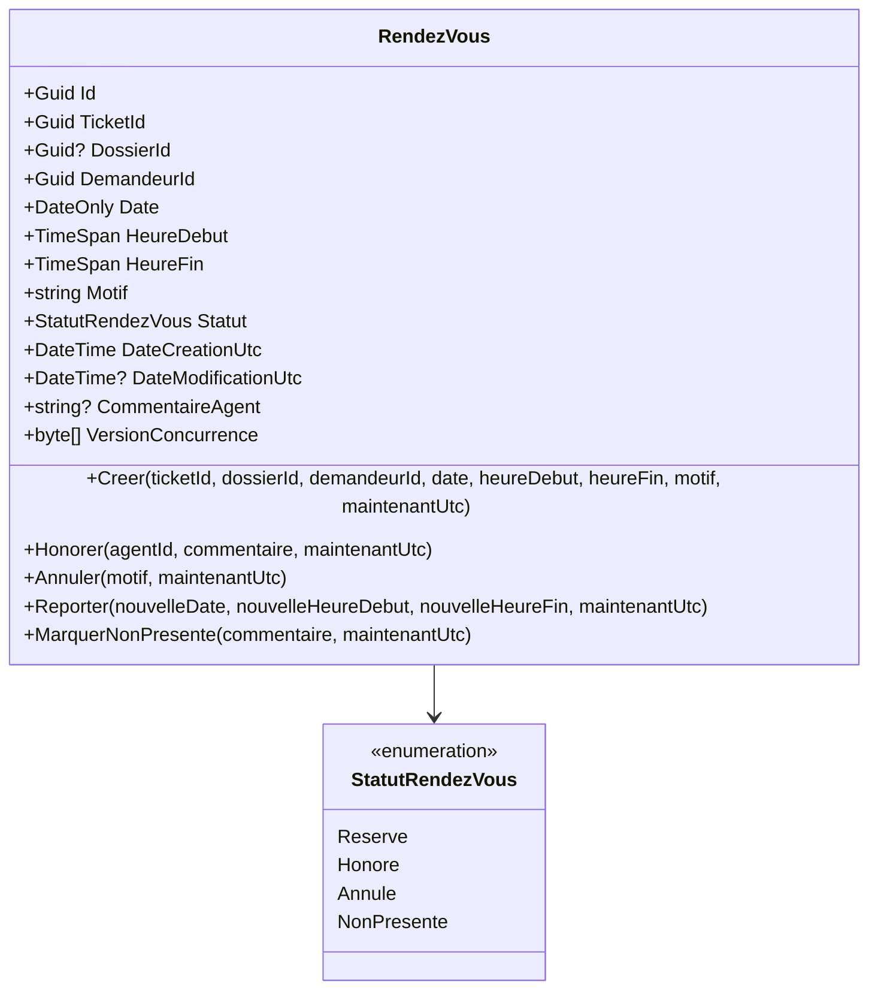

# Modèle de Données & Schéma Relationnel — Feature 010
## Continuité Guichet & Rendez-vous

> **Document** : `specs/010-continuite-guichet-rendez-vous/data-model.md`  
> **Statut** : Validé pour implémentation  
> **Date** : 1er septembre 2026

---

## 1. Entité Domaine : `RendezVous`

L'entité `RendezVous` est hébergée dans l'espace de noms `CIT.Plateforme.Domain.Guichet`.



### Invariants et Règles Métier du Domaine
1. **Pivot obligatoire** : `TicketId` ne peut pas être `Guid.Empty`.
2. **Plage horaire cohérente** : `HeureDebut < HeureFin`.
3. **Motif obligatoire** : Non vide, maximum 200 caractères.
4. **Transitions d'états valides** :
   - `Reserve` -> `Honore` (uniquement si à l'état `Reserve`)
   - `Reserve` -> `Annule` (uniquement si à l'état `Reserve`)
   - `Reserve` -> `NonPresente` (uniquement si à l'état `Reserve`)
   - `Reserve` -> `Reserve` avec nouvelles dates (report)
   - Aucune transition autorisée depuis `Honore`, `Annule` ou `NonPresente` (états terminaux immuables).
5. **Jeton de concurrence optimiste** : `VersionConcurrence` mis à jour par la base de données (RowVersion).

---

## 2. Schéma Relationnel EF Core (Table `RendezVous`)

```sql
CREATE TABLE [dbo].[RendezVous] (
    [Id] UNIQUEIDENTIFIER NOT NULL,
    [TicketId] UNIQUEIDENTIFIER NOT NULL,
    [DossierId] UNIQUEIDENTIFIER NULL,
    [DemandeurId] UNIQUEIDENTIFIER NOT NULL,
    [Date] DATE NOT NULL,
    [HeureDebut] TIME(7) NOT NULL,
    [HeureFin] TIME(7) NOT NULL,
    [Motif] NVARCHAR(200) NOT NULL,
    [Statut] NVARCHAR(32) NOT NULL,
    [DateCreationUtc] DATETIME2 NOT NULL,
    [DateModificationUtc] DATETIME2 NULL,
    [CommentaireAgent] NVARCHAR(500) NULL,
    [VersionConcurrence] ROWVERSION NOT NULL,
    CONSTRAINT [PK_RendezVous] PRIMARY KEY CLUSTERED ([Id] ASC),
    CONSTRAINT [FK_RendezVous_Tickets_TicketId] FOREIGN KEY ([TicketId]) REFERENCES [dbo].[Tickets] ([Id]) ON DELETE RESTRICT,
    CONSTRAINT [FK_RendezVous_Dossiers_DossierId] FOREIGN KEY ([DossierId]) REFERENCES [dbo].[Dossiers] ([Id]) ON DELETE RESTRICT
);
```

### Index de Recherche et Contraintes d'Unicité

| Nom de l'index | Colonnes | Type / Filtrage | Justification Métier |
|:---|:---|:---:|:---|
| **`IX_RendezVous_TicketId_ActifUnique`** | `TicketId` | UNIQUE (`WHERE [Statut] = 'Reserve'`) | **Garantit qu'un ticket ne peut avoir qu'un seul rendez-vous actif à la fois** |
| **`IX_RendezVous_Date_HeureDebut`** | `Date`, `HeureDebut`, `Statut` | Recherche (Non-unique) | **Calcul instantané de la capacité occupée par créneau (`CON-03`)** |
| **`IX_RendezVous_DemandeurId`** | `DemandeurId`, `DateCreationUtc` | Recherche (Non-unique) | **Affichage rapide des rendez-vous d'un usager dans son espace client** |
| **`IX_RendezVous_DossierId`** | `DossierId` | Recherche (Non-unique) | **Recherche et rattachement par dossier multi-BL** |

---

## 3. Matrice de Migration EF Core Additive

| Élément | Nature | Description |
|:---|:---:|:---|
| Table `RendezVous` | **Nouvelle table** | Stockage relationnel des rendez-vous guichet |
| Clé étrangère `FK_RendezVous_Tickets` | **Nouvelle FK** | Liaison vers `Tickets` (DeleteBehavior.Restrict) |
| Clé étrangère `FK_RendezVous_Dossiers`| **Nouvelle FK** | Liaison optionnelle vers `Dossiers` (DeleteBehavior.Restrict) |
| Index `IX_RendezVous_TicketId_ActifUnique` | **Nouvel index** | Index unique filtré sur statut actif |
| Index `IX_RendezVous_Date_HeureDebut` | **Nouvel index** | Index composite pour vérification de capacité |
| Index `IX_RendezVous_DemandeurId` | **Nouvel index** | Index client |
| Opérations destructives | **AUCUNE (0)** | **100 % Additif** |
