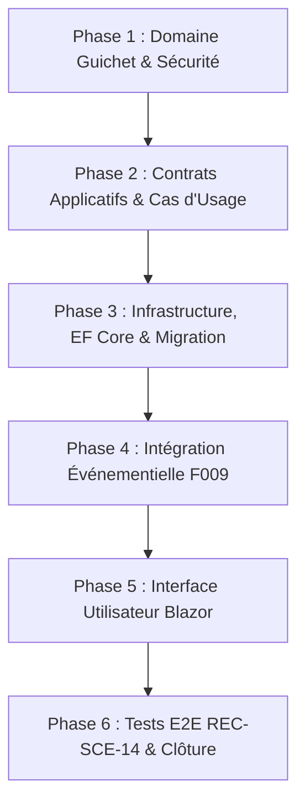

# Plan Technique d'Implémentation — Feature 010
## Continuité Guichet & Rendez-vous

> **Document** : `specs/010-continuite-guichet-rendez-vous/plan.md`  
> **Statut** : Validé pour implémentation  
> **Date** : 1er septembre 2026  
> **Branche** : `master`  
> **Auteur** : Antigravity (IA Pair Programmer)

---

## 1. Résumé Exécutif & Architecture Globale

La **Feature 010 — Continuité Guichet & Rendez-vous** implémente le pont fonctionnel et technique entre l'espace dématérialisé et l'accueil physique au Billing Office de Côte d'Ivoire Terminal.

Elle repose sur les piliers architecturaux suivants :
1. **Zéro Duplication (CON-01)** : L'instruction physique utilise directement l'instance existante du `Ticket` (même identifiant, même liasse documentaire, même historique).
2. **Recherche Optimisée Multi-Critères (CON-02)** : Recherche serveur rapide par N° ticket, N° dossier, N° BL/booking et nom de client.
3. **Module Relationnel de Rendez-vous (CON-03)** : Entité `RendezVous` avec gestion de la capacité par créneau, contraintes d'unicité active et prévention transactionnelle des conflits.
4. **Découplage Événementiel (F009)** : Publication d'événements de domaine sur `EvenementSocle` (`RendezVousReserve`, `RendezVousAnnule`, `RendezVousHonore`, `BasculePresentielleEffectuee`) sans dépendance directe vers les canaux d'envoi.
5. **Clôture Complète de REC-SCE-14** : Réalisation du scénario E2E de bout en bout couvrant l'ensemble du cycle digital/présentiel.

---

## 2. Découpage en Phases d'Implémentation

### Phase 1 : Domaine Guichet & Sécurité
- Création de `CIT.Plateforme.Domain.Guichet.StatutRendezVous` (enum : `Reserve`, `Honore`, `Annule`, `NonPresente`).
- Création de `CIT.Plateforme.Domain.Guichet.RendezVous` (entité avec invariants, transitions et `VersionConcurrence`).
- Extension de `CIT.Plateforme.Domain.Securite.NatureUtilisateur` :
  - `Permission.GuichetRecherche = "guichet.recherche"`
  - `Permission.RendezVousGerer = "rendezvous.gerer"`
- Tests unitaires du domaine dans `CIT.Plateforme.Domain.Tests/Guichet/RendezVousTests.cs`.

### Phase 2 : Couche Application & Cas d'Usage (Série C10)
- Interfaces de repository dans `CIT.Plateforme.Application.Abstractions` :
  - `IRendezVousRepository`
  - `IRechercheGuichetRepository`
- Objet de configuration `ParametresRendezVous`.
- Implémentation des Use Cases dans `CIT.Plateforme.Application.Guichet` :
  - `RechercherGuichetQuery` (C10-01)
  - `ConsulterDossierGuichetQuery` (C10-02)
  - `ListerCreneauxDisponiblesQuery` (C10-03)
  - `ReserverRendezVousCommand` (C10-04)
  - `AnnulerRendezVousCommand` (C10-05)
  - `ReporterRendezVousCommand` (C10-06)
  - `MarquerRendezVousHonoreCommand` (C10-07)
  - `MarquerRendezVousNonPresenteCommand` (C10-08)
  - `ListerMesRendezVousQuery` (C10-09)
  - `BasculerAlternativePresentielleCommand` (C10-10)
  - `RegulariserModeDegradeCommand` (C10-11)
- Tests unitaires applicatifs dans `CIT.Plateforme.Application.Tests/Guichet/`.

### Phase 3 : Infrastructure, Persistance & Migration EF Core
- Implémentation de `RendezVousRepository` et `RechercheGuichetRepository`.
- Configuration EF Core dans `PlateformeDbContext` :
  - Table `RendezVous` avec FK `TicketId` et `DossierId` (DeleteBehavior.Restrict).
  - Index unique filtré `IX_RendezVous_TicketId_ActifUnique` (`WHERE Statut = 'Reserve'`).
  - Index composite `IX_RendezVous_Date_HeureDebut`.
  - Index `IX_RendezVous_DemandeurId`.
- Création de la migration `AjoutContinuiteGuichetRendezVous`.
- Mise à jour de `DependencyInjection.cs` et de `DevelopmentSeeder.cs` (attribution des permissions aux agents de test).
- Tests d'intégration et de concurrence SQL Server réel dans `CIT.Plateforme.Infrastructure.Tests/Persistence/RendezVousRepositoryTests.cs`.

### Phase 4 : Interface Utilisateur Blazor
- Page Agent `/guichet/recherche` : `RechercheGuichet.razor`.
- Page Agent `/guichet/agenda` : `AgendaGuichet.razor`.
- Page Client `/rendez-vous/mes-rendez-vous` : `MesRendezVous.razor`.
- Composant Client `/rendez-vous/prendre/{ticketId:guid}` : `PrendreRendezVous.razor`.
- Liens de navigation dans `NavMenu.razor` (Espace Client & Espace Agent).
- Alerte RDV dans le bandeau ACR-01 (`DashboardClient.razor`).
- Tests d'interface bUnit dans `CIT.Plateforme.Web.Tests/Pages/Guichet/`.

### Phase 5 : Clôture REC-SCE-14 & Validation Globale
- Création du test de bout en bout `RecSce14E2ETests.cs`.
- Exécution de la suite complète (747 tests existants + nouveaux tests F010).
- Vérification 0 avertissement de build et 0 pending model change.

---

## 3. Matrice de Traçabilité des Exigences

| Exigence | Couche Domaine | Couche Application | Couche Infrastructure | Couche Web / UI |
|:---|:---|:---|:---|:---|
| **`CON-01`** | `Ticket` (réutilisé) | `ConsulterDossierGuichetQuery` | `PlateformeDbContext` | `FicheTicket.razor` |
| **`CON-02`** | `Permission.GuichetRecherche` | `RechercherGuichetQuery` | `RechercheGuichetRepository` | `RechercheGuichet.razor` |
| **`CON-03`** | `RendezVous`, `StatutRendezVous` | `ReserverRendezVousCommand`, `ListerCreneauxDisponiblesQuery`, `AnnulerRendezVousCommand`, `ReporterRendezVousCommand` | `RendezVousRepository`, Migration EF | `PrendreRendezVous.razor`, `MesRendezVous.razor`, `AgendaGuichet.razor` |
| **`CON-04`** | `EvenementSocle` | `MarquerRendezVousHonoreCommand` | `JournalEvenements` | Consigne textuelle sur fiche |
| **`IMP-15`** | `EvenementSocle` | `BasculerAlternativePresentielleCommand` | `JournalEvenements` | `FileControleDocumentaire.razor` |
| **`ERR-04`** | `JournalAudit` | `RegulariserModeDegradeCommand` | `JournalAudit` | `RechercheGuichet.razor` |

---

## 4. Vérification de la Constitution (17 Principes)

| # | Principe de la Constitution | Statut dans le Plan F010 |
|:---|:---|:---:|
| **I** | Strict Scope & Zero Extrapolation | ✅ Respecté (CON-01..04, IMP-15, ERR-04 strictement respectés) |
| **II** | Strict Test-First & No Mocks on Real SQL | ✅ Respecté (Tests unitaires + tests SQL Server réels pour concurrence) |
| **III** | Zero Multi-Tenancy Leaks & Strict RBAC | ✅ Respecté (Recherche cloisonnée, Anti-IDOR sur `DemandeurId`) |
| **IV** | Server-Side Identity Only (No Untrusted Guid) | ✅ Respecté (`DemandeurId` extrait des Claims serveur) |
| **V** | Non-Destructive Migrations & Snapshot Fidelity | ✅ Respecté (Migration 100% additive, 0 suppression) |
| **VI** | Zero Domain Logic in UI (No DbContext in Razor) | ✅ Respecté (Toutes opérations via Use Cases / Commands) |
| **VII** | Separation of Concerns (Domain / App / Infra / UI) | ✅ Respecté (Clean Architecture stricte) |
| **VIII**| Preserving Closed Baseline (No Regressions) | ✅ Respecté (Baseline 747 tests protégée) |
| **IX** | Traceability & Audit Immutability | ✅ Respecté (`EntreeHistorique` et `JournalAudit` renseignés) |
| **X** | Idempotence & Concurrency Safety | ✅ Respecté (RowVersion sur `RendezVous`, transaction isolée) |
| **XI** | No Forbidden External Providers | ✅ Respecté (0 connecteur calendrier externe, 0 fournisseur SMS/Email) |
| **XII** | Clean Decoupled Events (EvenementSocle) | ✅ Respecté (Publication d'événements pour consommation F009) |
| **XIII**| No Hardcoded Arbitrary Rules / Configuration First | ✅ Respecté (`ParametresRendezVous` injectable) |
| **XIV** | Robust Offline Organizational Model (No PWA) | ✅ Respecté (Continuité organisationnelle claire) |
| **XV** | UI Ergonomics & High-End Aesthetic | ✅ Respecté (Design épuré et sobre) |
| **XVI** | Full Coverage of REC-SCE-14 | ✅ Respecté (Test E2E de clôture planifié) |
| **XVII**| Strict Artifact & Preflight Traceability | ✅ Respecté (5 documents Spec Kit générés) |
