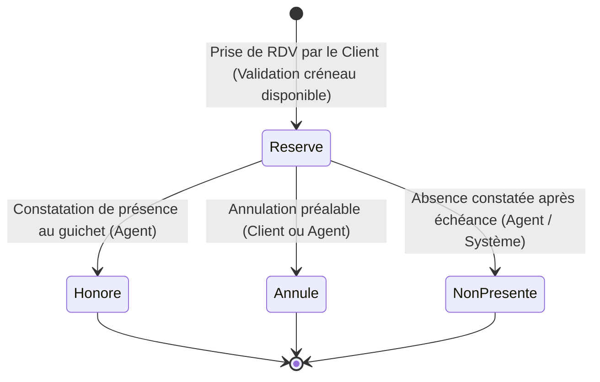

# Spécification Fonctionnelle Clarifiée — Feature 010
## Continuité Guichet & Rendez-vous

> **Statut** : **CLARIFIÉ & PRÊT POUR /speckit.plan**  
> **Branche cible** : `master`  
> **Date de clarification** : 1er septembre 2026  
> **Auteur** : Antigravity (IA Pair Programmer)  
> **Sources de référence** : CDC CIT v3.0 (§6.15, §15, §17.1, §22), `.specify/memory/constitution.md`, `docs/00-analyse-cdc.md`, `docs/01-matrice-exigences.md`, `docs/02-points-a-clarifier.md`, `docs/04-matrice-recette.md`, `docs/14-preflight-feature-010.md`.

---

## 1. Contexte & Alignement Stratégique

La plateforme digitale de Côte d'Ivoire Terminal (CIT) vise la dématérialisation et la fluidification des démarches d'importation, d'exportation, de facturation et d'enrôlement. Toutefois, la réalité portuaire et documentaire impose de garantir une **continuité sans rupture entre l'espace numérique et l'accueil physique au Billing Office / guichet**.

La **Feature 010 — Continuité Guichet & Rendez-vous** concrétise le principe fondamental selon lequel **le numérique et le présentiel ne forment pas deux mondes étanches, mais deux canaux d'accès complémentaires au même dossier unique**.

Elle permet :
1. À l'usager de basculer du portail web vers le guichet physique (ou inversement) sans jamais devoir ressaisir sa liasse ni recommencer son dossier (**`CON-01`**, **`IMP-15`**).
2. Aux agents d'accueil et de facturation de retrouver instantanément n'importe quel dossier au guichet grâce à une recherche multicritère optimisée (**`CON-02`**).
3. Aux clients de réserver un créneau de rendez-vous rattaché à leur ticket/dossier lorsqu'un passage physique est obligatoire (**`CON-03`**).
4. De garantir la traçabilité et l'articulation avec les flux physiques sans imposer d'interfaçage complexe immédiat avec les automates de bornes d'accueil (**`CON-04`**).
5. D'assurer un mode dégradé clair et documenté en cas d'indisponibilité du portail web (**`ERR-04`**).
6. De clôturer intégralement le grand scénario de recette contractuel **`REC-SCE-14`**.

---

## 2. Reconstitution Exhaustive des Exigences

| Réf. | Priorité | Module | Énoncé littéral CDC | Acteur(s) | Dépendances |
|:---|:---:|:---|:---|:---|:---|
| **`CON-01`** | **Must** | Transverse | Un client peut commencer son parcours en ligne et le poursuivre physiquement (ou inversement) sans recommencer son dossier : le numéro de ticket permet à l'agent de retrouver l'historique et l'étape en cours. | Client · Agent de guichet | `SOC-01` [E] |
| **`CON-02`** | **Must** | Transverse | Les agents de guichet disposent d'une recherche rapide de ticket (numéro, client, BL/booking) pour reprendre un dossier au guichet. | Agent de guichet | `SOC-01` [D] |
| **`CON-03`** | **Must** | Transverse | La plateforme permet au client de prendre un rendez-vous lorsque la présence physique est nécessaire ; le rendez-vous est rattaché à son ticket/dossier et lui donne accès au bureau de facturation. | Client | `SOC-01` [D] |
| **`CON-04`** | **Should** | Transverse | La plateforme et le système de gestion de file d'attente existant restent deux systèmes distincts ; une redirection est possible ; une intégration API constitue une évolution future et n'est pas requise. | Système | — |
| **`IMP-15`** | **Should** | Billing IMPORT | Alternative présentielle : à l'issue du contrôle BL, le client peut choisir de prendre rendez-vous et finaliser physiquement au Billing Office ; le ticket porte la trace de cette bascule. *(Instanciation de CON-01)*. | Client · Agent de guichet | `CON-01` [D] |
| **`ERR-04`** | **Should** | Transverse | Mode dégradé documenté : en cas d'indisponibilité du portail, le parcours physique reste possible ; la reprise s'effectue par le numéro de ticket. | Client · Agent de guichet | `CON-01` [D] |

---

## 3. Acteurs, Rôles et Responsabilités

1. **Client / Usager Authentifié** :
   - Initie ses démarches en ligne (Billing Import, Export, Enrôlement).
   - Peut choisir l'alternative présentielle (`IMP-15`).
   - Réserve, consulte ou annule un rendez-vous rattaché à son ticket/dossier (`CON-03`).
   - Se présente au guichet avec son numéro de ticket unique `SOC-01`.

2. **Agent de Guichet (`FUNCTIONAL_RESPONSIBILITY` — PC-03)** :
   - Responsabilité fonctionnelle d'accueil physique au Billing Office ou au Gate Desk.
   - Portée par la permission d'agent opérationnel `Permission.GuichetRecherche`.
   - Recherche rapidement un ticket/dossier par N° ticket, N° BL/Booking ou Raison sociale client (`CON-02`).
   - Reprend l'instruction du ticket sans ressaisie (`CON-01`), consulte la liasse documentaire, effectue les validations physiques (paiement caisse, constatation d'identité, etc.) selon ses habilitations propres.

3. **Superviseur / Administrateur CIT** :
   - Consulte l'agenda global des rendez-vous et la charge des créneaux.
   - Administre les plages horaires et la capacité d'accueil par créneau.

---

## 4. Spécification Détaillée des Fonctionnalités

### 4.1 CON-01 — Reprise sans Ressaisie (Invariants de Non-Duplication)
1. **Identifiant Pivot Universel** : Le numéro unique de ticket (`SOC-01`, ex. `CIT-IMP-20260901-0001`) ou de dossier (`SOC-09`, ex. `DOS-20260901-0001`) constitue la clé d'identification unique entre le client et l'agent.
2. **Invariants de Conservation et Non-Duplication** :
   - **Même Ticket** : L'instruction physique utilise **exactement l'instance existante du `Ticket`** (aucun clone, aucun second ticket créé).
   - **Mêmes Documents** : L'ensemble des pièces déposées en ligne (BL, bon à délivrer, déclaration douane, attestation) restent accessibles directement au guichet.
   - **Même Historique** : Le fil de messages (`FilMessages`) et l'historique (`EntreeHistorique`) sont conservés et enrichis au fil de l'instruction physique.
3. **Traçabilité de la Reprise** :
   - L'intervention de l'agent au guichet ajoute une `EntreeHistorique` marquant la prise en charge présentielle.
   - Le journal d'audit (`JournalAudit`) consigne l'opération `Guichet.RepriseDossier`.

### 4.2 CON-02 — Recherche Rapide au Guichet (Critères Validés)
1. **Écran de Recherche** : Accessible via `/guichet/recherche` pour les agents habilités (`Permission.GuichetRecherche`).
2. **Matrice des Critères Autorisés** :

| Critère | Donnée source | Mode de correspondance | Normalisation | Statut |
|:---|:---|:---|:---|:---:|
| **Numéro de Ticket** | `Ticket.Numero` | Préfixe ou Exact | Trim, Majuscules | ✅ AUTORISÉ |
| **Numéro de Dossier** | `Dossier.Numero` | Préfixe ou Exact | Trim, Majuscules | ✅ AUTORISÉ |
| **Numéro de BL** | `Ticket.NumeroBlOuBooking` (ou `ChargeUtile`) | Exact ou Sous-chaîne | Trim, Majuscules | ✅ AUTORISÉ |
| **Numéro de Booking** | `Ticket.NumeroBlOuBooking` (ou `ChargeUtile`) | Exact ou Sous-chaîne | Trim, Majuscules | ✅ AUTORISÉ |
| **Nom / Raison Sociale Client**| `SocieteCliente.InformationsDeclarees` | Sous-chaîne (Inclus) | Trim, Insensible casse | ✅ AUTORISÉ |

3. **Règles d'Exécution de la Recherche** :
   - **Plafond de résultats** : 50 premiers résultats ordonnés par date décroissante pour éviter tout ralentissement.
   - **Cloisonnement RBAC** : La recherche est exécutée côté serveur et ne retourne que les tickets appartenant aux modules et files pour lesquels l'agent est habilité.
   - **Absence de résultat** : Message clair et bienveillant *« Aucun dossier trouvé correspondant à vos critères de recherche »*.
   - **Dossier clôturé** : Renvoyé avec badge *« Clôturé »* ; l'ouverture au guichet s'effectue en mode consultation seule.

### 4.3 CON-03 — Gestion des Rendez-vous & Créneaux

#### A. Données du Rendez-vous
- `TicketId` (Guid, obligatoire) : Ticket rattaché.
- `DossierId` (Guid, optionnel) : Dossier multi-BL associé.
- `DemandeurId` (Guid, obligatoire) : Identifiant de l'utilisateur client (dérivé côté serveur).
- `Date` (DateOnly) : Date choisie (jours ouvrés).
- `HeureDebut` (TimeSpan) / `HeureFin` (TimeSpan) : Créneau horaire (ex. 09:00 - 09:30).
- `Motif` (string, max 200 car.) : Motif déclaré (ex. *Paiement Caisse*, *Dépôt pièces physiques*, *Remise badge*).
- `Statut` (`StatutRendezVous`) : État du cycle de vie.
- `DateCreationUtc` (DateTime) : Horodatage d'enregistrement.
- `CommentaireAgent` (string, optionnel) : Annotation lors du passage.

#### B. Cycle de Vie et Transitions d'États

| État | Source CDC | Transition Entrante | Transition Sortante | Acteur Déclencheur |
|:---|:---:|:---|:---|:---:|
| **`Reserve`** | CDC §6.15 | Création du RDV sur créneau valide | `Honore`, `Annule`, `NonPresente` | Client (ou Agent pour client) |
| **`Honore`** | CDC §15 | Client accueilli au guichet | *(État final)* | Agent de Guichet |
| **`Annule`** | CDC §6.15 | Annulation avant échéance | *(État final)* | Client ou Agent |
| **`NonPresente`** | Transverse | Créneau échu sans présentation | *(État final)* | Agent de Guichet |

#### C. Paramétrage des Créneaux et Conflits de Réservation
- **Plages horaires** : Configurables (par défaut : 08h00 à 16h30, tranches de 30 minutes, Lundi au Vendredi hors jours fériés).
- **Capacité d'accueil** : Paramétrable (par défaut : 5 usagers simultanés par créneau de 30 min au Billing Office).
- **Confirmation** : **Instantanée et automatique** dès validation si la capacité n'est pas atteinte.
- **Gestion des Conflits Concurrents** :
  - Si la capacité du créneau est atteinte au moment de l'enregistrement transactionnel, la requête concurrente en dépassement est rejetée proprement avec le message d'erreur : *« Ce créneau horaire est désormais complet, veuillez en sélectionner un autre »*.
- **Unicité** : Un ticket ne peut posséder qu'un seul rendez-vous à l'état `Reserve` à la fois.
- **Interdiction sur dossier clôturé** : Impossible de créer un RDV sur un ticket `Cloture` ou `Rejete`.

#### D. Annulation et Report
- **Annulation** : Le client peut annuler son RDV directement depuis sa fiche ticket tant qu'il est à l'état `Reserve`. Le créneau est immédiatement libéré pour les autres usagers.
- **Report** : Fonctionnellement équivalent à l'annulation du RDV existant suivie de la réservation d'un nouveau créneau (ou mise à jour de la date/heure du même RDV avec trace dans l'historique).

### 4.4 CON-04 — Continuité Présentielle & Borne d'Accueil Externe
1. **Systèmes Strictement Distincts** : La plateforme CIT ne communique pas en direct avec l'automate physique de tickets papier (ex. Qmatic/borne hall).
2. **Consignes Claires d'Accueil** : La fiche ticket et la confirmation de RDV affichent le texte d'orientation :
   > *« À votre arrivée au terminal, munissez-vous de votre numéro de ticket [CIT-xxx] ou de votre confirmation de rendez-vous pour retirer votre numéro de passage à la borne d'accueil du Billing Office. »*

### 4.5 IMP-15 — Alternative Présentielle Billing Import
1. **Disponibilité** : Proposée au client à l'issue de la validation du contrôle BL Import (`ControleDocumentaireValide`) et émission de la facture proforma.
2. **Comportement** :
   - Le client clique sur « Choisir la finalisation au guichet ».
   - Le ticket est tagué pour passage présentiel (`BasculePresentielleEffectuee`).
   - Le client est invité à réserver un créneau de rendez-vous via `CON-03`.
   - L'historique consigne la bascule pour que l'agent de facturation sache que le règlement et/ou la remise de quittance aura lieu au guichet.

### 4.6 ERR-04 — Mode Dégradé et Résilience Documentée
1. **Définition Précise du Mode Dégradé** :
   - Procédure organisationnelle en cas de panne réseau client ou indisponibilité momentanée du portail.
   - L'accueil physique au Billing Office continue normalement sur présentation des pièces physiques ou du numéro de ticket noté préalablement.
2. **Reprise après Restauration** :
   - Dès l'accès au portail rétabli, l'agent guichet instruit et valide l'opération en différé.
   - Le journal d'audit enregistre l'opération avec la mention *« Saisie en mode dégradé »*.
3. **Exclusion Formelle** : Aucune application PWA déconnectée ni synchronisation de base de données locale offline n'est requise.

---

## 5. Raccordement Événementiel avec F009 (Notifications)

La Feature 010 **n'implémente aucun canal direct** (aucun appel SMTP, SMS ou WhatsApp). Elle publie des événements de domaine standard sur `EvenementSocle` :

| Événement publié par F010 | Charge utile minimale | Règle de notification F009 correspondante |
|:---|:---|:---|
| **`RendezVousReserve`** | `{ "RendezVousId": "...", "TicketId": "...", "Date": "2026-09-02", "HeureDebut": "09:00", "Motif": "..." }` | Notification In-App + E-mail de confirmation au demandeur |
| **`RendezVousAnnule`** | `{ "RendezVousId": "...", "TicketId": "...", "Motif": "..." }` | Notification d'annulation au demandeur |
| **`RendezVousHonore`** | `{ "RendezVousId": "...", "TicketId": "...", "AgentId": "..." }` | Traçabilité & notification |
| **`BasculePresentielleEffectuee`**| `{ "TicketId": "...", "Module": "BillingImport" }` | Alerte sur le ticket |

---

## 6. Raccordement Tableau de Bord Client (ACR-01)

Conformément à **`ACR-01`**, le tableau de bord client affiche dans son bloc **« Mes actions requises »** :
- Tout rendez-vous à venir : *« 📅 Rendez-vous confirmé : le [Date] à [Heure] pour le ticket [N° Ticket] »*.
- Tout ticket en attente de passage guichet (`IMP-15`) nécessitant la prise d'un créneau.
- Cliquer sur l'élément renvoie directement à la fiche du ticket concerné.

---

## 7. Clôture Complète du Scénario Contractuel REC-SCE-14

La Feature 010 complète les dernières étapes manquantes de **`REC-SCE-14`** :

| Étape REC-SCE-14 | Module source | Responsabilité | Statut après F010 |
|:---|:---:|:---:|:---:|
| 1. Notification multicanale avec lien vers le ticket | F009 | Événements & canaux | ✅ Couvert |
| 2. Contrôle des habilitations et étanchéité inter-sociétés | F001 / F002 | RBAC & Cloisonnement | ✅ Couvert |
| 3. Journal d'audit des opérations | F001 | `JournalAudit` | ✅ Couvert |
| **4. Recherche de ticket au guichet par critères multiples** | **F010 (`CON-02`)** | **Écran `/guichet/recherche`** | ✅ **Couvert (F010)** |
| **5. Prise de rendez-vous donnant accès au bureau** | **F010 (`CON-03`)** | **Module RDV & Créneaux** | ✅ **Couvert (F010)** |
| **6. Continuité et reprise sans ressaisie de la liasse** | **F010 (`CON-01`)** | **Fiche Ticket & Reprise** | ✅ **Couvert (F010)** |

---

## 8. Sécurité, Cloisonnement et Protection des Données

1. **Permission Dédiée** : `Permission.GuichetRecherche = "guichet.recherche"` requise pour accéder à l'API de recherche guichet.
2. **Anti-IDOR Strict** :
   - `DemandeurId` est extrait de l'utilisateur authentifié côté serveur lors de la prise de RDV.
   - Le ticket doit appartenir à la société de l'utilisateur authentifié (ou l'utilisateur doit être un agent habilité).
   - Impossible pour un utilisateur d'annuler ou modifier le RDV d'un tiers.
3. **Étanchéité des Données Internes** : L'accès au dossier par l'agent au guichet n'expose pas de notes internes au client présent au comptoir.
4. **Données Personnelles** : L'entité `RendezVous` ne duplique pas l'e-mail ou le téléphone ; ils sont résolus dynamiquement via `IUtilisateurInfoRepository`.
5. **Pas de Suppression Physique** : Les rendez-vous annulés conservent leur historique en base avec le statut `Annule` (Soft State).

---

## 9. User Stories et Critères d'Acceptation (Gherkin)

### US1 — Recherche Rapide au Guichet (CON-02 — Must)
> **En tant qu'** agent de guichet habilité  
> **Je veux** rechercher un dossier par son N° ticket, N° dossier, N° BL/booking ou le nom du client  
> **Afin de** prendre en charge instantanément l'usager au comptoir.

- **Scenario 1.1 : Recherche nominale par numéro de ticket**
  - **Given** un agent connecté ayant la permission `GuichetRecherche`
  - **And** un ticket `CIT-IMP-2026-0001` existant
  - **When** l'agent recherche `CIT-IMP-2026-0001`
  - **Then** le ticket apparaît dans les résultats avec son statut, le nom du client et un lien vers la fiche de traitement.

- **Scenario 1.2 : Recherche par numéro de BL (insensible à la casse)**
  - **Given** un ticket associé au BL `COSU60123456`
  - **When** l'agent recherche `cosu60123456`
  - **Then** le ticket correspondant est retourné.

- **Scenario 1.3 : Tentative par un utilisateur non autorisé (403)**
  - **Given** un client ou un agent sans permission `GuichetRecherche`
  - **When** il tente d'exécuter la recherche guichet
  - **Then** l'accès est refusé avec une exception de sécurité serveur.

---

### US2 — Reprise sans Ressaisie (CON-01, IMP-15 — Must)
> **En tant qu'** agent de guichet  
> **Je veux** ouvrir le ticket sélectionné et accéder à l'ensemble des pièces et informations saisies en ligne  
> **Afin de** finaliser l'instruction sans faire recommencer la démarche au client.

- **Scenario 2.1 : Accès à la liasse documentaire existante**
  - **Given** un ticket créé en ligne contenant 2 documents
  - **When** l'agent ouvre le ticket depuis la recherche guichet
  - **Then** les 2 documents sont visualisables et téléchargeables
  - **And** aucun nouveau ticket n'est créé en base.

- **Scenario 2.2 : Traçabilité de l'intervention physique**
  - **When** l'agent valide l'étape en cours au guichet
  - **Then** une entrée d'historique mentionne l'instruction présentielle par l'agent
  - **And** le journal d'audit enregistre l'opération.

---

### US3 — Prise de Rendez-vous Client (CON-03 — Must)
> **En tant que** client portail  
> **Je veux** réserver un créneau de passage physique pour mon ticket  
> **Afin d'** être reçu au Billing Office à une heure convenue.

- **Scenario 3.1 : Réservation nominale sur créneau libre**
  - **Given** un ticket `CIT-IMP-2026-0001` appartenant au client connecté
  - **When** le client réserve le créneau de 09:00 demain avec le motif « Paiement Caisse »
  - **Then** le rendez-vous est créé à l'état `Reserve`
  - **And** l'événement `RendezVousReserve` est publié.

- **Scenario 3.2 : Conflit de créneau (Capacité atteinte)**
  - **Given** un créneau de 09:00 ayant atteint sa capacité maximale
  - **When** un client tente de réserver ce même créneau
  - **Then** la réservation est rejetée avec le message « Ce créneau horaire est désormais complet, veuillez en sélectionner un autre ».

- **Scenario 3.3 : Tentative sur le ticket d'un tiers (Anti-IDOR)**
  - **Given** un client tentant de réserver un RDV sur un ticket ne lui appartenant pas
  - **When** la commande est soumise
  - **Then** l'opération est bloquée par le contrôle d'accès serveur.

---

### US4 — Traitement et Clôture du Rendez-vous au Guichet (CON-03 — Should)
> **En tant qu'** agent de guichet  
> **Je veux** marquer le rendez-vous comme honoré lors de la venue du client  
> **Afin de** clore le passage physique.

- **Scenario 4.1 : Constatation de présence**
  - **Given** un rendez-vous à l'état `Reserve`
  - **When** l'agent clique sur « Valider présence »
  - **Then** le statut passe à `Honore`
  - **And** l'événement `RendezVousHonore` est émis.

- **Scenario 4.2 : Annulation par le client**
  - **Given** un rendez-vous futur à l'état `Reserve`
  - **When** le client clique sur « Annuler mon rendez-vous »
  - **Then** le statut passe à `Annule` et la place sur le créneau est libérée.

---

### US5 — Mode Dégradé Documenté (ERR-04 — Should)
> **En tant qu'** agent ou client  
> **Je veux** disposer d'une procédure claire en cas d'indisponibilité du portail  
> **Afin de** poursuivre les opérations physiques sans blocage.

- **Scenario 5.1 : Continuité organisationnelle**
  - **Given** une indisponibilité momentanée du portail client
  - **When** l'usager se présente au guichet avec ses pièces physiques
  - **Then** l'agent instruit physiquement le dossier avec saisie de régularisation dès rétablissement.

---

## 10. Clarifications Décidées & Validées (CLAR-CON)

| Réf. | Sujet | Décision Validée | Classification |
|:---|:---|:---|:---:|
| **`CLAR-CON-01`** | Rôle agent guichet (PC-03) | Géré par la permission `Permission.GuichetRecherche` attribuée aux agents Billing, Gate et Accueil. | **RÉSOLU** |
| **`CLAR-CON-02`** | Capacité des créneaux | Paramétrable via configuration (par défaut : 5 usagers simultanés / tranche de 30 min). | **RÉSOLU** |
| **`CLAR-CON-03`** | Horaires d'accueil | Lundi au Vendredi, 08h00 - 16h30 (tranches de 30 min, hors week-ends/fériés). | **RÉSOLU** |
| **`CLAR-CON-04`** | Statuts de RDV | Strictement 4 états : `Reserve`, `Honore`, `Annule`, `NonPresente`. | **RÉSOLU** |
| **`CLAR-CON-05`** | Conflits de créneaux | Verrou logique / contrôle transactionnel : 1 seul gagnant sur la dernière place, message explicite au second. | **RÉSOLU** |
| **`CLAR-CON-06`** | Borne d'attente (CON-04) | Système physique externe distinct — consignes d'orientation claires, aucune API matérielle requise. | **RÉSOLU** |
| **`CLAR-CON-07`** | Mode dégradé (ERR-04) | Organisationnel uniquement (accueil guichet + saisie différée), aucune PWA offline. | **RÉSOLU** |

---

## 11. Matrice de Réutilisation des Fondations (F001 à F009)

| Composant | Source | Niveau de Réutilisation dans F010 | Rôle dans F010 |
|:---|:---:|:---:|:---|
| **`Ticket` & `Dossier`** | F001 / F003 | **100 % Réutilisé** | Entité pivot de la continuité et de l'historique |
| **`FilMessages`** | F001 | **100 % Réutilisé** | Conservation des échanges lors du passage physique |
| **`Document`** | F001 | **100 % Réutilisé** | Liasse documentaire consultable au guichet sans ré-upload |
| **`JournalEvenements` (`EvenementSocle`)** | F001 / F009 | **100 % Réutilisé** | Publication des événements RDV pour consommation par F009 |
| **`HabilitationUtilisateur` / Sécurité** | F001 / F002 | **100 % Réutilisé** | Contrôle d'accès RBAC et cloisonnement des dossiers |
| **`JournalisationService` (SOC-13)** | F001 | **100 % Réutilisé** | Audit systématique des actions de guichet et de RDV |
| **`RendezVous`** | F010 | **Nouveau** | Entité Domaine + Table EF Core de gestion des créneaux |
| **Écran Recherche Guichet** | F010 | **Nouveau** | Vue `/guichet/recherche` dédiée aux agents |

---

## 12. Frontières Strictes et Exclusions

Sont **formellement exclus** du périmètre de la Feature 010 :
- ❌ **Mode Offline / PWA déconnectée** (organisationnel uniquement, non requis).
- ❌ **Moteur de calendrier externe** (aucun connecteur Google Calendar, Microsoft Exchange ou CalDAV).
- ❌ **Interfaçage API matériel avec les bornes d'accueil physiques** (exclu par CON-04).
- ❌ **Moteur d'envoi direct de notifications** (délégué intégralement à la Feature 009 via `EvenementSocle`).
- ❌ **Avoirs & Exonérations (`AVE`)** (réservés à la Feature 007).
- ❌ **Assistant IA (`IA`)** (réservé à une feature ultérieure).

---

## 13. Projection de Couverture CDC

- **Couverture certifiée avant F010** : **142 / 188 exigences (≈ 75,5 %)**
- **Exigences apportées par F010** :
  - `CON-01` (Must) : +1
  - `CON-02` (Must) : +1
  - `CON-03` (Must) : +1
  - `CON-04` (Should) : +1
  - `IMP-15` (Should) : +1
  - `ERR-04` (Should) : +1
- **Projection de couverture après validation F010** : **148 / 188 exigences (≈ 78,7 %)**
- **Scénario REC-SCE-14** : **100 % couvert et rejouable de bout en bout**.
