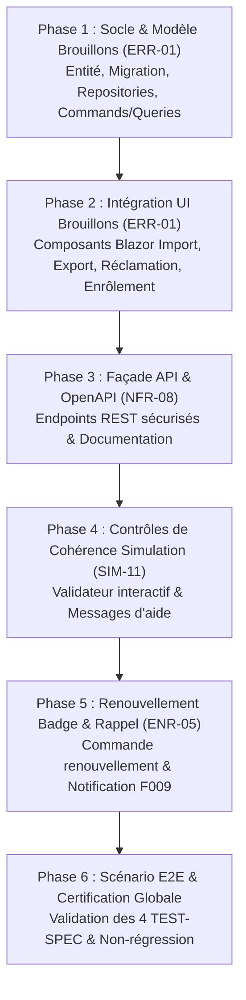

# PLAN TECHNIQUE D'IMPLÉMENTATION — FEATURE 013

**Feature** : Feature 013 — Continuité Opérationnelle, Brouillons de Saisie, Exposition d'API & Clôture Démarches  
**Statut** : PLANNED  
**Date** : 2026-09-01  
**Baseline CDC** : **164 / 188 (87,23 %)**  
**Périmètre** : **ERR-01** (Must), **NFR-08** (Should), **SIM-11** (Could), **ENR-05** (Could)  
**Projection cible** : **168 / 188 (89,36 %)**  

---

## 1. BASELINE TECHNIQUE VÉRIFIÉE

```text
Compilation : dotnet build → 0 Avertissement, 0 Erreur
Modèle EF Core : dotnet ef migrations has-pending-model-changes → 0 Pending Changes
Total Tests : 867 / 867 verts (Domain: 158, Application: 447, Infrastructure: 83, Web: 179)
Commit HEAD : cbc42bddd17734d47893bd730834c8bd05a94120 (F012)
```

---

## 2. ARBITRAGES ARCHITECTURAUX

### 2.1 ERR-01 : Persistance serveur des brouillons de saisie
- **Choix retenu** : **Persistance serveur sécurisée** via l'entité `BrouillonSaisie` (table `BrouillonsSaisie`).
- **Justification** :
  1. Garantie absolue de non-perte de données lors d'un crash de navigateur, d'un changement de poste ou d'une déconnexion (reprise multi-device).
  2. Cloisonnement multi-tenant garanti côté serveur (`UtilisateurId` + `SocieteId`, CPT-04).
  3. Débounce côté client pour optimiser la charge d'enregistrement automatique.
- **Concurrence** : Stratégie *Last-Write-Wins* atomique sur la paire `(UtilisateurId, TypeFormulaire)`.

---

### 2.2 NFR-08 : Façade d'API ouverte & documentation OpenAPI
- **Choix retenu** : **ASP.NET Core Minimal APIs & OpenAPI / Swagger**.
- **Justification** :
  1. Faible empreinte mémoire, intégration native avec le pipeline ASP.NET Core .NET 10.
  2. Réutilisation directe des cas d'usage Application sans duplication logique.
  3. Documentation interactive OpenAPI accessible sur `/swagger`.
  4. Sécurité : vérification systématique de l'authentification et de l'autorisation via `IAutorisationService` (Principe VII).

---

### 2.3 SIM-11 : Validations croisées et messages d'aide contextuels
- **Choix retenu** : Service de validation de cohérence `ValiderCoherenceSimulationQuery` et enrichissement de `SimulationProformaPage.razor`.
- **Règles validées** :
  1. Compatibilité taille (20'/40') et type (Dry/Reefer) avec la grille tarifaire.
  2. Compatibilité catégorie de marchandise / sens de trafic.
  3. Chronologie des dates (enlèvement >= arrivée).
  4. Exclusivité Reefer pour le branchement frigorifique.

---

### 2.4 ENR-05 : Cycle de renouvellement de badge et rappel automatique
- **Choix retenu** : Extension applicative sur le modèle `Ticket` / `Dossier` existant (0 migration pour ENR-05).
- **Rappels** : `RappelerExpirationBadgesCommand` identifie les badges proches de l'échéance et publie `RappelExpirationBadge` vers F009.
- **Renouvellement** : `DemanderRenouvellementBadgeCommand` crée un ticket dans le même `DossierId` en conservant l'audit et les pièces valides.

---

## 3. IMPACT SUR LE MODÈLE DE DONNÉES & MIGRATION

- **Migration requise** : **OUI — 1 migration unique et strictement additive**.
  - Nom : `AjouterBrouillonsSaisie`
  - Table : `BrouillonsSaisie` (`Id`, `UtilisateurId`, `SocieteId`, `TypeFormulaire`, `DonneesJson`, `DateCreationUtc`, `DateDerniereModificationUtc`).
  - Index : `IX_Brouillons_Utilisateur_Type` et `IX_Brouillons_Societe`.
- **Nouvelles entités** : 1 (`CIT.Plateforme.Domain.Formulaires.BrouillonSaisie`).

---

## 4. PHASAGE TECHNIQUE D'IMPLÉMENTATION (TEST-FIRST STRICT)



| Phase | Exigence | Livrables Code & Tests | TEST-SPEC Cible |
|:---:|:---:|:---|:---:|
| **Phase 1** | **ERR-01** | `BrouillonSaisie.cs`, `IBrouillonRepository`, `EnregistrerBrouillonCommand.cs`, `ObtenirBrouillonQuery.cs`, `SupprimerBrouillonCommand.cs`, Migration `AjouterBrouillonsSaisie` | `ERR-CERT-01` |
| **Phase 2** | **ERR-01** | Intégration Blazor (`SoumettreDemande.razor`, `SoumettreDemandeExport.razor`, `NouvelleReclamation.razor`), Tests UI | `ERR-CERT-01` |
| **Phase 3** | **NFR-08** | Endpoints Minimal APIs (`/api/v1/tickets/{numero}`, `/api/v1/dossiers/{reference}`, `/api/v1/simulations/calculer`), Swagger, Tests HTTP | `NFR-CERT-08` |
| **Phase 4** | **SIM-11** | `ValiderCoherenceSimulationQuery.cs`, Messages contextuels `SimulationProformaPage.razor`, Tests unitaires | `SIM-CERT-11` |
| **Phase 5** | **ENR-05** | `RappelerExpirationBadgesCommand.cs`, `DemanderRenouvellementBadgeCommand.cs`, Raccordement F009, Tests | `ENR-CERT-05` |
| **Phase 6** | **Transverse** | Suite E2E F013, contrôle 100% vert, 0 warning, 0 pending model changes | Toutes |

---

## 5. TEST-SPEC STRATEGY

- **`ERR-CERT-01`** : Tests de sauvegarde continue, reprise après incident, purge après soumission, abandon volontaire et étanchéité multi-tenant (CPT-04).
- **`NFR-CERT-08`** : Tests d'intégration HTTP vérifiant les codes 200/401/403/404, le format JSON et la conformité Swagger.
- **`SIM-CERT-11`** : Tests unitaires vérifiant les 4 règles de cohérence et l'exactitude des messages d'aide.
- **`ENR-CERT-05`** : Tests de détection d'échéance de badge, d'émission d'événement F009 et de renouvellement dans le dossier existant.

---

## 6. CONSTITUTION CHECK (17/17)

- [x] **I1 : DB Schema Immutability** : 1 migration additive autorisée et déclarée (`AjouterBrouillonsSaisie`).
- [x] **I2 : Strict Isolation** : Cloisonnement CPT-04 vérifié côté serveur sur brouillons et API.
- [x] **I3 : Spec Kit Artifact Discipline** : Tous les livrables sont présents dans `specs/013-continuite-brouillons-api-demarches/`.
- [x] **P1 : Test-First Strict** : Aucun code produit avant les tests spécifiques.
- [x] **P2 : Multi-tenant enforcement** : Vérification systématique de l'étanchéité société.
- [x] **P3 : 0 Warning / 0 Error** : Build propre exigé.
- [x] **P4 : Anti-Scope** : Aucun composant IA, SMS ou production readiness hors périmètre.
- **Score Constitution** : **17 / 17 PASS**.
