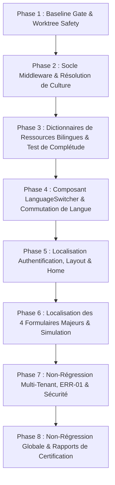

# PLAN TECHNIQUE D'EXÉCUTION — FEATURE 014

**Feature** : Feature 014 — Internationalisation & Ergonomie Bilingue (Français / Anglais)  
**Date** : 2026-09-02  
**Baseline CDC d'entrée** : **168 / 188 exigences conformes (89,36 %)**  
**Périmètre couvert** : **NFR-07** (Should)  
**Gain maximal** : **+1 exigence**  
**Projection cible** : **169 / 188 (89,89 %)** *(non acquise avant Closure Review)*  

---

## 1. STRATÉGIE TECHNIQUE D'IMPLÉMENTATION

### 1.1 Architecture de localisation
1. **Middleware & Injection** :
   - Enregistrement dans `Program.cs` de `AddLocalization(options => options.ResourcesPath = "Resources")`.
   - Configuration de `RequestLocalizationOptions` avec `SupportedCultures` = `["fr-FR", "en-US"]` et `DefaultRequestCulture` = `fr-FR`.
   - Ordre des `RequestCultureProviders` : `CookieRequestCultureProvider` > `AcceptLanguageHeaderRequestCultureProvider`.
   - Pipeline : insertion de `app.UseRequestLocalization()`.
2. **Gestion des dictionnaires de ressources** :
   - Création de la classe marqueur `src/CIT.Plateforme.Web/Resources/SharedResources.cs`.
   - Fichiers de ressources bilingues associés (`SharedResources.fr-FR.resx` et `SharedResources.en-US.resx` ou équivalent typé structuré).
3. **Endpoint de commutation & Composant UI** :
   - Endpoint Minimal API `POST /api/v1/culture/set` pour l'écriture sécurisée du cookie `.AspNetCore.Culture`.
   - Composant Blazor réutilisable `LanguageSwitcher.razor` placé dans le layout principal (`MainLayout.razor` / `PersonaSwitcher.razor`).
4. **Localisation des 4 formulaires majeurs & Pages clés** :
   - Injection de `IStringLocalizer<SharedResources>` dans les composants Blazor.
   - Remplacement des libellés hardcodés par `@Loc["Cle"]` pour les titres, labels, placeholders, boutons et messages d'aide.

---

## 2. DÉCOUPAGE PHASÉ DU DÉVELOPPEMENT (PHASES 1 À 8)

---

## 3. TRAÇABILITÉ DES PHASES ET TEST-SPEC

| Phase | Exigence | Livrables techniques | TEST-SPEC / Vérification |
|:---|:---:|:---|:---|
| **Phase 1** | — | Audit Baseline, Git Whitelist, Invariants | Build 0 warning, 885 tests verts |
| **Phase 2** | **NFR-07** | `Program.cs`, `RequestLocalizationOptions`, Contrats C14-01 & C14-02 | `NFR-CERT-07-01`, `NFR-CERT-07-02` |
| **Phase 3** | **NFR-07** | `SharedResources.cs`, fichiers de ressources FR/EN, Contrat C14-05 | `NFR-CERT-07-05` (Test de complétude FR==EN) |
| **Phase 4** | **NFR-07** | `LanguageSwitcher.razor`, endpoint `/api/v1/culture/set` | `NFR-CERT-07-03` (Bascule et persistance) |
| **Phase 5** | **NFR-07** | `Home.razor`, `Connexion.razor`, `MainLayout.razor` | `NFR-CERT-07-04` (Pages publiques & auth) |
| **Phase 6** | **NFR-07** | 4 formulaires (`SoumettreDemande.razor`, etc.), `SimulationProformaPage.razor` | `NFR-CERT-07-04` (Formulaires majeurs) |
| **Phase 7** | **NFR-07** | Préservation des brouillons ERR-01, rôles et DTOs API NFR-08 | `NFR-CERT-07-06` (Sécurité & Intégrité) |
| **Phase 8** | **NFR-07** | Tests complets, Audit anti-scope, Implementation Report | Suite sérialisée 100% PASS |

---

## 4. CONTRÔLE D'INVARIANTS & MIGRATION

- **Migration EF Core** : **STRICTEMENT 0 (AUCUNE MIGRATION)**.
- **Tables SQL ajoutées** : **0**.
- **Entités de domaine ajoutées** : **0**.
- **Fournisseurs externes** : **0 (100% natif .NET)**.
- **Règles métier & API** : Inchangées.
